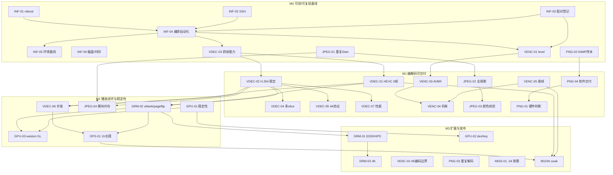
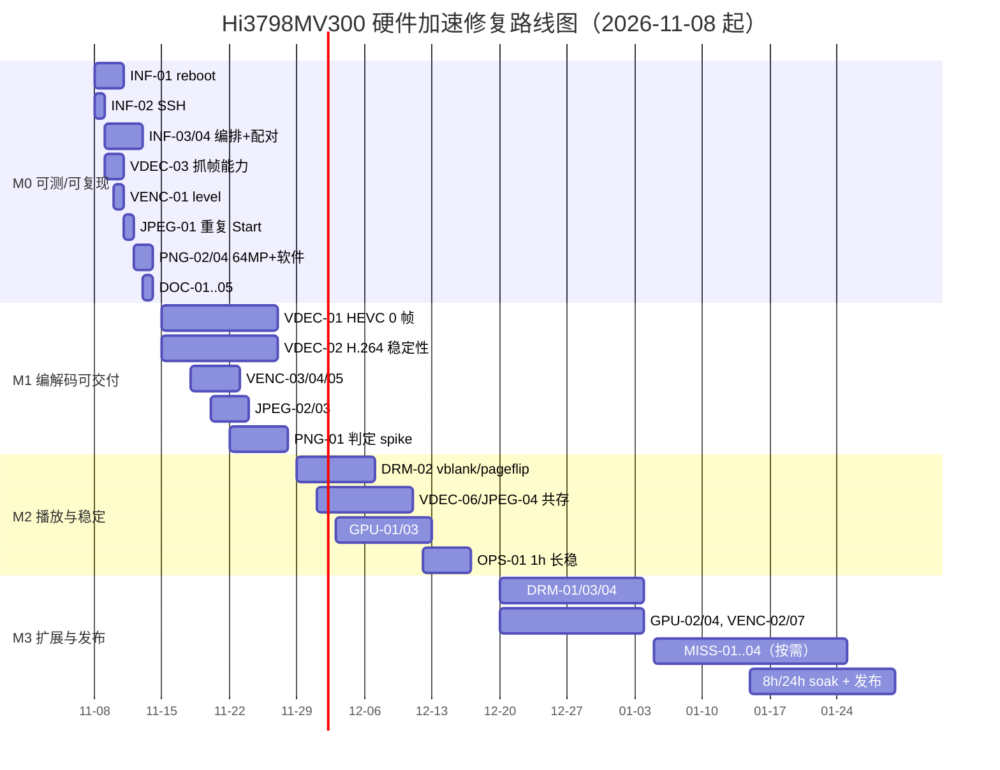

# Hi3798MV300 硬件加速：全面修复清单与路线图（2026-11-07）

> **依据**：本次全量实测 [`REPORT.md`](artifacts/hwtest-2026-11-07/REPORT.md)（2026-11-07，P0–P5）。
> 本文只列"要修什么、怎么修、怎么验收、什么时候做"，不重复报告里的实测数据；每条均给证据入口。
> **编号**：`<子系统>-<序号>`。**优先级**：P0＝1 周内必须动（阻断验收）；P1＝2–3 周；P2＝1–2 月；P3＝>2 月/可选。
> **工作量**：S ≤1 天；M 2–3 天；L 1–2 周；XL >2 周。**状态**：已定位 / 强假设 / 未定位。
>
> **已被取代（2026-11-08）**：待办部分见 [HARDWARE-ACCELERATION-FIXLIST-ROADMAP-2026-11-08.md](HARDWARE-ACCELERATION-FIXLIST-ROADMAP-2026-11-08.md)，本文保留为历史。
> 口径变更：**8h/24h 长稳取消（改为 1h ×3 boot）**；**4K 编码确认硬件不支持**（VENC 最大 1920×1088）；**PNG 需与 JPEG 同栈**（PNG-07/08，见新路线图 §2.4）。

---

## 0. 一页速览

> **修复进度（滚动更新）**：见 [`artifacts/hwtest-2026-11-07/fixes/PROGRESS.md`](artifacts/hwtest-2026-11-07/fixes/PROGRESS.md)。
> 截至 2026-11-08 01:05 已闭环：INF-02/03/04、VENC-01/03/05、JPEG-01、PNG-01（根因闭环）/PNG-02、DOC-01..05；
> workaround：INF-01；部分：PNG-04、VDEC-03（1080p 已恢复，4K 待）；
> 待攻坚：VDEC-02（boot 状态依赖，重试兜底；W3/W7 追因）、VDEC-04/05/07、VENC 间歇崩溃（VENC-07 已定性关闭，崩溃类另计）、PNG-03、GPU/DRM/MISS/OPS。
> 2026-11-08 03:10 更新：VDEC-01 根因定位（部署落后 commit `6a2b5f5`，HEVC 修复模块 1080p 20/20）；VENC-07 关闭为“RC 自动丢帧（设计内行为）+ 文档化极限”；VDEC-02 模式 A 为 boot 状态依赖（重试兜底），继续 W3/W7 追因；INF-04 七阶段全部上板 PASS。
> **2026-11-08 Round 7 更新**：**VDEC-01 完全闭环**（`hi_vdec_hevc_head_w1.ko` `047cad9b` + `vdec_spec_hevc_head` `6ada1250` 全矩阵 **7/7 PASS**，抓帧像素 bit-exact）、**VDEC-03 4K 抓帧闭环**。
> 当前验收对/修复模块登记见 [`TOOL-MODULE-PAIRING.md`](TOOL-MODULE-PAIRING.md) §1.5–§1.8；逐条状态与证据见 [`fixes/PROGRESS.md`](artifacts/hwtest-2026-11-07/fixes/PROGRESS.md)；下一轮建议以 PROGRESS「下一轮建议」为准。

> **2026-11-08 06:30 滚动进度（Round 8–14；仅更新进度，§1 条目定义/历史结论未改）**
> ✅ 本轮完成：**VDEC-02** panic 根因（SCD ISR NULL，串口取证）→ v2 修复（kill-race 100 次 0 panic）；**rmmod class-name Oops（`0006`）+ reload EEXIST/exit inverse（`0007`）→ reloadfix `e8859791` rmmod/insmod ×10 PASS**；**VDEC-01/03** 用 reloadfix 复核（矩阵两 boot 4/7+5/7；**抓帧像素 bit-exact 复核 PASS**）；**VDEC-04** 1080p 多 slice 全 PASS、HEVC s4/wppon 30/30、4K 单/多 slice 单用例 20/20；**VDEC-05** 预热五相（cold 20/20、吞吐≈0.24×steady）；**VENC-02** 4K 编码=平台边界（`1920×1088` 编译宏）；**VENC crash-repro** 首轮 22 次无崩溃；**INF-04** 8/8 阶段上板 PASS；**GPU/DRM** 审计（GPU-01 轻载 PASS、重载 PARTIAL；DRM-01/03/04 限制确认）；**MISS-01..04 全 NA**；**OPS-01** soak 设计+脚本就绪。
> ⏳ 待办：VDEC-02 交付间歇/mmz 漂移；VDEC-04 4K 长序列/HEVC tiles；VDEC-05 预热判据定档；VENC-07 `--drift 101` 判别；VENC 崩溃长时复现；GPU-01 重载/GPU-04；DRM-02 运行级；OPS-01 真跑；PNG-03/PNG-04。
> 证据入口：当前验收对见 [`TOOL-MODULE-PAIRING.md`](TOOL-MODULE-PAIRING.md) §1.9；逐条状态/证据见 [`fixes/PROGRESS.md`](artifacts/hwtest-2026-11-07/fixes/PROGRESS.md)；各条目证据在 `fixes/<item>/`。

> **2026-11-08 08:00 滚动进度（Round 15–16；仅更新进度，§1 条目定义/历史结论未改）**
> ✅ 本轮完成（主机侧交付/脚本就绪）：**JPEG-02** 整缓冲 memset 优化（`JPEG_POISON=none` 默认；预期 1080p 200→~6ms、64MP 4188→~163ms；新 `jpeg_test` `ff1e15f6`；待上板 `verify-jpeg-cost.sh`）；**JPEG-03** HW 色度=**NV21** 关键发现 + `yuvdiff`/compare 判据 **mean≤1/max≤1**（样本 420/422/444/gray/64mp；待上板）；**JPEG-04 Plan A 去重导出**（jpeg 删 4 行 + png 删 24 行 `EXPORT_SYMBOL`、定义保留；`hi_jpeg_noext`(8f39ceb0)/`hi_png_noext`(7159f862)；A1–A6 矩阵脚本就绪，**待上板，若通过则共存阻断可解除**）；**VDEC-06** 并发脚本就绪（10×60s、判 success≥9/10/退化<10%/oops=0）；**VDEC-07** 打印开关盘点（**唯一常开热打印=SPITAG，22 处热路径无门控**；FILEDBG/PUTBM/VTSTAT/M2DIAG 默认 0）+ P/D A/B 脚本；**PNG-03** 同 boot 5 次重复解码脚本；**PNG-04** 硬件整幅 NA/软件路径唯一交付（md5 bit-exact；峰值内存待实测）。
> 🔁 **OPS-01 方法变更**：phased/bundle 因板卡 clean-boot 不可靠不可行 ⇒ **soak-lite**（8h=4 blocks×2h，A=VDEC+GPU+PNG-SW、B=VENC+JPEG+GPU，block 内连续迭代）；**blockA 预验证** VDEC 30/30、4K 19→20/20、Mali450 PASS、oops=0；**07:56 启动 8h（block1 运行中）**；24h 未跑。
> ⏳ 待办：上述 6 项（JPEG-02/03/04、VDEC-06/07、PNG-03）soak 结束后上板复验；VDEC-02 交付间歇/mmz 漂移；播放闭环（DRM-02/GPU-01 重载）；OPS-01 出 8h 结论；24h soak；VDEC-04 4K 长序列/HEVC tiles。
> 证据入口：[`fixes/jpeg-02`](artifacts/hwtest-2026-11-07/fixes/jpeg-02/FIX-REPORT.md)、[`jpeg-03`](artifacts/hwtest-2026-11-07/fixes/jpeg-03/FIX-REPORT.md)、[`jpeg-04`](artifacts/hwtest-2026-11-07/fixes/jpeg-04/PLAN-A-FIX.md)、[`vdec-06`](artifacts/hwtest-2026-11-07/fixes/vdec-06/PLAN.md)、[`vdec-07`](artifacts/hwtest-2026-11-07/fixes/vdec-07/PLAN.md)、[`png-03`](artifacts/hwtest-2026-11-07/fixes/png-03/PLAN.md)、[`png-04`](artifacts/hwtest-2026-11-07/fixes/png-04/SOFTWARE-PATH.md)、[`ops/soak-lite`](artifacts/hwtest-2026-11-07/fixes/ops/soak-lite/)、[`PROGRESS`](artifacts/hwtest-2026-11-07/fixes/PROGRESS.md)。

### 0.1 本次实测暴露的问题分层

| 层 | 问题 | 代表条目 | 影响 |
|---|---|---|---|
| ① 测试基础设施 | reboot 挂起/SSH 不自启、无自动化编排、工具-模块配对未登记、抓帧能力缺失 | INF-01/02/03/04、VDEC-03 | 无法稳定回归，结论可信度受限 |
| ② 交付路径/非确定性 | VDEC 事件→帧交付不稳定（H.264 间歇、HEVC 0 帧） | VDEC-01/02 | D01/D02 无法交付 |
| ③ 构建/模块版本 | VENC HEVC level=0、验收模块无 `vdec_no_vcmp`、PNG 用户态帧流组织 | VENC-01、VDEC-03、PNG-01 | E01 不合规、PNG 无输出 |
| ④ 平台能力边界 | 4K 编码 Create 失败、HEVC L5 不可配、DRM 单模式/无 EDID、GPU 固定 200MHz | VENC-02、DRM-01/03、GPU-02 | 需文档化边界，不可"修" |
| ⑤ 未移植/未启用 | VPSS、TDE/GFX2D、SEC、音频 | MISS-01..04 | 能力矩阵空白 |
| ⑥ 交付化 | 播放闭环、零拷贝、模块共存/热重载、长稳 | DRM-02、VDEC-06、JPEG-04、OPS-01 | 离"可交付产品"仍有距离 |

### 0.2 三条修复主线

1. **可复现性主线（P0/P1）**：把"每次结果不一样"变成"每次可复现"——自动化编排 + 固定环境基线 + VDEC 事件链/参数集定位 + 像素验证能力。
2. **能力补齐主线（P1/P2）**：VDEC（HEVC/H.264/多 slice/4K）、VENC（level/AVBR/尾帧）、JPEG（重复解码）、PNG（硬件或明确 NA）、GPU/DRM（稳定性/显示能力）。
3. **交付化主线（P2/P3）**：模块共存→播放闭环→零拷贝→长稳→发布；未移植块（VPSS/TDE/音频/SEC）按需求决定是否投入。

### 0.3 先做哪 10 件事（按顺序）

| 顺序 | 条目 | 理由 | 预计 |
|---|---|---|---|
| 1 | INF-04 测试编排脚本（reboot→insmod→测试→取证全自动） | 一切后续工作都靠它省时间、保证据 | 2–3 d |
| 2 | INF-01/02 reboot 与 SSH 自动化恢复 | 消除人工等待/丢证据 | 0.5–1 d（workaround）/M（根因） |
| 3 | VDEC-03 恢复抓帧/像素验证能力（部署 `vdec_no_vcmp` 模块 + 配对工具） | 后续 VDEC 修复必须能验像素 | 0.5–1 d |
| 4 | VENC-01 重建含 level 修复的 VENC 模块并复测 | 快速可修的合规问题 | 0.5–1 d |
| 5 | JPEG-01 同 handle 重复 Start 流程修复 + loops=100 验证 | 低风险、直接提升交付价值 | 0.5 d |
| 6 | PNG-02/04 生成 64MP 样本 + 软件路径交付化 | 先把兜底能力做实 | 1 d |
| 7 | VDEC-01 HEVC 0 帧根因（SCD→VDH 参数集/消息） | 最大阻断项 | 1–2 w |
| 8 | VDEC-02 H.264 交付稳定性定位（vdec_test 稳定 vs vdec_spec 不稳定） | 第二大阻断项 | 1–2 w |
| 9 | VENC-03/04 AVBR 与码率精度（长窗口复测 + RC 参数） | 把"有条件 PASS"变成 PASS | 2–3 d |
| 10 | DOC-01..05 文档口径修正 + 配对/配方登记 | 防止历史结论误导后续决策 | 0.5 d |

### 0.4 与实测报告的覆盖对照（证明无遗漏）

> 左列 = `REPORT.md` 中记录的每个问题/缺口；右列 = 本清单对应修复条目。共 33 条问题，全部有归属。

| REPORT 问题/缺口 | 修复条目 |
|---|---|
| D01 HEVC 0 帧（§5.1） | VDEC-01、VDEC-03 |
| D02 H.264 交付不稳定 / PTS 错（§5.2） | VDEC-02、VDEC-03、VDEC-07 |
| 多 slice 0–1/10（§4.1） | VDEC-04 |
| 4K 预热/ES 环/重启协议（§2.2、§6 R6） | VDEC-05 |
| VDEC/VENC 并发与 MMZ（§6 R1、历史 round117–119） | VDEC-06 |
| VDEC 无像素验证能力（§1.2、§6 R2） | VDEC-03 |
| E01 HEVC `level=0`（§5.4） | VENC-01 |
| 4K 编码 `0x801d0002`（§4.2） | VENC-02 |
| E02 两组合 AVBR <30fps（§5.4） | VENC-03 |
| CBR 码率偏高 7–12%（§4.2） | VENC-04 |
| 尾帧 1 帧未刷出（§4.2） | VENC-05 |
| VENC 热重载不可用（§6 R4） | VENC-06 |
| 高熵 RC 停摆（历史） | VENC-07 |
| JPEG 同 handle 重复 Start 失败（§4.3） | JPEG-01 |
| JPEG 全周期成本（§4.3） | JPEG-02 |
| JPEG 颜色未逐项像素校验（§4.3） | JPEG-03 |
| JPEG/VDEC 模块符号冲突（§6 R3） | JPEG-04 |
| PNG 硬件无输出（§4.4、§5.3） | PNG-01、PNG-04 |
| PNG 64MP 样本缺失（§4.4） | PNG-02 |
| PNG 每 boot 仅一次（历史） | PNG-03 |
| PNG 软件路径兜底（§4.4） | PNG-04、PNG-02 |
| GPU pp 复位稳定性（§6 R10） | GPU-01 |
| GPU 固定 200MHz/无 devfreq（§4.5） | GPU-02 |
| weston 走 llvmpipe/无 GL 路径（§4.5） | GPU-03 |
| GPU 隔离与 fault 恢复 | GPU-04 |
| DRM 无 EDID/HPD、单模式（§4.5） | DRM-01 |
| DRM 无 vblank/page-flip（§4.5） | DRM-02 |
| DRM 4K 不可行（§4.5） | DRM-03 |
| DRM 多图层/PQ/缩放未移植（§4.5） | DRM-04 |
| VPSS/TDE/GFX2D/SEC/音频（§4.5） | MISS-01..04 |
| 8h/24h 长稳未做（§6 R7） | OPS-01 |
| reboot/SSH/时间/磁盘/配对/编排（§2.3、§2.4、§6 R5/R6） | INF-01..06 |
| 文档口径（§7.2） | DOC-01..05 |

---

## 1. 修复清单

### 1.1 基础设施与测试环境（INF）

#### INF-01 `systemctl reboot` 偶发不生效 / `reboot -f` 不自动回来 ｜P0｜M（根因）+ S（workaround）
- **现象/证据**：REPORT §2.3；P0 基线 §7。22:47 正常、23:00 后多次挂起，`reboot -f` 后 ping/串口全无输出，需 `/dev/ttyUSB1` RTS 脉冲复位。
- **根因/假设**：强假设——PSCI/ATF 复位路径或 systemd shutdown 卡在某个 unit；需对比 `reboot -f` 与 `systemctl reboot` 的 ATF 日志（BL31），检查 `psci` 版本（PSCIv1.0）与 ATF `psci_suspend/reset` 实现。
- **修复动作**：
  1. 采集失败现场：串口完整记录 shutdown→BL31→BootROM 序列（复现 ≥3 次）；
  2. 在 ATF（`source/kernel/arm-trusted-firmware`）核对 reset 实现与 PSCI 版本；必要时改用 PSCI SYSTEM_RESET2 或硬件看门狗复位；
  3. 同时落地 workaround：测试脚本 60 s 未恢复 → 自动 RTS 复位（见 INF-04）。
- **验收**：连续 10 次 `systemctl reboot` 全部在 90 s 内回到 SSH；串口日志完整；无文件系统损坏。
- **依赖**：无。**风险**：改 ATF 需要重新烧 FIP，失败需 U 盘/串口恢复；建议先做 workaround 再动 ATF。

#### INF-02 串口复位后 `ssh.socket`/`ssh.service` 不自启 ｜P0｜S
- **现象/证据**：REPORT §2.3；p0 §8（boot `cf589df7` 实测 inactive，串口 `systemctl start ssh.socket ssh` 后恢复）。
- **根因/假设**：未定位（可能与 networkd 就绪顺序/ssh.socket 依赖或 reset 后 unit 状态异常有关）。
- **修复动作**：在测试编排脚本中复位后默认执行 `systemctl start ssh.socket ssh`；进一步检查 `ssh.socket` 的 `After=network.target`/`Wants=` 与失败原因（`systemctl status ssh.socket`）。
- **验收**：复位后 SSH 自动就绪率 100%（10 次）。
- **依赖**：INF-04。**风险**：低。

#### INF-03 工具-模块配对未登记（ABI 错配） ｜P0｜S
> **2026-11-08 更新：✅ 已完成**——[`TOOL-MODULE-PAIRING.md`](TOOL-MODULE-PAIRING.md) 已建立（初版 197 行），并扩展修复阶段 §1.5–1.8（VDEC HEVC 当前验收对 `047cad9b`+`6ada1250`、VENC `0d95a512` 演进、实验模块、抓帧配对；M1–M9 历史误判，含 VDEC-01"落后一 commit"隐蔽错配）。验收对须记录源码 commit（R11）。
- **现象/证据**：REPORT §4.1；本次实测 `vdec_spec` 25abbfdf（Pair A）与 `vdec_spec_r36` 38b64af0 结果不同；历史上多次因工具/模块错配误判（matrix/gaps.md D1–D8）。
- **根因/假设**：已定位——模块与用户态 MPI 静态链接，ioctl/结构体 ABI 必须成对。
- **修复动作**：建立 `docs/porting/TOOL-MODULE-PAIRING.md`（模块 sha1 × 工具 sha1 × 参数 × 输入流 sha1 × 期望结果）；测试脚本启动时校验 sha1，不匹配直接拒绝运行。
- **验收**：每份实测日志头部含配对表；错配时脚本 exit≠0。
- **依赖**：无。

#### INF-04 测试编排自动化缺失 ｜P0｜M
- **现象/证据**：本次 6 个阶段靠人工 SSH/reboot/串口，期间多次人工等待与重试（REPORT §2.2、§2.3）。
- **修复动作**：实现 `tools/hwtest/run_phase.sh`（主机侧）：
  - 阶段定义（boot 需求、模块加载、参数、用例列表、超时）；
  - 自动 reboot（`systemctl reboot --no-block`）→ 90 s 轮询 → 失败自动 RTS 复位（pyserial）→ 必要时串口拉起 SSH；
  - 记录 boot_id/uptime/sha1/CmaFree/df 到证据目录；自动 scp 日志；
  - 失败重试策略（0 帧重试 N 次 + 重启 1 次的既定配方）；
  - 生成 summary + 与历史基线对比。
- **验收**：一条命令跑完 5 个阶段 ≥3 次，全自动、证据齐全、无人工干预。
- **依赖**：INF-01/02/03/07。**风险**：串口自动化对时序敏感，需容忍窗口。

#### INF-05 环境基线未固定（WiFi/服务/CmaFree/rootfs） ｜P1｜S
- **现象/证据**：REPORT §2.4（CmaFree 62–138 MB 波动；rootfs 一度 96%）；历史 round212–215 归因环境但未固定基线。
- **修复动作**：定义"测试基线 profile"：测试 boot 时停用非必要服务（smbd/nmbd/wpa_supplicant/fwupd）、记录 lsmod 白名单、测试前 `df` 清理阈值（≥1 GB）、每用例记 CmaFree；在脚本中强制校验。
- **验收**：同一用例在 10 次测试中环境基线一致（lsmod/服务/CmaFree 范围记录在案）。
- **依赖**：INF-04。

#### INF-06 无 RTC + 根分区一度 96% ｜P0｜S
- **现象/证据**：REPORT §2.1/§2.4（板卡无 RTC，板上时间恒从 2026-07-28 起；根分区一度 96%、可用 294 MB，64MP YUV 320 MB 占满）。
- **修复动作**：时间统一用"主机时间+boot_id+uptime"（已写入报告约定）；测试前清理 `/root/hwtest` 大文件（64MP YUV 320 MB），脚本加磁盘阈值检查；长期可评估外接 RTC 或 NTP 强制同步。
- **验收**：证据时间一致；测试开始/结束 df 均 ≥500 MB。
- **依赖**：INF-04。

### 1.2 VDEC（D01/D02）

#### VDEC-01 HEVC 解码 0 帧（VDH 不启动） ｜P0｜L｜强假设
> **2026-11-08 更新：✅ 已定位并闭环**。根因 = **部署对落后一个 commit**：板上 `d4337a64`/`25abbfdf` 源码 = `1ad1764`，恰为 HEVC 使能 commit `6a2b5f5` 的父提交；缺 HEVC HAL picture/slice 槽 cache 发布（`m2_sync_hevc_msgs=1`）→ VDH 不启动。
> 修复验收对：`hi_vdec_hevc_head_w1.ko`（`047cad9b`）+ `vdec_spec_hevc_head`（`6ada1250`），全矩阵 **7/7 PASS**（HEVC 1080p/4K60 8bit/Main10/20M/100M + H.264 控制），抓帧 1080p/4K 20/20 bit-exact；同 boot sync=1/0 对照 20/20 vs 0/20。
> 证据：[`fixes/vdec-01/BOARD-VERIFY-H1.md`](artifacts/hwtest-2026-11-07/fixes/vdec-01/BOARD-VERIFY-H1.md) §1–§4、[`HEVC-0FRAMES-REPORT.md`](artifacts/hwtest-2026-11-07/fixes/vdec-01/HEVC-0FRAMES-REPORT.md)、[配对 §1.5](TOOL-MODULE-PAIRING.md)。**以下为 2026-11-07 时点假设，保留备查。**
- **现象/证据**：REPORT §4.1/§5.1；HEVC 1080p/4K60 8-bit/Main10/100Mbps 全部 0 帧，VTSTAT `img=0 vdh=0 scd=N`；2 种模块（d4337a64、6d33babb）、2 个 boot、含开机首用例 codec-first 均复现（`raw/p1-vdec/p1c-logs/`）。
- **根因/假设**：SCD 收到码流（scd=N）但 VDH 未启动 ⇒ 参数集/消息交接或启动条件未满足；历史成功运行中 `setdecparam/spspps` 为 1（round208–210 观测过 0）。不排除环境非确定性（MMZ/CMA 物理布局、中断时序）。
- **修复动作**（按顺序）：
  1. **只读观测**：插桩（内存环形，非热路径 printk）记录 HEVC 每 AU 的 SPS/PPS 解析结果、`DEC PARAM` 就绪位、SCD→VDH 消息字段、`StartSCD/StartVDH` 返回值；与 H.264 成功路径逐字段对比；
  2. **环境对照**：同一 boot 先跑 H.264（已知 vdec_test 50/50）再跑 HEVC、以及纯 HEVC boot，比较 MMZ/CMA 分配地址与 VDH 中断时序；
  3. **最小流**：用 I 帧单 AU / gen3 级小流定位是"参数集未接受"还是"VDH kick 失败"；
  4. 与 vendor 反汇编/Android 侧对照（`venc` 逆向方法可复用），确认 VDH 启动序列差异；
  5. 修复后跑 codec-first 矩阵。
- **验收**：HEVC 4K60 8-bit 连续 5 次 ≥20/20、`err_mbs=0`、抓帧 sha1 与 ffmpeg 参考逐帧一致；HEVC 1080p 同；Main10 8/8 且像素一致（≥3 次）。
- **依赖**：VDEC-03（抓帧能力）、INF-04。**风险**：若根因是 vendor 预编译核行为，可能只能"缓解"；设置 2 周决策点（见 §3.4）。

#### VDEC-02 H.264 解码交付不稳定（`vdec_test` 稳定 vs `vdec_spec` 不稳定） ｜P0｜L｜强假设
- **现象/证据**：REPORT §4.1/§5.2；`vdec_test gen3_idr` 50/50 ×2；`vdec_spec` 仅 2 例完全成功（1080p-bp 30/30、4K-bp 20/20），其余 0–29 帧；出现 `received=29/30 且 pts_errors=28`。
- **根因/假设**：差异在通道参数/交付路径/状态复位：`vdec_test` 用旧通道与旧取帧路径，`vdec_spec` 用新通道/合成 display id/高轮询。历史 round208 事件链（EVT 113/114 导致帧被拒）、round209 `RecvFrm` 语义可作线索。
- **修复动作**：
  1. A/B 单变量：同一模块、同一流，仅替换通道参数（cap/level、buffer 数量、`VDEC_BUF_MB`、poll 间隔）与取帧 API（`ChanRecvFrm` vs user-dec-frame），定位触发失败的条件；
  2. 检查 `RecvFrm` 空队列返回值语义（历史曾有"成功但空帧"伪成功）；
  3. 检查 PTS 传递：为什么收到帧但 `pts_errors` 高（driver 返回 PTS 是否被覆盖/截断）；
  4. 修复后用 `vdec_spec` 跑 20 次 ≥90% 完全成功。
- **验收**：H.264 1080p 三 Profile 各 20 次中 ≥18 次 30/30、pts_errors=0；4K30 三 Profile 同；多 slice 10/10（≥3 次）；吞吐中位 ≥30fps（1080p）/≥30fps（4K30）。
- **依赖**：VDEC-03、INF-04。**风险**：环境非确定性可能占比高，需配合 INF-05 受控基线。

#### VDEC-03 像素级验证能力缺失（验收模块无 `vdec_no_vcmp`） ｜P0｜S–M
> **2026-11-08 更新：✅ 已闭环（1080p + 4K）**。1080p H.264：Pair A + `vdec_spec`（capture 目录须预建）30/30 逐帧 Y bit-exact；**4K/HEVC 抓帧**改用 `hi_vdec_hevc_head_w1.ko`（`047cad9b`）+ `vdec_spec_hevc_head`（`6ada1250`）+ `vdec_no_vcmp=1`/`VDEC_BUF_MB=16`：1080p 20/20、4K 20/20，抽样 Y+全帧 sha1 bit-exact。旧 `ok64`+`vdec_spec_r32` 路径仍 0 帧（已弃用）。证据：[`fixes/vdec-03/FIX-REPORT.md`](artifacts/hwtest-2026-11-07/fixes/vdec-03/FIX-REPORT.md) §7、[`fixes/vdec-01/BOARD-VERIFY-H1.md`](artifacts/hwtest-2026-11-07/fixes/vdec-01/BOARD-VERIFY-H1.md) §4、[配对 §1.8](TOOL-MODULE-PAIRING.md)。
- **现象/证据**：REPORT §1.2/§5；当前验收模块 `d4337a64` 无 `vdec_no_vcmp`，4K 输出 `NV21_TILE_CMP`，`vdec_spec` 拒绝抓帧 ⇒ 本次 VDEC 成功用例无像素证据。
- **修复动作**：
  1. 优先：部署主机已构建的 `port/vdec-ok64/hi_vdec.ko`（sha1 2835224c60，含 `vdec_no_vcmp`）+ 配对 `vdec_spec_r32`（历史 Pair B），用于**像素验证专用**（不用于性能判定）；
  2. 或：在验收模块上补回 `vdec_no_vcmp` 参数并重建（保持 Pair A 的其它修复）；
  3. 在编排脚本中把"抓帧 → 反 tile → 与 ffmpeg 参考 sha1/像素比对"固化为标准用例。
- **验收**：1080p/4K、H.264/HEVC 成功用例均可输出逐帧 sha1 与 ffmpeg 参考比对结果（0 差异或 ≤±1 舍入，与历史口径一致）。
- **依赖**：INF-03/04。

#### VDEC-04 多 slice 解码失败（0–1/10） ｜P1｜M
- **现象/证据**：REPORT §4.1；`hp-slice-nob` 0–1/10（历史 10/10）。
- **根因/假设**：与 VDEC-02 同属交付链路；历史 round43 有"多 slice 逐像素一致"的成功记录，说明修复过，本次退化可能同链路问题。
- **修复动作**：先跟随 VDEC-02 修复；再单独验证 slice message 链遍历（历史上 commit `64d45c5` 修过"walk the whole slice-message chain"）。
- **验收**：多 slice 流 10/10 ×3、逐像素一致。
- **依赖**：VDEC-02。

#### VDEC-05 4K 使用协议（预热/ES 环/重启）正式化 ｜P1｜M
- **现象/证据**：REPORT §2.2；历史 round115/116（4K+16MB 环曾致重启、预热规避）、round119/120（`VDEC_BUF_MB=8`）。
- **修复动作**：把"4K 默认为 `VDEC_BUF_MB=8`、抓帧 16、每 boot/每流先预热一次、4K 用完不频繁切编码"写进编排脚本与运维文档；对冷启动 0 帧做 A/B 统计（预热 vs 不预热各 20 次）。
- **验收**：4K 用例 20 次无重启、成功率和吞吐稳定；预热效果有统计结论（有效/无效都算结论）。
- **依赖**：VDEC-02/03。

#### VDEC-06 VDEC/VENC 并发与 MMZ 容量 ｜P2｜M
- **现象/证据**：REPORT §4.2/§5；历史 round117–119（交替 0 帧根因=MMZ；`VDEC_BUF_MB=8` 下 4/4 成功）。
- **修复动作**：定义并发规格（解码+编码同时）；在编排脚本中加入并发用例（1080p 解码 + 1080p 编码各 60 s），监控 CmaFree/MMZ 峰值与失败率；必要时实现帧存/ES 缓冲动态回收。
- **验收**：并发 10 次 ≥9 次成功、无 oops、吞吐退化 <10%。
- **依赖**：VDEC-02、VENC 稳定。

#### VDEC-07 热路径调试开关与性能回归 ｜P1｜M
- **现象/证据**：本次矩阵多数用例 `idle_polls` 高、成功用例 output_fps 仅 14–16（历史 68–77）；历史 round29/108 已证 trace/printk 会显著拖慢；当前部分构建仍带 SPITAG/FILEDBG 调试打印。
- **修复动作**：整理 `vdec_dbg*`/SPITAG/FILEDBG 开关默认关闭清单；出"性能模式"构建（无 trace）与"诊断模式"构建（可开）；在成功用例上做 trace 开关 A/B（确认性能差是否全是测量假象）。
- **验收**：性能模式 4K60 中位 ≥60fps（若 VDEC-01/02 修复）；诊断开关默认 0；无热路径常开打印。
- **依赖**：VDEC-02。

### 1.3 VENC（E01/E02/4K）

#### VENC-01 HEVC SPS `level=0`（未写入合法 level） ｜P0｜S
> **2026-11-08 更新：✅ 已闭环**——重建模块 `339c04da`（199,248 B）上板 HEVC CBR/AVBR `level=120`、H.264 六组合零回归；当前验收模块 `0d95a512` 已含 level 修复。证据：[`fixes/venc-01/FIX-REPORT.md`](artifacts/hwtest-2026-11-07/fixes/venc-01/FIX-REPORT.md)、[`BOARD-VERIFY.md`](artifacts/hwtest-2026-11-07/fixes/venc-01/BOARD-VERIFY.md)、[配对 §1.6](TOOL-MODULE-PAIRING.md)。
- **现象/证据**：REPORT §4.2；`hi_venc_m4pass.ko`（7cfb0c0a）输出 `level=0`；历史 round101/102 已修复为 120（L4）。
- **根因/假设**：已定位——当前在板二进制早于/未包含 level 修复（`H265e_MakeVPS/SPS` 的 level 写入）。
- **修复动作**：从 `port/venc` 最新源码重建 VENC 模块（含 level 修复）→ sha1 校验 → 部署 → 用 `encoder_accept` 重测；同时核对 1080p30→level_idc=120、4K 仍 Create 失败（平台边界）的口径。
- **验收**：HEVC 码流 `ffprobe level=120`（或按平台能力 L4 的合法值，文档标注）；E01 判定从 PARTIAL 升级为 PASS（平台边界 L5 除外）。
- **依赖**：INF-03。**风险**：重建模块需确保其它修复（DDR 配置/SMMU）不回退。

#### VENC-02 4K 编码 Create 失败（`0x801d0002`） ｜P2｜M（判定/文档）
- **现象/证据**：REPORT §4.2；历史 round103/105 同。
- **根因/假设**：平台能力边界（VEDU/HAL 不支持 4K 编码或需 vendor 配置）。
- **修复动作**：查阅 SDK/芯片规格与 HAL 能力位，确认是硬件限制还是未启用；若为软件开关缺失，评估打开代价；否则正式写为平台边界（能力矩阵 + 交付说明）。
- **验收**：能力矩阵明确"4K 编码不支持"及证据；不做无依据的逆向投入。
- **依赖**：无。

#### VENC-03 AVBR 两组合 <30fps（MP/AVBR 27.27、HP/AVBR 28.39） ｜P1｜S–M
- **现象/证据**：REPORT §4.2；本次 90 帧单次；历史 round121 也见同类低值。
- **修复动作**：按既定规范用 ≥120 帧 ×3 次、取中位数复测；若仍低，调 RC 参数（`u32DriftRateThr` 等）并 A/B；区分"码控开销"与"运动内容"。
- **验收**：六组合各 3 次中位 ≥30fps（或给出明确的 AVBR 极限与文档口径）。
- **依赖**：VENC-01（同一构建）。

#### VENC-04 CBR 码率偏高 7–12% ｜P1｜S
- **现象/证据**：REPORT §4.2（目标 5.8 Mbps，H.264 实测 6.2–6.5；HEVC 5.74）。
- **修复动作**：核对 RC 目标码率/统计窗口/帧率配置（`u32DriftRateThr`、GOP、首帧 I 帧占比）；用 ≥120 帧窗口重测；必要时修 RC 初始化。
- **验收**：CBR 稳态码率误差 ≤5%（120 帧窗口，3 次）。
- **依赖**：VENC-03。

#### VENC-05 尾帧 1 帧未刷出（无 EOS/drain 接口） ｜P1｜M
> **2026-11-08 更新：✅ 已闭环（并纠正误判）**——丢的不是尾帧，而是**首帧 PTS=0**（驱动 PTS0 初值判重复）；1 行修复 `PTS0=0xFFFFFFFF` → `eab8d6cd` 上板 90/90、ffprobe 90 帧、level 41/120。证据：[`fixes/venc-05/FIX-REPORT.md`](artifacts/hwtest-2026-11-07/fixes/venc-05/FIX-REPORT.md)、[配对 §1.6](TOOL-MODULE-PAIRING.md)。
- **现象/证据**：REPORT §4.2（completed=89/90，所有用例一致）；历史同型。
- **修复动作**：实现/暴露 stop-flush 语义（StopChn/ResetChn 前把尾帧编码并取出），或在 MPI 层补 drain；测试程序改为"提交 N、取 N"。
- **验收**：90 帧提交 → 90 帧码流（或文档化"尾帧丢弃 1"并给出 SDK 依据）。
- **依赖**：无。

#### VENC-06 `rmmod hi_venc` 段错误 / 重载 `-EEXIST` ｜P1｜M
> **2026-11-08 更新：✅ 已闭环**——两处根因修复：① die-notifier exit 注销（`569f13d5`）；② `venc_probe_work` 未 INIT 时无条件 `cancel_delayed_work_sync`（workqueue.c:4409 WARN）→ `0d95a512`。上板 rmmod/insmod ×10 无 WARNING、taint 全程 4096、编码回归 90/90。证据：[`fixes/venc-06/FIX-REPORT.md`](artifacts/hwtest-2026-11-07/fixes/venc-06/FIX-REPORT.md)、[`BOARD-VERIFY-06b.md`](artifacts/hwtest-2026-11-07/fixes/venc-06/BOARD-VERIFY-06b.md)、[配对 §1.6](TOOL-MODULE-PAIRING.md)。
- **现象/证据**：历史（REPORT §6 R4；round245–247）；本次未复测（避免污染）。
- **修复动作**：补齐退出路径（pdev 注销、proc 删除、IRQ 释放、DMA/MMZ 缓冲释放、`hi_venc_dma` 设备清理）；加 `rmmod/insmod` ×10 循环测试。
- **验收**：rmmod→insmod ×10 无 oops、无 EEXIST；`/dev/hi_venc` 重建正常。
- **依赖**：INF-01（重启可靠性）。

#### VENC-07 高熵内容 RC 停摆（历史 1–9 帧） ｜P2｜M
> **2026-11-08 更新：✅ 结论闭环（非缺陷）**——「停摆」= 驱动 RC 自动丢帧（设计行为）：`AutoSkipFrameEn=(Drift<=100)`、丢帧条件 `Sum > BitRate*(Drift+100)/100`（默认 1.2×）；纯噪声必触发、motion 内容 PASS。验收口径：噪声内容记「设计内丢帧」。证据：[`fixes/venc-07/VENC-07-REPORT.md`](artifacts/hwtest-2026-11-07/fixes/venc-07/VENC-07-REPORT.md)、[`VENC-07-MATRIX.md`](artifacts/hwtest-2026-11-07/fixes/venc-07/VENC-07-MATRIX.md)。
- **现象/证据**：历史（REPORT §6；round42/97 噪声内容停摆）。
- **修复动作**：用噪声/高熵序列复现；定位 RC QP/漂移保护与硬件队列；必要时加超时恢复。
- **验收**：噪声流 120 帧全部完成且码流可解码（或文档化极限）。
- **依赖**：VENC-03/04。

### 1.4 JPEG（D09）

#### JPEG-01 同一 handle 重复 Start 失败（loops>1 rc=-1） ｜P0｜S
- **现象/证据**：REPORT §4.3（j1080 loops=5 → 2007 ms/帧、rc=-1；单帧用例 5–10 ms 正常）；历史已知"同 handle 重复 Start 需重新 ParseHeader/SetStreamBufInfo"。
- **修复动作**：在 `jpeg_test`/MPI 封装中实现：每帧 Start 前重新 ParseHeader/SetStreamBufInfo（或每帧新建 handle），并用 loops=100 验证；把修复写入用户态示例。
- **验收**：loops=100 每帧 5–11 ms、rc=0、无泄漏（MMZ 稳定）。
- **依赖**：无。

#### JPEG-02 全周期成本高（输出缓冲 memset 主导） ｜P1｜S–M
- **现象/证据**：REPORT §4.3；历史全周期 ~200 ms/1080p、4,188 ms/64MP（输出 memset 主导）；纯解码 5.31/162.63 ms。
- **修复动作**：去掉不必要的整缓冲 memset（只清需要区域/用 DMA 初始化），复用输出缓冲，评估 zero-copy 到显示/编码。
- **验收**：1080p 全周期 ≤50 ms、64MP ≤1,000 ms（目标值可按产品需求调整）。
- **依赖**：JPEG-01。

#### JPEG-03 4:2:2/4:4:4/gray 未逐像素校验 ｜P1｜S
- **现象/证据**：REPORT §4.3（仅 1080p 4:2:0 与 64MP Y 做了统计）。
- **修复动作**：扩展现有比对脚本到四类颜色 + 64MP 全平面（Y/Cb/Cr），纳入回归用例。
- **验收**：四类颜色均输出 mean/max 误差且 ≤1（或给出转换差异说明）。
- **依赖**：无。

#### JPEG-04 JPEG 与 VDEC 模块符号冲突（不可同 boot） ｜P2｜L
- **现象/证据**：REPORT §6 R3；`hi_jpeg.ko` 与 `hi_vdec.ko` 重复导出 `HI_DRV_MODULE_Register`。
- **修复动作**：统一基础模块（提取 `HI_DRV_MODULE_Register` 等公共符号到 `hi_drv_base.ko` 或改为命名空间导出），JPEG/VDEC/VENC/PNG 共用；验证同 boot 共存。
- **验收**：JPEG+VDEC+VENC 同 boot 加载成功、各自用例通过。
- **依赖**：INF-01（重启需求降低）。

### 1.5 PNG（D11）

#### PNG-01 硬件整幅无输出（ISR 1 次后静默） ｜P1｜L｜未定位
- **现象/证据**：REPORT §4.4/§5.3；驱动/IRQ/寄存器全通，`Decode rc=-2147483635`，输出全 0；历史 round163–172 已排除 SMMU/cache/时钟/中断/stride/transform/分段/filter，归因 vendor 私有流控。
- **修复动作**（按投入产出排序）：
  1. **复刻历史 head 像素成功条件**：round159/161 用"IDAT 帧流 + 干净会话"解出正确局部像素，本次 `png_test` 未复现 ⇒ 先用历史帧流/工具版本做 A/B（S）；
  2. **vendor 用户态栈**：评估 `libhigo_png` 依赖（round164/165 已查）能否在 mainline 上跑通（M–L）；
  3. **逆向/文档**：若前两者不通，申请 vendor 流控文档或按寄存器状态机逆向（L，设 5 天 spike 决策点）；
  4. 兜底：软件路径交付化（PNG-04）。
- **验收**：硬件解出整幅且与软件参考逐像素一致；或形成"vendor 限制 + 软件兜底"的正式结论（含证据）。
- **依赖**：PNG-02、INF-04。**风险**：可能无解，需决策点止损。

#### PNG-02 64MP 样本缺失 ｜P0｜S
- **现象/证据**：REPORT §4.4（板上 PNG 样本只有 1080p/640×480，无 64MP；历史亦无）。
- **修复动作**：用 ffmpeg 生成 8000×8000 PNG（含 RGB/RGBA/灰度各一），纳入 `samples/` 与测试矩阵；同时生成软件参考。
- **验收**：64MP 硬件/软件用例可执行；样本 sha1 登记。
- **依赖**：INF-06（磁盘空间）。

#### PNG-03 每 boot 仅第一次解码可用 ｜P2｜M
- **现象/证据**：历史约束（每 boot 只解一次、二次全零）；本次未复测。
- **修复动作**：定位"第二次解码状态未复位"点（Open/Create/AllocBuf 复用或硬件状态机），实现 re-init/reset；加"同 boot 连续 5 次解码"回归。
- **验收**：同 boot 连续 5 次均成功。
- **依赖**：PNG-01。

#### PNG-04 软件路径交付化（兜底） ｜P1｜S–M
- **现象/证据**：REPORT §4.4（ffmpeg 1080p 729 ms）；历史 64MP 软件 8.13 s 且逐像素验证。
- **修复动作**：集成 libpng/ffmpeg 解码到用户态组件；加入内存/耗时预算与降级策略（大图分块/后台解码）；64MP 用例纳入回归。
- **验收**：1080p ≤300 ms、64MP ≤10 s、内存峰值可控；逐像素验证。
- **依赖**：PNG-02。

### 1.6 GPU（lima/Mali450）

#### GPU-01 VBO 重负载触发 pp 复位（稳定性） ｜P1｜L
- **现象/证据**：历史（REPORT §4.5/§6 R10）；本次只做轻负载（FBO 64×64 PASS），未复测重载。
- **修复动作**：用 glmark2 重场景/多窗口/多进程压测复现；抓 lima job timeout/ppmmu fault 日志；检查 IOMMU（SMMU）映射、GPU 内存域、job 超时与重置恢复；加驱动错误恢复（reset 后恢复调度）。
- **验收**：glmark2 基准/多窗口 soak 60 min 无 pp 复位（或定义可接受恢复策略并验证）。
- **依赖**：无。**风险**：lima 上游限制，可能只能缓解。

#### GPU-02 固定 200 MHz、无 devfreq/调压/热管理 ｜P2｜M
- **现象/证据**：REPORT §4.5（`clk_gpu`/`clk_gpu_bus` 200 MHz；无 devfreq、无 power）。
- **修复动作**：在 DTS/驱动中补 OPP 表与 devfreq（或 simple-opp），把 GPU 频率/电压与负载关联；加 thermal 保护；测量性能/功耗收益。
- **验收**：devfreq 生效、可调频；重载性能提升且稳定。
- **依赖**：GPU-01。

#### GPU-03 weston 客户端走 llvmpipe（pixman 合成器无 GL/dma-buf 路径） ｜P1｜M
- **现象/证据**：REPORT §4.5（glmark2 → llvmpipe；libEGL `failed to get driver name for fd -1`）。
- **修复动作**：修复 DRM/GBM/dma-buf 导入导出，让 weston gl-renderer 可用（历史曾可用）；或用 kiosk/专用 GL 应用直接 renderD128。
- **验收**：weston gl-renderer 稳定运行 30 min（或明确使用专用 GL 应用路径）；glmark2 使用 Mali450。
- **依赖**：DRM-02、GPU-01。

#### GPU-04 GPU 内存/进程隔离与错误恢复 ｜P2｜M
- **现象/证据**：历史证据（REPORT §6 R10；VBO 重载曾触发 pp 复位并影响整机图形）；本次未复测，属预防性修复。
- **修复动作**：加 per-process GPU 上下文隔离与 fault 后恢复（避免一个进程触发全局 pp 复位）；检查 MMU 页表隔离。
- **验收**：注入非法 GPU 访问后系统存活、其它进程 GPU 可用。
- **依赖**：GPU-01。

### 1.7 显示 / DRM / VO

#### DRM-01 无 EDID/HPD、仅单模式 ｜P2｜M–L
- **现象/证据**：REPORT §4.5（connector 永远 connected、无 EDID/DDC/HPD、单模式 1920×1080@60）。
- **修复动作**：实现 DDC 读取/HPD 中断与模式枚举；对接 HDMI 驱动；无 EDID 时用安全默认模式。
- **验收**：热插拔可检测；读取到 EDID；支持 ≥2 种模式。
- **依赖**：无。

#### DRM-02 无 vblank/page-flip/atomic ｜P1｜M
- **现象/证据**：REPORT §4.5。
- **修复动作**：实现 vblank 中断、page-flip 回调与 atomic modeset（hi3798-drm）；补 plane 更新路径。
- **验收**：双缓冲 page-flip 无撕裂、有 vblank 节拍；modetest 原子提交通过。
- **依赖**：DRM-01。

#### DRM-03 4K 输出不可行 ｜P2｜M
- **现象/证据**：REPORT §4.5（DRM 仅 1920×1080@60 单模式，无 4K 模式/EDID 支撑）。
- **修复动作**：确认 VDP/HDMI 能力与时钟/带宽，评估 4K 模式可行性；不可行则明确能力矩阵。
- **验收**：结论 + 证据（可行则实测 4K60）。
- **依赖**：DRM-01。

#### DRM-04 多图层/PQ/缩放（vendor VO）未移植 ｜P2｜L
- **现象/证据**：REPORT §4.5/§6（hi3798-drm 单图层 1080p60；vendor VO 的多层/PQ/缩放未移植，weston 单屏）。
- **修复动作**：评估需求；如需要，移植 vendor VO 的 layer/PQ/scaling 或基于 DRM plane 自研。
- **验收**：按需求定义。

### 1.8 未移植/未启用加速块（MISS）

| 条目 | 内容 | 优先级 | 工作量 | 说明/前置 |
|---|---|---|---|---|
| MISS-01 | **VPSS**（视频后处理：缩放/去隔行/格式转换） | P2 | XL | 有 vendor 源码未移植；需评估是否可用 CPU/GPU 替代；前置：VDEC/DRM 稳定 |
| MISS-02 | **TDE/GFX2D**（2D 加速） | P2 | L | 同上；桌面/合成可用 CPU 替代，优先级取决于产品形态 |
| MISS-03 | **SEC/硬件加密** | P2 | L | 内核 config 无 `CONFIG_CRYPTO_DEV_HISI_SEC`，需确认本板 SEC 与外设；收益（TLS/存储加密）需评估 |
| MISS-04 | **音频（AIAO/AO/AI/HDMI audio）** | P2 | L | 内核无 `CONFIG_SND*`、dts 无 sound 节点；需评估是否产品必需 |
| OPS-01 | **长稳（8h/24h）** | P1 | M | 依赖 INF-04；混合负载（VDEC/VENC/JPEG 串行 + GPU/网络）；判据：无 oops/重启/内存增长 |

### 1.9 文档与口径（DOC）

| 条目 | 优先级 | 动作 | 验收 |
|---|---|---|---|
| DOC-01 | P0 | 修正 `CODEC-SPEC-FINAL-SUMMARY-2026-11-08.md`/`HARDWARE-ACCELERATION-STATUS-ROADMAP-2026-11-07.md` 中"可复现"表述，改为"历史通过/当前不可复现（见本次报告）" | 无"可复现"歧义；引用本次 REPORT.md |
| DOC-02 | P0 | 统一 VBR 口径：规格 VBR 与 AVBR=驱动 Variable 分列 | 文档两处口径一致 |
| DOC-03 | P0 | 更新 PNG 状态为"硬件部分可用（vendor 流控）/本次无输出/软件兜底" | 与 REPORT §4.4 一致 |
| DOC-04 | P1 | 增加工具-模块-输入流配对登记（INF-03 产物链接） | 每次实测可追溯 |
| DOC-05 | P1 | 在 `STATUS.md` 增加"硬件加速：历史证据 vs 当前实测"入口与本次报告链接 | 新会话可按图索骥 |

---

## 2. 修复清单统计

| 优先级 | 条目数 | 代表 |
|---|---|---|
| P0 | 14 | INF-01/02/03/04/06（5）、VDEC-01/02/03（3）、VENC-01、JPEG-01、PNG-02、DOC-01/02/03（3） |
| P1 | 18 | INF-05、VDEC-04/05/07、VENC-03/04/05/06、JPEG-02/03、PNG-01/04、GPU-01/03、DRM-02、OPS-01、DOC-04/05 |
| P2 | 14 | VDEC-06、VENC-02/07、JPEG-04、PNG-03、GPU-02/04、DRM-01/03/04、MISS-01..04 |
| 合计 | **46** | 46 个可执行条目；P3/可选（VPSS/TDE/SEC/音频的深度移植）按需求在 M3 再排 |

---

## 3. 路线图

### 3.1 阶段与里程碑

| 里程碑 | 时间窗（相对今天 2026-11-07） | 主题 | 内容 | 退出标准（必须全部满足） |
|---|---|---|---|---|
| **M0 可测/可复现基线** | W1（11-08 ~ 11-14） | 止血 + 工具化 | INF-01/02/03/04/06、VDEC-03 抓帧、VENC-01 重建、JPEG-01、PNG-02/04、DOC-01..05 | 一条命令自动跑完 5 阶段 ×3 次；VENC HEVC level=120；JPEG loops=100 rc=0；64MP PNG 软件用例通过；报告/文档口径修正 |
| **M1 编解码可交付** | W2–W3（11-15 ~ 11-28） | 核心能力 | VDEC-01 HEVC 0 帧、VDEC-02 H.264 稳定性、VDEC-04/05/07、VENC-03/04/05、JPEG-02/03、PNG-01 spike（5 天） | D01：HEVC 4K60 20/20 ×5、像素一致；D02：H.264 三 Profile 20 次 ≥18 次完全成功；E02 六组合 ≥30fps（中位）；JPEG 全周期达标；PNG 有明确结论（硬件/NA+软件） |
| **M2 播放闭环与稳定性** | W4–W6（11-29 ~ 12-19） | 交付化 | VDEC-06、JPEG-04 模块共存、DRM-02 vblank/page-flip、GPU-01/03、OPS-01（1h 起步） | 硬解播放 1080p H.264 + PTS 同步显示 30 min 无异常；JPEG+VDEC 同 boot；GPU 重载 30 min 无复位；1h 混合负载 0 oops |
| **M3 能力补齐与发布** | W7–W12（12-20 ~ 01-31） | 扩展 + 长稳 | DRM-01/03/04（按需）、GPU-02/04、VENC-02/07、PNG-03、MISS-01..04（按需）、8h/24h soak、发布打包 | 能力矩阵完整（每项 PASS/PARTIAL/FAIL/NA + 证据）；8h/24h soak 通过；交付包（工具/固件/文档/回滚）齐备 |

### 3.2 依赖关系

### 3.3 甘特（示例）

### 3.4 决策点（止损/升级）

| 决策点 | 时间 | 条件 | 决策 |
|---|---|---|---|
| D1 | M0 末（11-14） | 编排/配对/抓帧是否可用 | 不可用则暂停新功能，先修工具（历史教训：工具错配导致多轮误判） |
| D2 | M1 中（11-21） | HEVC 0 帧是否定位到可修点 | 否 → 评估 vendor 栈/软件解码兜底，D01 记"当前不可交付"并转 M2 |
| D3 | M1 末（11-28） | VDEC 稳定性是否达 ≥90% | 否 → 交付降级为"vdec_test 健康检查 + 软件解码"，把剩余预算转 PNG/DRM/交付化 |
| D4 | M1 末（11-28） | PNG 硬件 spike 结论 | 无解 → 正式记 NA（vendor 限制）+ 软件交付，停止硬件投入 |
| D5 | M2 末（12-19） | 1h 长稳/播放闭环 | 不通过 → 延长 M2，M3 扩展项砍到最小 |

### 3.5 资源与分工建议

| 角色 | 职责 | 说明 |
|---|---|---|
| 板卡执行（Lead/1 人） | 排期、串行执行、证据归档、最终验收 | 单板瓶颈：所有硬件阶段必须串行；建议第二块板用于并行回归 |
| 驱动/内核（1 人） | INF-01、VDEC-01/02、VENC-01/06、DRM-02、GPU-01 | 需要内核/ATF/驱动背景 |
| 用户态/测试（1 人） | INF-03/04、JPEG-01/02、PNG-04、编排脚本 | 可与驱动并行 |
| 逆向/取证（按需） | PNG-01、VDEC HEVC 参数集、vendor 对照 | 复用 `artifacts/venc-reverse/` 的 qemu/串口/反汇编工具链 |

**前置条件**：串口自动化（pyserial + RTS）稳定；主机工具链齐全；板卡备份镜像可用（`/home/jason/bringup-7.3/backup/`）。

---

## 4. 风险与前置假设

| # | 风险/假设 | 影响 | 缓解 |
|---|---|---|---|
| R1 | VDEC 不稳定可能是环境非确定性（历史 round200–215 未找到可修点） | M1 可能超期 | 设 D2/D3 决策点；先做受控环境对照（INF-05），并接受"降级交付" |
| R2 | HEVC 失败可能来自 vendor 预编译 vfmw 核行为 | 无法源码修复 | 反汇编/Android 对照；保留软件解码兜底 |
| R3 | 单板串行 + reboot 不可靠 | 进度不可控 | INF-01/04 优先；建议第二块板 |
| R4 | 重建 VENC/VDEC 模块可能引入回归 | 已有能力丢失 | 每次构建登记 sha1 + 回归套件（JPEG/VENC/VDEC smoke） |
| R5 | 改 ATF/固件需烧写，失败风险 | 变砖 | 先做 workaround；备份/恢复流程（U 盘/串口）演练通过后再改 |
| R6 | PNG 硬件可能永久无解（vendor 私有） | 投入浪费 | 5 天 spike + D4 决策点，超时转软件兜底 |
| R7 | VPSS/TDE/音频/SEC 工作量大且需求未定 | 人力浪费 | 以产品需求为准，M3 再排；先做能力矩阵与替代方案评估 |
| R8 | 长稳未做导致发布后暴露问题 | 交付风险 | OPS-01 提前到 M2（1h），M3 做 8h/24h |

---

## 5. 未来 7 天执行清单（可直接开工）

| 天 | 任务 | 产出 | 验收 |
|---|---|---|---|
| D1（11-08） | INF-01/02 workaround：RTS 复位 + 串口拉起 SSH 脚本化 | `tools/hwtest/recover_board.sh` | 复位→SSH 就绪 ≤120 s，10/10 |
| D1 | INF-03 配对登记 | `TOOL-MODULE-PAIRING.md` | 覆盖本次全部模块/工具 sha1 |
| D2（11-09） | INF-04 编排脚本 v0（单阶段：VDEC） | `tools/hwtest/run_phase.sh` | 自动跑完 VDEC 矩阵并归档 |
| D2 | VDEC-03 抓帧能力部署 | 配对模块+工具、抓帧比对脚本 | 1080p/4K 各 1 例出像素证据 |
| D3（11-10） | VENC-01 重建 + 复测 | 新 `hi_venc` 模块 + 报告 | HEVC `level=120`；六组合回归 |
| D3 | JPEG-01 修复 + loops=100 | 补丁 + 日志 | 100 帧 rc=0、5–11 ms/帧 |
| D4（11-11） | PNG-02/04 64MP 样本 + 软件路径 | 样本 + 软件解码用例 | 1080p/64MP 均通过、逐像素验证 |
| D4 | DOC-01..05 | 文档修订 | 口径一致、无"可复现"歧义 |
| D5（11-12） | VDEC-01 诊断插桩（只读、环形记录） | 插桩模块 + 失败现场数据 | HEVC 失败时能看到 DEC PARAM/VDH 状态 |
| D6（11-13） | VDEC-02 A/B 实验（通道参数/取帧 API） | A/B 表 | 定位 1–2 个可复现差异变量 |
| D7（11-14） | M0 验收 + 下周计划（D2 决策） | M0 报告 | §3.1 退出标准 |

> **执行状态（2026-11-08 更新）**：D1–D4 已基本完成（INF-01 workaround/INF-02/INF-03 配对登记、VDEC-03 抓帧、VENC-01 level、JPEG-01、PNG-02/04、DOC-01..05）；D5（VDEC-01 诊断插桩）已被「根因定位：部署落后一 commit」取代，无需继续；D6/D7 执行情况与下一轮建议以 [`fixes/PROGRESS.md`](artifacts/hwtest-2026-11-07/fixes/PROGRESS.md) 为准。

---

## 6. 验收与回归测试规范

1. **每次修复必须带**：模块/工具 sha1、boot_id、参数、输入流 sha1、原始日志、判定数据。
2. **回归套件（最小）**：VDEC smoke（`vdec_test` 50 帧）→ H.264 1080p/4K（`vdec_spec`）→ HEVC 1080p/4K60 → VENC 六组合 + HEVC → JPEG 单帧/64MP → PNG 软件 → GPU FBO 冒烟 → DRM 模式检查。
3. **失败复测策略**：0 帧重试 3 次；仍失败重启后再测 1 次；连续 2 个 boot 失败才判 FAIL（历史现场不稳）。
4. **判定口径**：沿用 REPORT §1.3 的 PASS/PARTIAL/FAIL/NA 定义；历史数据只作 H-* 对照。
5. **每次里程碑**：更新 `REPORT.md` 同目录的实测报告（新增 `ROUND-*` 或版本化文件），不覆盖历史证据。

---

## 7. 关联文档与证据

- 修复进度（滚动）：[`fixes/PROGRESS.md`](artifacts/hwtest-2026-11-07/fixes/PROGRESS.md)（条目状态/证据/下一轮建议）
- 工具-模块配对登记：[`TOOL-MODULE-PAIRING.md`](TOOL-MODULE-PAIRING.md)（§1.5–1.8 修复阶段当前验收对/实验模块/抓帧）
- 本次实测：[`REPORT.md`](artifacts/hwtest-2026-11-07/REPORT.md)（问题、数据、证据索引）
- 历史基线：[`HISTORY-BASELINE.md`](artifacts/hwtest-2026-11-07/report/HISTORY-BASELINE.md)（H-* 与矛盾 C01–C16）
- 工具/流矩阵：[`TEST-MATRIX.md`](artifacts/hwtest-2026-11-07/matrix/TEST-MATRIX.md)、`harnesses.csv`、`streams.csv`、`gaps.md`
- 历史路线图：[`HARDWARE-ACCELERATION-STATUS-ROADMAP-2026-11-07.md`](HARDWARE-ACCELERATION-STATUS-ROADMAP-2026-11-07.md)
- VENC 逆向工具链：[`artifacts/venc-reverse/README.md`](artifacts/venc-reverse/README.md)
- 构建/启动/恢复：[`runbook-build-and-boot.md`](runbook-build-and-boot.md)、[`HANDOFF-hardware-acceleration-2026-11-04.md`](HANDOFF-hardware-acceleration-2026-11-04.md)
- VDEC 交接：[`HANDOFF-M2-vdec-2026-11-05.md`](HANDOFF-M2-vdec-2026-11-05.md)
