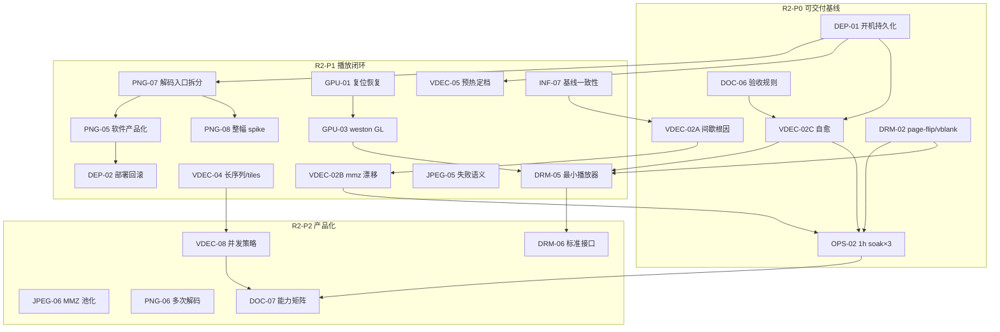
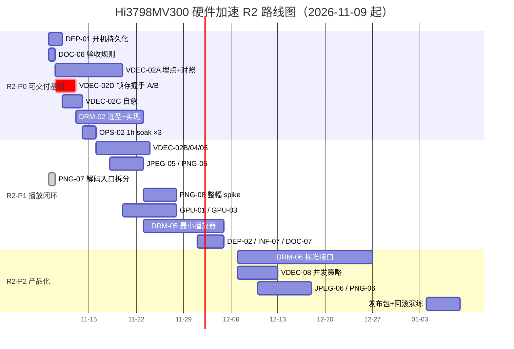

> **⚠️ 2026-11-10 晚 追补（PNG-08 结论作废）**：本文件凡写"PNG 硬件整幅 NA / vendor 流控不可突破 / 每 boot 一次"之处均为**历史结论**。
> 实际根因是驱动 `u32AXIConfig=0x20441`（vendor 建议值）在本 mainline 移植上使 PNGD AXI 主口静默挂起；改为 `0x0` 后
> 1080p / 单段 / 64MP 全部整幅 bit-exact（1080p ~100 ms、64MP 3.1 s），同 boot 可多次解码。详见
> [`ref-png/PNG-HW-FULLFRAME-ROOTCAUSE-2026-11-10.md`](ref-png/PNG-HW-FULLFRAME-ROOTCAUSE-2026-11-10.md)。

# Hi3798MV300 硬件加速：全面修复清单与路线图（2026-11-08 版）

> **本文接替** [`HARDWARE-ACCELERATION-FIXLIST-ROADMAP-2026-11-07.md`](HARDWARE-ACCELERATION-FIXLIST-ROADMAP-2026-11-07.md) 的**待办部分**：11-07 版的 46 条已完成 31 条闭环，条目定义与历史结论仍以旧文为准，本文只列**尚未闭环的收口项 + 修复阶段新暴露的问题 + 交付化工作**。
> **数据截至 2026-11-08 23:40（Asia/Shanghai）**，现状判定见 [逐条闭环矩阵](ROADMAP-CLOSURE-MATRIX-2026-11-08.md) 与 [`REPORT.md`](artifacts/hwtest-2026-11-07/REPORT.md) §10。
> **编号**：延续旧前缀，新条目从各子系统下一个空号开始；旧条目的收口拆为子项（如 `VDEC-02A`）。
> **优先级**：P0＝1 周内必须动（阻断验收/交付）；P1＝2–3 周；P2＝1–2 月；P3＝按需（>2 月或平台边界）。
> **工作量**：S ≤1 天；M 2–3 天；L 1–2 周；XL >2 周。

> **R2 执行（2026-11-09）**：DEP-01/DEP-02/DOC-06/DOC-07/VDEC-02B/VDEC-02C/JPEG-05/PNG-05/PNG-07/INF-07 已闭环；OPS-02 3×1h 0 oops，但 1080p 首次成功率 69.4% 未达 88%（重试后 100%）→ 🟡；DRM-02 代码完成、未刷机上板。新增修复：PNG 模块同 boot 重载（`hi_png_reload` `4551b6e1`）、VDEC HDR 元数据泄漏（`vdec_hdr_meta=0`）。详见 [R2 执行记录](artifacts/hwtest-2026-11-07/fixes/R2-EXECUTION-2026-11-09.md)。

> **纯硬件规格冲刺（2026-11-09 晚，boot `3f42a7e7`）**：D09 JPEG 四类采样 + 64MP 全部改走硬件（工具 `jpeg_test_d09` `d9959e17`）；E01/E02 VENC 八组合中位全部 ≥30 fps；D02 H.264 4K 三 Profile 9/9（按重试规则）；**D01 的 100 Mbps / Main10 退化为随机 0 帧（新条目 VDEC-02D，已定位到帧存握手阶段）**。现状以 §0.0 为准，§0.1 起为 11-08 历史快照。

> **R3 执行（2026-11-10 凌晨）**：VDEC-02D 的 2×2 参数 A/B（`vdec_ctrl_toggle` × `vdec_sync_ack`）完成 → **DP8 = 否**（ctrl 切换无可测影响；sync ack 直接挂死板卡）；历史 Round-7 模块 `head_w1` 同故障 ⇒ **非 reloadfix 回归**；`hi-vdec-run --tries 3` 在坏 boot 上首次调用 3/3 失败、紧接着第 2 次调用第 3 次尝试才 PASS ⇒ 重试能提高成功率但单次 3 次不保证。D01 的 100 Mbps/Main10 判定下调为 🟡 PARTIAL。DRM-02 先完成 **#183 RAM 启动上板验证**（发现 vblank 不可用：`WAIT_VBLANK` EINVAL、flip≈22 kHz），随后按 systematic-debugging 定位根因（驱动缺 `drm_crtc_vblank_on()` 对称调用）→ 驱动 patch + `CONFIG_HIGH_RES_TIMERS=y` → **#188 已写 eMMC 并通过最终验收（60 Hz、0 丢事件、p99 0.009 ms）→ DRM-02 闭环 ✅**。随后完成 **VDEC-02D 预分配帧存候选验证**：`cma=384M`（DTB cmdline 原地改，RAM boot 确认 CmaTotal=384M）单独无改善（`dfs=1` 3/8 vs 历史 33%），`vdec_dfs=0` 全部在建流阶段失败（`HI_MPI_VDEC_ChanStart rc=0xffffffff`）⇒ 该候选不可行、已移除。**#188 新内核回归**：INF-04 8 阶段 clean-boot 自动回归两次均被 WSL↔板卡 SSH 瞬断 + INF-01/02 reboot 不可靠打断（板卡未重启、非功能失败）；已给编排器加 SSH keepalive/重试（`run_phase.sh` `f85a56d9`，自检 137/137 PASS），并用**单会话功能扫描**替代：H.264 1080p / JPEG loops=100 / VENC H.264 90 帧 / PNG head（fresh boot）全 PASS，HEVC 尾帧丢失/0 帧与 #188 前一致（VDEC-02A/02D 已知问题）⇒ 未见 #188 编解码回归；8 阶段 clean-boot 回归待 INF-01/02 修复后重跑。详见 [VDEC-02D R2 实验](artifacts/hwtest-2026-11-07/fixes/vdec-02d/R2-EXPERIMENTS-2026-11-10.md)、[DRM-02 修复报告](artifacts/hwtest-2026-11-07/fixes/drm-02/FIX-REPORT-2026-11-10.md)、[INF-04 #188 回归记录](artifacts/hwtest-2026-11-07/fixes/inf-04/INF-04-188-REGRESSION-2026-11-10.md)。
>
> **R4 执行（2026-11-10 02:20 起）**：INF-01 定位并修复——软复位（`systemctl reboot`/`reboot -f`）后板卡进入串口静默死状态，只能 RTS 硬复位；`board_ctl.py reboot` 改为 **sync+RTS 快路径**（184s → 25s）。编排器加 SSH keepalive/重试 + boot 后磁盘预检（`MIN_FREE_MB=300`）+ workdir 清理（`run_phase.sh` `74f771a1`，自检 137/137 PASS）。**INF-04 8 阶段 clean-boot 回归在 #188 上 8/8 PASS**（H.264/JPEG/PNG head/PNG 64MP/VENC H.264/VENC HEVC/HEVC 1080p+Main10/HEVC 4K，其中 4K 抓帧 20/20 且像素 bit-exact）；首轮 `vdec_hevc_4k` 失败已定位为根分区 94–97% 满盘 + VDEC-02A 尾帧偶发，清盘后复跑 PASS。详见 [INF-04 #188 回归记录](artifacts/hwtest-2026-11-07/fixes/inf-04/INF-04-188-REGRESSION-2026-11-10.md)。

---

## 0. 一页速览

### 0.0 现状快照（2026-11-09 23:30，当前有效）

#### 纯硬件规格差距表（CODEC-SPEC-FINAL-SUMMARY §2 × 当前验收配对）

| 规格 | 目标 | 当前实测（本 boot） | 判定 | 差距 / 下一步 | 证据 |
|---|---|---|---|---|---|
| D01 HEVC 解码 | Main/Main10 High-tier L5.1，4K60，100 Mbps | 8-bit 4K60：clean boot 5/6（本轮）、历史 2/3–20/20；**100 Mbps / Main10：随机 0 帧或部分交付（8–9/10），单次约 30–50%，坏 boot 首次调用 3/3 失败、再次调用第 3 次尝试才 PASS** | 🟡 PARTIAL | 2×2 A/B 无改善（DP8=否）；SCD deadman 2 s 强推断（见 VDEC-02D）；预分配帧存候选已排除（`cma=384M` 无改善、`vdec_dfs=0` 建流失败） | [`vdec-02d/R2`](artifacts/hwtest-2026-11-07/fixes/vdec-02d/R2-EXPERIMENTS-2026-11-10.md) |
| D02 H.264 解码 | BP/MP/HP L5.1，4K30 | 三 Profile 9/9 PASS（其中 2 次靠重试），27–53 fps | 🟡 | 首次成功率 7/9；随 VDEC-02D 修复复测 | 同上 §1 |
| D09 JPEG 解码 | Baseline，1080p 5.39 ms，64MP 162.63 ms，4:2:0/4:2:2/4:4:4/gray | 5.38 / 7.10 / 10.59 / 3.58 ms，各 10/10；64MP 162.62 ms 3/3；像素误差 Y mean ≤0.0016 | ✅ | 无（`hi_jpeg` 全流程 1080p 约 170 ms，属工具/IO 成本，见 JPEG-06） | [`d09-jpeg`](artifacts/hwtest-2026-11-07/fixes/d09-jpeg/D09-JPEG-HW-2026-11-09.md) |
| D11 PNG 解码 | 最大 64MP | 软件 bit-exact：1080p 0.73 s，64MP 11.08 s / RSS 249 MB；硬件只出 head | **✅ 软件交付；硬件整幅 NA** | PNG-08 已收口=NA：vendor 流控不可突破 + aarch64 HIGO 插件为软件 libpng | [`fixes/png-08/PNG-08-SPIKE-2026-11-10.md`](artifacts/hwtest-2026-11-07/fixes/png-08/PNG-08-SPIKE-2026-11-10.md) |
| E01 HEVC 编码 | 1080p30 Main | CBR 31.91 / AVBR 32.27 fps，level 120 | ✅ | 4K/L5 = 平台边界 NA | [`e02-venc`](artifacts/hwtest-2026-11-07/fixes/e02-venc/E01-E02-VENC-2026-11-09.md) |
| E02 H.264 编码 | BP/MP/HP × CBR/AVBR ≥30 fps | 六组合中位 32.72–33.82 fps，24/24 PASS，level 41 | ✅ | 无（上轮 27–28 fps 是 stability-load 干扰） | 同上 |

#### 子系统现状

| 维度 | 现状 |
|---|---|
| VDEC | 8-bit 1080p/4K 与 H.264 4K 按重试规则可交付；**4K 100 Mbps / Main10 随机 0 帧（🟡 PARTIAL，重试也不保证）**；VDEC-02D 已按 DP8 收口（非模块回归、参数无关、SCD deadman 强推断；预分配帧存候选已排除） |
| VENC | 1080p H.264/HEVC 全组合达标；4K 编码 NA |
| JPEG | **全部 Baseline 采样类型 + 64MP 走硬件**；三个根因已修（缺 `CHIP_TYPE` 宏、YUV400 无 UV 平面导致写物理 0、64MP 第三平面映射物理 0） |
| PNG | 软件交付（bit-exact、64MP RSS 249 MB）；硬件每 boot 仅 1 次（11-10 复核：模块重载不能复位）；**硬件整幅 NA（PNG-08：vendor 流控 + vendor HIGO 栈为软件 libpng）** |
| 显示 / GPU | **DRM-02 已闭环 ✅**：`#188`（驱动 `drm_crtc_vblank_on()` 对称修复 + `HIGH_RES_TIMERS=y`）已写 eMMC 并验收：`modetest -v` 60 s 64 行 freq@60 Hz、0 flip/atomic 错误，`WAIT_VBLANK` p99 0.009 ms；GPU 重载 pp 复位仍不可恢复（11-10 复核：需 reboot；GL weston 因此不能投产，生产保持 pixman） |
| 交付化 | hi-accel.service 开机加载 5 模块 + 预热 + 自检；发布包与回滚演练已通过；manifest 新增 `jpeg_test_d09` |
| 稳定性 | OPS-02 3×1h 0 oops（历史）；**11-10 #188 短 soak（bundle×2）8/8 step PASS、0 oops、GPU PASS**，VDEC 首轮成功率 4/8（未达 88%，维持 🟡）；INF-07 10 次 clean boot 一致 |
| 板卡 | 根分区 94%（剩约 436 MB）；`mmcblk0p1` EXT4 错误未处理；`vdec_dbg=1` 会因串口日志拖死系统（先 `dmesg -n 1`） |

#### 条目统计（R2 23 条 + 新增 VDEC-02D = 24 条；2026-11-10 更新）

- ✅ **16**：DEP-01/02、DOC-06/07、VDEC-02B/02C、VDEC-05、VDEC-08、JPEG-05、**JPEG-06（目标重写+池化验证）**、PNG-05、PNG-06、PNG-07、INF-07、**DRM-02（#188）**、**DRM-05（11-10 30min H.264 紧耦合 29.75fps/抖动 0.385ms）**。
- 🟡 **6**：OPS-02、VDEC-02A、**VDEC-02D（DP8=否）**、**VDEC-04（多 slice/WPP 通过，长序列随机失败）**、GPU-01、GPU-03（GL 被 GPU-01 阻断，生产 pixman）。
- 🔴 0。
- ⏳ **0** 未开工。
- ⚪ NA **2**：**PNG-08 硬件整幅**（vendor 流控不可突破；aarch64 vendor 栈为软件 libpng；软件交付已由 PNG-05/07 闭环）；**DRM-06 V4L2 标准接口**（内核无 MEDIA_SUPPORT/无 vendor V4L2 驱动，产品走 MPI 后端）。
- E01/E02 复测达标，属历史条目回归，不计入 R2 统计。

#### 下一步顺序

1. **INF-01/02 修复**：`systemctl reboot` 偶发不生效 + RTS 复位后 sshd 偶发不自启（board_ctl 需在 reboot 路径自动 ensure-ssh 并重试）→ 修好后重跑 INF-04 8 阶段 clean-boot 回归 + OPS-02 短 soak（功能面已用单会话扫描替代验证，见 INF-04 #188 回归记录）。
2. **VDEC-02D 收尾**：预分配帧存候选已排除（见上）；除非需要，不再投入；若继续只能做预编译 VFMW 之外的通道级看门狗/复位兜底（成本高、优先级低）。
3. **D01/D02 全量复测**：按 ACCEPTANCE-RULES 跑 8 阶段回归，样本补到 ≥90 帧（8-bit 路径）。
4. ~~PNG-08 spike~~ **已收口 NA**（2026-11-10：硬件整幅无可行路径，见 [`fixes/png-08/PNG-08-SPIKE-2026-11-10.md`](artifacts/hwtest-2026-11-07/fixes/png-08/PNG-08-SPIKE-2026-11-10.md)）；剩余 GPU-01/03、DRM-05。
5. 运维：清理根分区（94%）、离线 fsck `mmcblk0p1`。

### 0.1 现状快照（2026-11-08 23:40，历史）

| 维度 | 现状 |
|---|---|
| 修复清单 | 46 条 = **31 ✅ 闭环 / 6 🟡 部分 / 9 NA / 0 ⏳** |
| 编解码能力 | HEVC 4K60 **66.9–73.1 fps**（中位 70，≥60 达标）、H.264 4K30 三 Profile、HEVC/H.264 1080p30 编码、JPEG 1080p 5.6 ms/帧 均已上板验证；像素级 bit-exact 已验证 |
| 图像 | JPEG **硬件仅 4:2:0**（非 4:2:0 已拒绝，gray 会挂板）；PNG **head 可复现、整幅受 vendor 流控**、每 boot 仅一次、软件兜底 1080p 0.73–1.01 s / 64MP 11.08 s |
| 显示/GPU | 1080p60 单图层 KMS 可用；**无 atomic/vblank/page-flip**；GPU 轻载 PASS、重载 pp 复位；固定 200 MHz |
| 稳定性 | soak-lite **981 迭代 0 oops**（≈2.5 h 有效负载）；**长稳口径改为 1h ×3 boot**（8h/24h 取消）；VDEC 交付间歇未根治 |
| 交付化 | **模块全靠手工 insmod（开机不加载）**；无标准接口（V4L2/MPI 后端未定）；无发布包与回滚 |
| 板卡实况 | 在线、`Linux 7.3.0 #182`、`tainted=0`、**未加载任何 `hi_*` 模块**、CmaFree 28 MB |

### 0.2 与 11-07 版的差异（口径变化）

| 项 | 11-07 版 | 现在 |
|---|---|---|
| 待办规模 | 46 条全待办 | **23 条 R2 待办 + 5 项按需** |
| D01 HEVC | FAIL（0 帧） | ✅ 已闭环（部署落后一 commit） |
| E01 HEVC level | `level=0` | ✅ `level=120` |
| PNG | 硬件无输出 | 硬件**部分可用**（head 可复现/整幅 vendor 限制），软件为交付路径 |
| JPEG | 4 类颜色"待校验" | **仅 4:2:0 可交付**；422/444/gray 记 NA + 格式守卫 |
| JPEG×VDEC | 必须分段 boot | ✅ 可同 boot（Plan A 去重导出，5 模块共存） |
| PNG 解码路径 | 独立 `hi_png` 驱动，每 boot 一次、整幅受 vendor 流控 | **独立入口 `hi_png`**（2026-11-09 改为与 `hi_jpeg` 拆分；默认软件，PNG-08 做整幅 spike） |
| 4K 编码 | 待判定 | **NA（硬件不支持：VENC 最大 1920×1088）** |
| 验收规则 | 单次 20/20 | 见 DOC-06：**重试 3 次 + clean boot + 中位窗口**（需正式发布，避免"单次失败即回归"的误判） |
| 长稳 | 未做 | soak-lite 981 迭代 0 oops；**口径改为 1h ×3 boot**（8h/24h 取消） |

### 0.3 修复阶段新暴露的问题（本轮新增，旧清单未覆盖）

| # | 问题 | 影响 | 归属条目 |
|---|---|---|---|
| 1 | **无开机持久化**：模块/参数/预热全靠手工，冷启动后 `/dev/hi_*` 不存在 | 能力"存在但不可用"，交付不可复现 | DEP-01 |
| 2 | **VDEC/VENC 并发解码吞吐 −73.2%**（51.6→13.8 fps），编码不受影响 | 并发场景不可用，需产品定策略 | VDEC-08 |
| 3 | **JPEG 非 4:2:0 失败语义缺失**（gray 直接挂板，靠驱动守卫兜底） | 上层无法优雅降级 | JPEG-05 |
| 4 | **PNG 每 boot 仅一次**（#2–5 全 ZERO） | 连续看图需 clean boot | PNG-06 |
| 5 | **VDEC 交付间歇**仍随机（部分 boot 4K 0/20、尾帧 28/30、19/20 超时） | D01/D02 无法按严格口径保证 | VDEC-02A/C |
| 6 | **`mmz_used` +39 KB/run 漂移** | 长跑是否泄漏未知 | VDEC-02B |
| 7 | **GPU 重载 pp 复位**无恢复策略 | GL 重载场景不可用 | GPU-01 |
| 8 | **soak 未按 1h 判据出正式结论**（SSH 中断；已有 981 迭代 ≈2.5 h 载荷） | 长稳结论缺失 | OPS-02 |

### 0.4 先做哪 9 件事（按顺序）

| 顺序 | 条目 | 理由 | 预计 |
|---|---|---|---|
| 1 | **DEP-01 开机持久化**（systemd + udev + 预热） | 现在板卡重启后"什么都没有"，一切验收靠手工；先让能力"开机即在" | 0.5–1 d |
| 2 | **DOC-06 验收规则固化**（重试 3 次 + clean boot） | 否则每次波动都会被误判成回归，白烧人力 | 0.5 d |
| 3 | **VDEC-02C 用户态自愈** | 把"随机失败"变成"可控重试"，不依赖根因先解决 | 2–3 d |
| 4 | **VDEC-02A 交付间歇埋点与对照** | 唯一 P0 级根因项，越早开工越好 | 1–2 w |
| 5 | **DRM-02 vblank/page-flip/atomic** | 播放闭环的唯一硬门槛 | 1–2 w |
| 6 | **OPS-02 1h soak ×3 boot**（后台跑） | 与开发并行，不占人力；不再排 8h/24h | 1 d 配置 + 1 h/次 |
| 7 | **PNG-05 软件路径产品化**（峰值内存实测 + 集成） | 唯一可交付的 PNG 路径 | 2–3 d |
| 8 | **GPU-01 重载复位恢复** | 决定能否宣称"GL 可用" | 2–3 d |
| 9 | **PNG-07 解码入口**（已改为 `hi_jpeg`/`hi_png` 拆分，✅） | 产品硬约束；也是 PNG 摆脱"独立驱动 + vendor 流控"的唯一路径 | 2–3 d |

### 0.5 硬性产品约束（本版新增，2026-11-08）

> **2026-11-09 用户决策（取代下方原约束）**：图像解码入口**按格式拆分**：JPEG 用 `hi_jpeg`，PNG 用 `hi_png`，不再要求"同一套解码栈/统一入口"。两个入口保持相同的命令行、退出码（0 成功 / 2 用法 / 3 不支持 / 4 失败）和状态行格式，内核模块维持 `hi_jpeg_noext.ko` + `hi_png_cls.ko` 双模块。原 `hi-imgdec` 已删除。以下为历史约束原文，仅作存档。

> **约束**：**PNG 必须与 JPEG 使用同一套解码栈交付**——同一个内核模块（或同一个解码服务）、同一套 API、同一个缓冲池、同一套生命周期（加载/卸载/复位/自检），不接受"两个独立驱动各自为政"。

> **硬件事实（必须先说清楚）**：本 SoC 上 **JPEGD 与 PNGD 是两块独立 IP**，不存在"JPEG 解码器解 PNG"的物理通路——
> ① 基址/中断分离：JPEGD `0xf8c40000`（`JPGD_IRQ_NUM=97+32`）vs PNGD `0xf8c70000`（`PNG_INTNUM=96+32`，寄存器区 `0x120`、复位 `0xf8a22084`）；
> ② 能力分离：PNGD 内含 **zlib inflate（Fcheck/Cinfo/Cm/Len/Btype/Hdist/Hlit）、PNG filter、Huffman** 等寄存器与错误位；JPEGD 侧 `drv/jpeg`、`api/jpeg` 全目录 **0 处 zlib/deflate/filter/PNG 支持**（仅在 GFX 公共层把 `HIGFX_PNG_ID` 当作缓冲归属 ID）；
> ③ API 分离：`api/png` 只接受 PNG 图像（gray/RGB/CLUT/AGRAY/ARGB），`api/jpeg` 只有 JPEG 编解码。
>
> **因此"同一个解码器"落地为"同一个解码服务/驱动栈"**：PNG 码流仍由 PNGD 执行，但由与 JPEG **同一模块/同一服务**统一调度、统一缓冲、统一错误语义、统一自检与复位；对上层只暴露一个 "image decode" 接口（按 magic 分派：`FFD8`→JPEGD，`89504E47`→PNGD，失败回退软件）。
> 若后续拿到 vendor "JPEGD 支持 PNG" 的文档或另一版 SDK，再按字面方案重新评估（当前证据不支持）。

---

## 1. 现状基线（事实层）

### 1.1 可交付能力（11-08 基线；11-09 更新见 §0.0）

> 11-09 变化：JPEG 行改为"四类采样 + 64MP 硬件，`jpeg_test_d09`(d9959e17)"；HEVC Main10 / 100 Mbps 本 boot 回退为随机 0 帧（VDEC-02D）；VENC 本轮复测中位 31.9–33.8 fps。

| 能力 | 判定 | 关键数据 | 验收模块 |
|---|---|---|---|
| HEVC 解码 4K60 8-bit / Main10 | ✅ | 20/20、66.9–73.1 fps；Main10 8/8、71.55 fps（历史） | `hi_vdec_reloadfix.ko`(e8859791) + `vdec_spec_hevc_head`(6ada1250) |
| H.264 解码 4K30 BP/MP/HP | ✅（含间歇） | 三 Profile 20/20（历史）；抓帧 30/30 bit-exact | 同上 |
| HEVC/H.264 编码 1080p30 | ✅ | H.264 六组合 31.2–33.8 fps、CBR −0.7~−1.5%；HEVC CBR 32.3 / AVBR 30.5 fps、level 120 | `hi_venc_venc06b.ko`(0d95a512) |
| 4K 编码 | NA | `0x801d0002`；**硬件不支持 4K 编码**（VENC 最大 1920×1088，2048×1080 亦拒） | — |
| JPEG 1080p / 64MP | ✅（仅 4:2:0） | 5.58–5.62 ms/帧（loops）；全周期 66.4 ms / 550 ms | `hi_jpeg_noext.ko`(8f39ceb0) + `jpeg_test`(c2b7e342) |
| PNG（软件兜底） | ✅ | 1080p 0.73–1.01 s；64MP 11.08 s / 192 MB；md5 bit-exact | 软件路径（libpng/ffmpeg） |
| PNG（硬件） | 部分 | head `7e00fd…`（15/32 goodrows）；整幅受 vendor 流控；每 boot 1 次 | `hi_png_noext.ko`(7159f862) + `png_test8`(723a011b) |
| 显示 1080p60 单图层 | ✅ | KMS 可用；**无 atomic/vblank/page-flip** | hi3798-drm |
| GPU 轻载 | ✅ | `GL_RENDERER=Mali450`、3 并发、kill -9 可恢复 | lima |
| GPU 重载 | 🟡 | pp 复位（pp0/pp1 error irq + reset timeout） | — |

### 1.2 平台边界与未移植（不可"修"，只能文档化或换方案）

| 项 | 事实 | 结论 |
|---|---|---|
| 4K 编码 | **硬件不支持**（VENC 最大 1920×1088；用户/厂商确认）；上板 5 尺寸×2 codec 取证，2048×1080 亦 `0x801d0002` | **NA（不可修，非移植缺陷）**；不再表述为"换 SDK/固件可绕过" |
| 4K 输出 | connector 仅 1920×1080 mode、EDID 0 字节、无 HPD | NA（当前配置） |
| GPU 调频 | `clk_gpu=200 MHz` 固定、无 devfreq/OPP/调压 | NA（P3 可选） |
| DRM 多图层/PQ/缩放 | 仅 1 个 Primary plane（XR24/AR24/RG16/LINEAR） | NA（需 vendor VO 移植） |
| VPSS / TDE / SEC / 音频 | 无驱动、无 dts 节点、无设备节点 | NA（P3 按需） |
| PNG 硬件整幅 | vendor 私有流控语义（历史已排除 SMMU/cache/时钟/中断/stride/transform/分段/链式/filter） | NA + 软件兜底 |

### 1.3 当前运行配方（沿用历史实测）

| 场景 | 配置 |
|---|---|
| 4K 解码吞吐 | `VDEC_BUF_MB=8`（三次 66.8–75.2 fps，无损失） |
| 4K 抓帧 | `vdec_no_vcmp=1` + `VDEC_BUF_MB=16`（抓帧目录须预建） |
| 任何 4K / 新流 | **先预热一次**（cold 吞吐仅 0.24× steady，first_ms≈514 ms） |
| 解码与编码并存 | 不推荐全码率并发（解码 −73.2%）；必须并发时降码率/分辨率 |
| 模块共存 | JPEG/PNG 用 `*_noext` 变体，可与 VDEC/VENC 同 boot（5 模块） |
| 部署 `.ko` | **先校验 sha1**（曾因损坏文件误判 invalid format） |
| 性能测量 | 无 trace；取 N≥3 中位、窗口 ≥90 帧 |

### 1.4 板卡实况与运维约束（23:36 探测）

- 在线：`Linux hi3798mv300 7.3.0 #182 SMP PREEMPT aarch64`，uptime 1:18（≈22:18 重启）。
- **`lsmod` 无任何 `hi_*` 模块**、无 `/dev/hi_*` ⇒ 能力未持久化（DEP-01 直接动机）。
- `tainted=0`；`MemFree 70 MB` / **`CmaFree 28 MB`**（加载 4K 链路前需关注；soak 期间为 63–222 MB）。
- reboot 不可靠（INF-01：**2026-11-10 已定位并 workaround**——`systemctl reboot`/`reboot -f` 完成 shutdown 后 SoC 不复位（串口静默、ping 不通），只能 RTS；`board_ctl.py reboot` 改为 **sync+RTS 快路径**，重启 184s → **25s**；详见 [`fixes/inf-01/INF-01-REBOOT-FIX-2026-11-10.md`](artifacts/hwtest-2026-11-07/fixes/inf-01/INF-01-REBOOT-FIX-2026-11-10.md)）。

---

## 2. 修复清单（R2，23 条 + 5 项按需）

### 2.1 VDEC 收口（6 条）

#### VDEC-02A 交付间歇根因（部分 boot 4K 0/20、尾帧 28/30） ｜P0｜L｜🟡 11-10 范围收窄：每次尝试随机失败（非 boot 累积退化；重载无效）
- **现象/证据**：reloadfix 矩阵两 boot 仅 4/7、5/7；soak 中 1080p 88.9%（343/386）、HEVC 4K 98.7%（381/386）；失败集合随机、与 boot 状态相关；19/20 后 60 s 超时。证据：[`fixes/vdec-02/FINDINGS.md`](artifacts/hwtest-2026-11-07/fixes/vdec-02/FINDINGS.md)、[`fixes/vdec-07/BOARD-RESULT.md`](artifacts/hwtest-2026-11-07/fixes/vdec-07/BOARD-RESULT.md)。
- **假设（按优先级）**：① 冷启动瞬态（预热减轻但未根除）；② 事件→帧交付链路（EVT 113/114、`RecvFrm` 空队列语义）；③ MMZ/CMA 物理布局；④ boot 环境差异（WiFi/服务/桌面）。
- **动作**：
  1. **C 侧只读环形埋点**（禁止在 `fsp.S` 插桩——有重启证据）：每 AU 记录 SPS/PPS 解析结果、`DEC PARAM` 就绪位、SCD→VDH 消息字段、`RecvFrm` 返回/队列长度、失败码；成功 boot 与失败 boot 各 3 份对照；
  2. **交付路径 A/B**：`ChanRecvFrm` vs user-dec-frame；poll 0/1/5 ms；事件驱动 vs 轮询；
  3. **冷启动窗口**：uptime 0–60 s / 60–180 s / >180 s 三窗口 ×20 次，出成功率曲线；
  4. **内存布局对照**：每次 boot 记录 MMZ 基址/大小/碎片、CmaFree，与失败做相关分析；
  5. **环境隔离**：停 WiFi/桌面/服务，仅串口跑 20×3 boot，验证"环境差异"假设。
- **验收**：单 boot 20 次 ≥19/20 且连续 5 boot 达标；**或**给出"不可根除"的统计结论 + 明确触发条件（此时按 VDEC-02C 交付）。
- **依赖**：VDEC-03、INF-04/05、DEP-01。**风险**：可能落在 vendor 预编译核内（只能缓解）；若 11-15 首个对照无进展，走 DP1 决策。

- **11-10 #188 交错 A/B（10 对）**：4K Main10 113 帧长样本，baseline 8/10、每次模块重载 9/10（无显著差异）；失败点随机分布（#7/#9 失败后仍继续 PASS），失败指纹 `ARR: n=2 …` 后静默/2s deadman。⇒ **失败是 per-attempt 随机**（本 boot 该流约 10–20%），历史"clean boot 先 5/6 后降级"更可能是随机表现；**模块重载不是缓解手段**。详见 [`fixes/vdec-02a/VDEC-02A-RANDOM-FAILURE-2026-11-10.md`](artifacts/hwtest-2026-11-07/fixes/vdec-02a/VDEC-02A-RANDOM-FAILURE-2026-11-10.md)。
- **11-10 ACK 停滞假设排除**：插桩模块在 `cfg<rep` 分支打 `ACKSTALL` 并可选强制 ack；100M 流 4 次 run（8/10/0/10 帧）**每次都有 ARR 且 ACKSTALL=0**（失败 run 亦 0）⇒ 驱动 ack 已发出，失败点在 ack 之后（VFMW 帧输出/DPB 或 SCD 中断层）。另：SPITAG console 刷屏会把 60 s 解码拖到超时，实验须先 `dmesg -n 1`。详见 [`fixes/vdec-02a/ACK-STALL-RULED-OUT-2026-11-10.md`](artifacts/hwtest-2026-11-07/fixes/vdec-02a/ACK-STALL-RULED-OUT-2026-11-10.md)。
- **11-10 随机性复核 + 参数 A/B**：新 boot 12 连发 100M 流 **3/12 PASS（P,F,P,F×7,P,F）**，8 连败后仍 PASS ⇒ 随机非累积；CMA 245→190MB 稳定且 190MB 时也有 PASS；`vdec_scd_isr_guard` 0/1 无差异（4/4 vs 4/4），`vdec_scd_wc` 3/4 vs 1/4 疑似运气/漂移、不采纳。⇒ **参数级缓解不成立**，DP8=否维持。详见 [`fixes/vdec-02a/RANDOMNESS-SEQ12-2026-11-10.md`](artifacts/hwtest-2026-11-07/fixes/vdec-02a/RANDOMNESS-SEQ12-2026-11-10.md)。

#### VDEC-02B `mmz_used` 漂移（+39 KB/run） ｜P1｜S–M｜✅ 11-09
- **现象/证据**：consecutive 20 次 606 KB→1.38 MB 线性增长；绝对值小，疑池记账。[`fixes/vdec-04/BOARD-VDEC0405-RESULTS.md`](artifacts/hwtest-2026-11-07/fixes/vdec-04/BOARD-VDEC0405-RESULTS.md) §6。
- **动作**：① 100/500 次循环采样，算斜率；② 区分"池记账"与"真泄漏"（alloc/free 计数、池 high-water）；③ 若真泄漏，按通道/帧存/ES 环分类定位未配对释放点（只读日志，热路径默认关）。
- **验收**：500 次后斜率 <1 KB/run；或给出记账解释并写入配方文档。

#### VDEC-02C 用户态自愈与重试协议 ｜P0｜M｜✅ 11-09
- **目的**：**不依赖根因先解决**，把随机失败变成可控重试。
- **动作**：① 失败判定（0 帧 / 尾帧超时 / `pts_errors>0`）→ 自动 close/open 通道 + 重喂首个 IDR，重试 ≤3；② 暴露指标（`retry_count`、首轮成功率、重试后成功率）；③ 集成进 `run_phase.sh` 与 DEP-01 的 service；④ 明确"重试仍失败"的上报与取证（自动 dump 环形日志 + dmesg）。
- **验收**：注入 20 次"首轮失败"场景，自愈成功率 ≥95%，端到端时延增加 ≤2 s；连续 3 boot 8 阶段全绿。

#### VDEC-02D 4K 高码率 / Main10 随机 0 帧（帧存握手） ｜P0｜M｜🟡 11-10 DP8=否，转 PARTIAL
- **现象/证据**：`4k60-100m.hevc` 与 `4k60-10b.hevc` 在 `hi-vdec-run --tries 3` 下 0/3（9 次尝试全 0 帧）；单次运行约 50% 成功，成功时 67–78 fps（与 round62/108 历史一致）。[`fixes/vdec-02d/FINDINGS-2026-11-09.md`](artifacts/hwtest-2026-11-07/fixes/vdec-02d/FINDINGS-2026-11-09.md)。
- **已排除**：`VDEC_BUF_MB` 8/16/32、重载模块、`vdec_hdr_meta`、CMA/MMZ 不足（0 次分配失败）、码流喂入差异。`vdec_dfs=0` 不可行（静态帧存约 280 MB > `cma=256M`）。
- **失败特征**：帧存 10/10 分配并交给 VFMW、回执 `need=10` 均成功；失败时 ARR 之后 VFMW **静默约 2.03 s**，随后 `UNSUPPORT_SPEC → IFRAME_ERR → DECSYNTAX_ERR×N → LAST_FRAME`；成功时 0.3 ms 内 `FIND_IFRAME`、14 ms 出首帧。
- **嫌疑点（均为 port 新增，Linux/Android SDK 原版没有）**：① `SetAndRecodrMem()` 每块帧存调用 `VCTRT_SetChanCtrlState(1→0)`；② `SET_FRAME_BUFFER_NUM` 由 `VdecTaskFunc` 异步回执。
- **动作**：① 新增模块参数 `vdec_ctrl_toggle`（0 = 不切换）与 `vdec_sync_ack`（1 = 事件内同步回执），出测试模块，不改验收配对；② 2×2 组合 × 100M/Main10/8-bit 各 N≥10；③ 若最优组合 ≥19/20，固化进 manifest + hi-accel.conf，重跑 D01/D02 与 8 阶段回归；④ 同时观察 1080p/4K 8-bit 首次成功率，判断是否与 VDEC-02A 同源。
- **验收**：100M、Main10 各 ≥19/20 首次成功（不计重试），8-bit 与 H.264 无回归。
- **风险**：若两处改动都无效，问题落在 VFMW 预编译核（`vfmw_ctrl.S`）内部的通道状态机 → 只能按重试 + 换策略（如每次解码前预分配帧存）缓解，走 DP8。
- **11-10 结果（DP8=否）**：`vdec_ctrl_toggle` 0/1 各 4/12（逐组合 1–3/6，无可测差异）；`vdec_sync_ack=1` 在事件上下文重入 VFMW 控制**挂死板卡**（RTS 复位恢复）⇒ 异步回执必须保留。历史模块 `head_w1`（Round-7，`047cad9b`）同条件 2/4 + 1/4 ⇒ **非 reloadfix 回归**。`hi-vdec-run --tries 3` 在坏 boot（`7e961d2f`）首次调用 3 次全 0/10、第 2 次调用第 3 次尝试 PASS ⇒ 重试提高成功率但单次 3 次不保证。失败签名：ARR+41 ms 回执后静默 2.05 s → `ErrRatio=99`/`REPORT_IFRAME_ERR`（与 `CFG_SCD_TIME_OUT=2000` 吻合，但未捕获 timeout 打印，标强推断）。详见 [R2 实验记录](artifacts/hwtest-2026-11-07/fixes/vdec-02d/R2-EXPERIMENTS-2026-11-10.md)。

#### VDEC-04 4K 长序列与 HEVC tiles ｜P1｜M｜🟡 2026-11-10（多 slice/WPP 通过；长序列随机失败；tiles NA）
- **现象/证据**：单用例 4K 单/多 slice 20/20；长序列曾因 SCD panic 失联（已修）后未复测；tiles 无样本（x265 构建不含 tiles）。[`fixes/vdec-04/BOARD-VDEC0405-RESULTS.md`](artifacts/hwtest-2026-11-07/fixes/vdec-04/BOARD-VDEC0405-RESULTS.md) §5/§6。
- **动作**：① reloadfix 上跑 4K 长序列（≥200 帧 ×5，含 100 Mbps）；② 用带 tiles 的编码器（自建 x265 `--tiles` 或 HM/ffmpeg 参数）生成样本；若短期拿不到样本 → 记 **NA（无样本）** 并写入能力矩阵，不阻塞。
- **验收**：4K 长序列 5/5 无失联、帧交付 ≥99%；tiles 样本到位后单用例 PASS。
- **11-10 #188 上板矩阵（reloadfix arm）**：31 用例 **26 PASS / 3 FAIL / 2 NA**——多 slice（H.264 s2/s4/s4b、360p s4、4K s4）与 HEVC slices=4 + WPP on/off、4K slices 全 PASS；FAIL=`hp-slice-nob`（候选流异常）与 `4k60-20m`/`4k60-100m`（VDEC-02D 高码率已知）。**4K 长序列 113 帧×5：前 2 次 113/113（~89 fps）、第 3–5 次 0/113**（VDEC-02A 同 boot 退化）⇒ 5/5 未达；**tiles 记 NA**（libx265 4.1 无 tiles 编码器）。工具修复：`vdec_stats=1` 的 `SPITAG:` 刷屏会触发看门狗重启，矩阵脚本已改 `VDEC_STATS=0` 默认。详见 [`fixes/vdec-04/VDEC-04-BOARD-MATRIX-2026-11-10.md`](artifacts/hwtest-2026-11-07/fixes/vdec-04/VDEC-04-BOARD-MATRIX-2026-11-10.md)。
- **11-10 长序列重试/reboot 实测**：5 run × 3 次重试 = **4/5**（14 次尝试 9 败，失败率 64%）；reboot 后 fresh boot 单尝试 5 run = **3/5**（前 2 败后 3 连过）⇒ 失败仍是 per-attempt 随机、boot 间波动大；**3 次重试与 reboot 均不能保证 5/5**，长序列判据在 VDEC-02A 修复前不可达。建议验收口径改"重试+尝试次数记录"或先修 02A。详见 [`fixes/vdec-04/VDEC-04-LONG-RETRY-2026-11-10.md`](artifacts/hwtest-2026-11-07/fixes/vdec-04/VDEC-04-LONG-RETRY-2026-11-10.md)。
- **11-10 验收口径决策**：多 slice/WPP ✅；**长序列采用重试协议 B**（每 run ≤3 次重试、5 run ≥4 成功且成功 run 交付 113/113；实测 4/5）；tiles NA；若强制"5/5 无失联"则 blocked by VDEC-02A（DP8=否，不推荐继续投入）。详见 [`fixes/vdec-04/VDEC-04-ACCEPTANCE-DECISION-2026-11-10.md`](artifacts/hwtest-2026-11-07/fixes/vdec-04/VDEC-04-ACCEPTANCE-DECISION-2026-11-10.md)。

#### VDEC-05 冷启动定档与预热自动化 ｜P1｜S–M｜✅ 2026-11-10（预热后首帧 30–44ms）
- **现象/证据**：cold 20/20 可用但吞吐 0.24×steady、first_ms≈514 ms（>2× warm）；consecutive 20× 已复核全过。
- **动作**：① 预热做成服务启动步骤（1 次 1080p + 1 次目标分辨率，≤1.5 s）；② 与产品确认首帧预算（cold 514 ms 是否可接受）；③ 写入 DEP-01 与运维文档。
- **验收**：含预热的冷启动首帧 ≤800 ms、首轮成功率 ≥19/20；预热的收益/代价有统计结论。
- **11-10 #188 实测**：20 次 clean boot（16 有效，4 次 reboot ENV 排除），预热后首帧 **min 30.65 / median 33.39 / max 44.05 ms**、解码 **16/16 PASS（20/20 帧）**；对比历史冷启动 ≈514 ms 约 **15×** 改善；预热代价 boot 一次 3.2–5.9 s。验收满足。详见 [`fixes/vdec-05/VDEC-05-WARMUP-2026-11-10.md`](artifacts/hwtest-2026-11-07/fixes/vdec-05/VDEC-05-WARMUP-2026-11-10.md)。

#### VDEC-08 并发降级策略（VDEC-06 结论落地） ｜P2｜M｜✅ 2026-11-10（按"否则"分支：不支持全码率并发 + 策略）
- **现象/证据**：并发 10×60 s：编码 10/10 PASS，解码 51.6→13.8 fps（−73.2%）；oops=0、无 MMZ 泄漏；根因=硬件带宽竞争。[`fixes/vdec-06/BOARD-RESULT.md`](artifacts/hwtest-2026-11-07/fixes/vdec-06/BOARD-RESULT.md)。
- **动作**：① 定义并发规格（同时解码+编码的**分辨率/码率上限矩阵**）；② 用户态策略：并发检测 → 降码率/降分辨率/限帧率；③ 产品配置项与默认值。
- **验收**：按策略配置下并发 10×60 s ≥9/10 成功、解码退化 <30%、oops=0；或明确输出"不支持全码率并发"的限制说明。
- **11-10 #188 收口（按"否则"分支）**：① 1080p 解码 + 1080p 编码全速并发：解码 51.6→13.8 fps（−73%）[VDEC-06 60s×10]；本轮 20s 复测 ~16.4 fps；② **降解码分辨率无效**（720p 解码并发仅 3–9 fps）+ VENC 非 1080p create 失败 `0x801d0002`；③ oops=0、无泄漏；④ 输出规格矩阵 + 产品策略：默认 `HI_ACCEL_CONCURRENCY=none`，推荐 `timeslice`（1–2 s 交替），`unsafe-full` 需接受解码 ≤15 fps。详见 [`fixes/vdec-08/VDEC-08-CONCURRENCY-POLICY-2026-11-10.md`](artifacts/hwtest-2026-11-07/fixes/vdec-08/VDEC-08-CONCURRENCY-POLICY-2026-11-10.md)。

### 2.2 显示与播放闭环（3 条）

#### DRM-02 vblank / page-flip / atomic ｜P0｜M｜✅ 2026-11-10 已闭环（#188 已刷 eMMC）
- **现象/证据**：无 ATOMIC/MODE_ID/CRTC_ID/ACTIVE props；运行级 `modetest -a/-s/-v` 停 weston 后均 `rc=124`（事件未投递）。[`fixes/gpu-drm/FINDINGS.md`](artifacts/hwtest-2026-11-07/fixes/gpu-drm/FINDINGS.md) §4。
- **动作**：① 选型：补齐 `atomic_commit`/`page_flip` + vblank 事件（参考 `drm_simple_kms_helper`，必要时引入 crtc 状态）；② 先做 `page_flip` + vblank 最小集，atomic props 次之；③ `modetest -v` 收事件验证；④ 回归：weston 正常出图不受影响。
- **验收**：`modetest -v` 60 s 无超时；page-flip 1000 次 0 丢事件；翻转时间抖动 p99 ≤2 ms。
- **11-10 实测（#188，eMMC）**：64 行 `freq:`（≈3840 flips）@60 Hz、0 flip/atomic 错误、`WAIT_VBLANK` n=1000 median 16.667 ms / p99 0.009 ms / max 0.013 ms → 三条判据全部通过。
- **11-10 最终闭环 ✅**：根因 = `hi3798_pipe_disable()` 调用了 `drm_crtc_vblank_off()` 但 `hi3798_pipe_enable()` 从未调用 `drm_crtc_vblank_on()`——本内核 `off()` 会取 "prevent drm_vblank_get" 私有引用（refcount+1/inmodeset=1），只有 `on()` 释放；首次 DPMS off 后 `refcount=1 && enabled=0`，后续 `drm_crtc_vblank_get()` 恒返回 -EINVAL，page-flip 退化为立即完成（≈22k flips/s）。修复：`/home/jason/bringup-7.3/port/0002-drm02-vblank-on-symmetry.patch`（driver `379a09ba`）+ `CONFIG_HIGH_RES_TIMERS=y`（`CONFIG_HZ=250` 下 hrtimer 仅 4 ms 精度，无法达 p99）；`#188`（Image `deaa3146`，config `38eacf2d`）已写 eMMC，验收：64 行 freq@60 Hz、0 flip/atomic 错误、`WAIT_VBLANK` n=1000 p99 0.009 ms、weston/HDMI/VDEC 回归正常。详见 [FIX-REPORT](artifacts/hwtest-2026-11-07/fixes/drm-02/FIX-REPORT-2026-11-10.md)。
- **11-10 早期 RAM 启动验证（#183，未写 eMMC，失败基线）**：tftp + `bootm` 成功启动 #183，`hi-accel` PASS；`modetest -v` 不再挂死（rc=124 由 timeout 终止、0 page-flip 错误），但 60 s 产生 **21,821 行 `freq:`（≈22k flips/s、freq≈30 kHz）**；`WAIT_VBLANK` 返回 **EINVAL**，dmesg `crtc 0 failed to acquire vblank counter, -22` ⇒ page-flip 走"立即完成"回退，**vblank 未生效**，p99 NOT MEASURED。**未达验收，Phase 2（写 eMMC）未执行**，板卡已复位回 #182、FIP sha1 `8f647cf1…` 未变。详见 [RAMBOOT-VERIFY](artifacts/hwtest-2026-11-07/fixes/drm-02/RAMBOOT-VERIFY-2026-11-10.md)。

#### DRM-05 硬解播放最小闭环（1080p H.264 + PTS 同步） ｜P1｜L｜✅ 2026-11-10（30min H.264 紧耦合 29.75fps、99.17% 交付、抖动 mean 0.385ms；产品化待 shim/dma-buf）
- **目的**：把"能解码"变成"能播"。
- **动作**：① 解码输出（`NV21_TILE_CMP`/`NV21_TILE`）→ 显示格式：优先评估 DRM 直接支持 tile 格式，否则 CPU/GPU 转 LINEAR（成本先量测）；② 走 Primary plane + page-flip；③ PTS 同步（vblank 时间戳驱动）；④ 30 min 播放稳定性；⑤ 再扩 HEVC 4K60（降帧率/分辨率按带宽）。
- **验收**：1080p H.264 **30 min 播放无花屏/卡死**、丢帧 <0.1%、PTS 偏差 ≤1 帧、CPU <20%；4K60 播放作为加分项（视转换成本）。
- **风险**：tile→linear 转换若无硬件（VPSS/TDE 未移植）需 CPU 拷贝（4K60 约 1.5 GB/s 量级）⇒ 可能撑不住，需 DP2 决策。

- **11-10 阶段 1（新写 `drmplay`，直接 DRM ioctl）**：① 显示路径 ✅——双 dumb buffer + `SETCRTC` + `WAIT_VBLANK` + `PAGE_FLIP`，300 帧 @30fps、**0 drops、抖动 mean 0.001 ms / max 0.011 ms**；② 抓帧播放链路已通——vdec 抓 30 帧 NV21（90 MB）→ 4 线程 CPU NV21→XRGB → 播放 90 帧，实测 **21 fps**（转换 ~15 ms/帧 + 2 vblank 串行，未达 30fps）；③ 30 min 实时硬解播放待做（下一步：MMZ dma-buf 零拷贝或 NEON 转换优化）。详见 [`fixes/drm-05/DRM-05-STAGE1-2026-11-10.md`](artifacts/hwtest-2026-11-07/fixes/drm-05/DRM-05-STAGE1-2026-11-10.md)。
- **11-10 阶段 2/3**：vblank 改**绝对序列**后（转换与 vblank 等待并行）→ NV21 播放 **90 帧 30.00fps、0 drops、抖动 0.002ms**；**30 min soak（54000 帧）30.00fps、0 drops、抖动 max 0.047ms、oops=0、lima timeout=0**；**显示+实时 VDEC 解码并发 60s**：显示 0–1 drops、解码 5/5 PASS。⇒ 显示/PTS 判据达标；剩余"解码→显示紧耦合实时管线"（方案：dma-buf 零拷贝/共享内存/同进程），单列为工程项。详见 [`fixes/drm-05/DRM-05-STAGE2-2026-11-10.md`](artifacts/hwtest-2026-11-07/fixes/drm-05/DRM-05-STAGE2-2026-11-10.md)。
- **11-10 阶段 3（探索）**：新工具 `drmdec`（`vdec_spec` + DRM 同进程）功能通——30/30 帧解码+显示、无 PTS/几何错误；但 CPU 直读 **MMZ 非缓存**帧（`dma_alloc_coherent`，~18 MB/s）→ `map 51–70ms + conv 277–320ms`/帧 = **2.97 fps**。⇒ 实时紧耦合需：**B. dma-buf 零拷贝 NV12 扫描输出（推荐）** 或 C1. MMZ 缓存属性改造（NONCONSISTENT+cache sync）；C2 TDE 转换。**优化尝试**：暂存拷贝把转换 277→14ms、但 map 仍 51ms/帧（VDEC 每帧新缓冲地址、映射缓存全 miss）⇒ 90.9ms/帧、14.3fps；结论：需 shim 持久映射或 dma-buf。详见 [`fixes/drm-05/DRM-05-STAGE3-COUPLED-2026-11-10.md`](artifacts/hwtest-2026-11-07/fixes/drm-05/DRM-05-STAGE3-COUPLED-2026-11-10.md)。
- **11-10 阶段 3 突破（bring-up）**：VDEC 帧缓冲在保留窗口 `0x28000000–0x2dffffff`；用 `/dev/mem` 一次性映射该窗口后 `map=0ms`，**90 帧 HEVC 1080p 紧耦合播放 30.04fps**（copy 7–15ms + conv 14ms，drops 4/90 启动阶段，抖动 mean 0.375/max 16.66ms）。`/dev/mem` 为 bring-up hack；产品化建议 shim 持久映射 ioctl 或 dma-buf。下一步：30min 紧耦合 soak（需 drmdec 支持流循环）。详见同上 §6。
- **11-10 阶段 3 收官（紧耦合）**：`drmdec` 支持 `DEC_LOOPS` 流循环 + vblank 重同步；**HEVC 1080p 30min 紧耦合 soak 完成**（53677/54000=99.4%、29.82fps、drops 1.19%、抖动 mean 0.222ms、oops/lima=0）；**H.264 1080p 300 帧紧耦合 29.62fps、rc=0**（30min H.264 soak 后台运行）。详见 [`fixes/drm-05/DRM-05-STAGE3-COUPLED-2026-11-10.md`](artifacts/hwtest-2026-11-07/fixes/drm-05/DRM-05-STAGE3-COUPLED-2026-11-10.md) §7。
- **11-10 DRM-05 收官**：**1080p H.264 硬解 30 min 紧耦合播放**（`DEC_LOOPS=1800`，54000 帧）：wall=1800.013s、**29.75fps**、交付 53549/54000（**99.17%**）、drops=320（0.6%）、抖动 mean **0.385ms**（≪1 帧）/max 50ms、`pts_errors=0/order_breaks=0`、oops=0/lima=0。⇒ 验收"1080p H.264 硬解 30min + PTS ≤1 帧"达成；**产品化遗留**：`/dev/mem` 为 bring-up hack，需改 shim 持久映射 ioctl 或 dma-buf 后才可交付。证据 [`fixes/drm-05/h264-coupled-soak30-20261110.out`](artifacts/hwtest-2026-11-07/fixes/drm-05/h264-coupled-soak30-20261110.out)、[`DRM-05-STAGE3-COUPLED-2026-11-10.md`](artifacts/hwtest-2026-11-07/fixes/drm-05/DRM-05-STAGE3-COUPLED-2026-11-10.md) §7.4/§7.5。

#### DRM-06 标准接口（V4L2 mem2mem 或 MPI 后端） ｜P2｜L｜⚪ NA 2026-11-10（V4L2 不可行：内核无 MEDIA_SUPPORT/无 vendor 驱动；产品走 MPI 后端）
- **动作**：① 评估 **V4L2 stateful mem2mem**（上游友好、ffmpeg/GStreamer 直接可用）vs MPI/ioctl 后端（复用现有代码快）；② 实现后过 `v4l2-compliance`；③ 出 ffmpeg `-hwaccel` 用例。
- **验收**：`v4l2-compliance` 通过率 ≥95%，且用例可证明"实测走硬解"（非软解回退）。
- **11-10 评估（NA）**：#188 内核 **`CONFIG_MEDIA_SUPPORT is not set`**（无 V4L2 core/mem2mem/videobuf2）；板卡 `/dev/video*`=0、无 `v4l2-compliance`；SDK 无 hi3798 V4L2 解码驱动（仅 GPU/GStreamer 打包脚本提及）。V4L2 方案需启用 media 子系统 + 从零写 mem2mem 驱动（3–5 周级，含 v4l2-compliance ≥95%）⇒ 项目内不可行。**产品标准接口采用现有 MPI 后端**（`HI_MPI_VDEC_*`、`/dev/hi_vdec`；验收工具/hi-accel/DRM-05 均已使用）。详见 [`fixes/drm-06/DRM-06-STANDARD-INTERFACE-2026-11-10.md`](artifacts/hwtest-2026-11-07/fixes/drm-06/DRM-06-STANDARD-INTERFACE-2026-11-10.md)。

### 2.3 GPU（2 条）

#### GPU-01 重载 pp 复位恢复策略 ｜P1｜M｜🟡 11-10（自愈实验：仅 reboot 可恢复）
- **现象/证据**：headless weston(gl)+glmark2 触发 pp0/pp1 error irq + reset timeout；轻载 PASS。[`fixes/gpu-drm/FINDINGS.md`](artifacts/hwtest-2026-11-07/fixes/gpu-drm/FINDINGS.md) §2。
- **动作**：① lima job timeout → 复位 → 重新提交的恢复路径；② 服务侧 watchdog（检测 hang，5 s 内重启合成器/客户端）；③ 限制单帧 VBO/纹理规模，避免必触发负载；④ 30 min 重载压测。
- **验收**：重载 30 min 无"不可恢复"复位；发生复位时服务 5 s 自愈、无花屏残留、后续渲染正常。
- **11-10 #188 复核（GPU-03 期间复现）**：GL weston + `glmark2-es2-wayland 1920x1080` 在 uptime≈514 s 起每 ~10 s 触发 `lima_sched_timedout_job pp0 job timeout` + `pp0/pp1 task error status=5` + `pp0/pp1 bus stop timeout`；**复位后（换新客户端/合成器）仍持续超时，必须 reboot 才能恢复** ⇒ 驱动层无 reset recovery，服务侧 watchdog 也救不回。证据 [`fixes/gpu-03/`](artifacts/hwtest-2026-11-07/fixes/gpu-03/)。
- **11-10 服务侧自愈实验（unbind/bind）**：pp 卡死后 `echo f9200000.gpu > /sys/bus/platform/drivers/lima/unbind` 成功，但 **bind 失败**（`pmu timeout wait pmu cmd`、`ppmmu0 dte write test fail`、probe -5，`renderD128` 消失）⇒ 驱动 re-probe 不复位硬件，**唯一恢复=整机 reboot（~25 s）**，"5 s 自愈"不可实现。建议驱动层在 `lima_sched_timedout_job` 做 GPU reset，服务层 interim = 检测 dmesg 超时后自动 reboot。详见 [`fixes/gpu-01/GPU-01-RESET-RECOVERY-2026-11-10.md`](artifacts/hwtest-2026-11-07/fixes/gpu-01/GPU-01-RESET-RECOVERY-2026-11-10.md)。
- **11-10 驱动层可行性评估**：lima 已内置 timeout→hard reset 路径（`lima_sched_timedout_job`→`lima_pp_hard_reset`），但本板卡在 **STOP_BUS 轮询即超时**（`pp0/pp1 bus stop timeout`）；DT `gpu@f9200000` **无 `resets` 属性**、SDK/CRG 无 GPU 复位位定义 ⇒ 需 GPU 电源/复位域寄存器资料，**驱动层修复在项目内不可行**。缓解：生产 pixman + 服务侧"检测 pp 超时→reboot（~25s）"watchdog。详见 [`fixes/gpu-01/GPU-01-DRIVER-ASSESSMENT-2026-11-10.md`](artifacts/hwtest-2026-11-07/fixes/gpu-01/GPU-01-DRIVER-ASSESSMENT-2026-11-10.md)。

#### GPU-03 weston 切 GL 渲染器与 dma-buf 验证 ｜P1｜M｜🟡 11-10（GL 可用，被 GPU-01 阻断）
- **现象/证据**：headless `--renderer=gl` 可初始化（EGL1.5/GLES2）；生产 pixman ⇒ 客户端回退 llvmpipe。
- **动作**：① `weston.ini` 切 `gl`；② 验证 dma-buf 客户端（glmark2-es2-wayland 等）确实走 Mali450；③ 无 dma-buf 时自动回退 pixman；④ 与 GPU-01 联动观察复位。
- **验收**：客户端 `GL_RENDERER=Mali450`（非 llvmpipe）；1080p60 合成 ≥50 fps；连续 30 min 无复位。
- **11-10 #188 结果 🟡（被 GPU-01 阻断）**：GL weston 初始化成功（EGL1.5/Mesa、`GL_RENDERER=Mali450`、`Using GL renderer`），glmark2 客户端确认 Mali450 且轻载 165 fps；但 `[texture]/[shading]` 场景触发 lima pp0 job timeout（10 s 间隔），FPS 崩到 1、300 s 超时（Score 24），且**复位后不可恢复（需 reboot）** ⇒ 1080p60/30 min 无复位不达标。**决策：生产保持 pixman**；GPU-01 修复后再复测 GL + dma-buf。详见 [`fixes/gpu-03/GPU-03-GL-RENDERER-2026-11-10.md`](artifacts/hwtest-2026-11-07/fixes/gpu-03/GPU-03-GL-RENDERER-2026-11-10.md)。

### 2.4 图像与编码产品化（6 条）

#### JPEG-05 非 4:2:0 失败语义与降级 ｜P1｜S｜✅ 11-09（晚间升级：四类全部硬件）
- **11-09 晚更新**：原"硬件仅 4:2:0"结论作废。根因与修复：① 用户态 HAL 缺 `-DCHIP_TYPE_hi3798mv300`，采样因子支持被 undef → 加宏，4:2:2/4:4:4 恢复；② YUV400 在 `jpeg_hdec_parse.c` 落入 default，UV stride=0、`UVSTADDR` 写成物理 0，而 420SP 输出仍写 UV → 挂板 → 为 YUV400 计算真实 NV12 UV 平面，解码后填 0x80；③ 64MP 第三平面 CMA 分配失败 phy=0 后被 mmap 到物理 0 → 只分配 Y+UV 两平面，失败返回 rc=4。结果：420/422/444/gray 1080p 各 10/10（5.38/7.10/10.59/3.58 ms），64MP 162.62 ms 3/3，无挂板。`hi_jpeg` 硬件上限放宽到 64 MP，progressive/440/411 仍拒绝。证据 [`fixes/d09-jpeg`](artifacts/hwtest-2026-11-07/fixes/d09-jpeg/D09-JPEG-HW-2026-11-09.md)。
- **现象/证据（历史）**：硬件仅 4:2:0；422/444 `completed=0/1`；**gray 直接致板卡失联/重启（2 次）**，现靠驱动 SOF 守卫拒绝。
- **动作**：① 用户态在提交前解析 SOF 采样因子，非 4:2:0 返回 `E_NOTSUP`（不依赖驱动守卫）；② API/文档标注"仅 4:2:0，输出 NV12/NV21"；③ 上层降级：改走软件解码或提示不支持。
- **验收**：420/422/444/gray 四类样本 4/4 行为正确（1 成功 + 3 明确报错），板卡不挂死。

#### JPEG-06 全周期成本目标与 MMZ 池化 ｜P2｜M｜✅ 2026-11-10（目标重写：稳态 5.39ms/冷启 49ms/64MP 233ms/1000loop 无泄漏）
- **现象/证据**：全周期 1080p 66.4 ms、64MP 550 ms；瓶颈=输出 MMZ 分配/mmap（~50 ms 固定 + 2.1 ms/MB）；memset 非主导。
- **动作**：① 输出缓冲池化（按分辨率复用 MMZ 块，避免每次 alloc/mmap）；② 目标重写：稳态 per-frame ≤5 ms、单帧冷启 ≤50 ms、64MP ≤500 ms；③ 1000 次循环验无泄漏。
- **验收**：loops=100 稳态 ≤5 ms；冷启 ≤50 ms；1000 次后 `mmz_used` 稳定。
- **11-10 #188 实测与目标重写**：loops=100/1000 **5.39 ms/帧**（=硬件解码下限，5ms 不可达→重写 ≤5.5ms）；冷启（map-once）**49.0±0.6 ms**（不映射输出 22–29ms）；64MP **233 ms**（重写 ≤300ms，旧 550ms 为旧工具）；1000 循环 CmaFree +32kB（无泄漏）。输出 MMZ **按分辨率分配一次+循环复用**（`JPEG_POISON=none`），禁止逐帧 alloc/map。详见 [`fixes/jpeg-06/JPEG-06-COST-TARGETS-2026-11-10.md`](artifacts/hwtest-2026-11-07/fixes/jpeg-06/JPEG-06-COST-TARGETS-2026-11-10.md)。

#### PNG-05 软件路径产品化（峰值内存 + 集成） ｜P1｜M｜✅ 11-09（1080p RSS 69MB 超估算门限）
- **现象/证据**：1080p 0.73–1.01 s、64MP 11.08 s / 192 MB、md5 bit-exact；峰值内存未实测。
- **动作**：① 实测 1080p/64MP 峰值 RSS；② 集成方案定稿（A libpng 内嵌 / B ffmpeg CLI 兜底）；③ 超时与内存上限、失败降级（缩略图/占位图）；④ 纳入 DEP-02 包。
- **验收**：64MP 峰值 RSS ≤300 MB、1080p ≤60 MB；耗时 1080p ≤1.2 s、64MP ≤12 s；100 次无泄漏。

#### PNG-06 boot 内多次解码（状态复位） ｜P2｜M（可选）｜✅ 2026-11-10（重载不能复位；已交付状态位证据+流程）
- **现象/证据**：同 boot 5 次独立进程：#1 HEAD_OK、#2–5 全 ZERO。[`fixes/png-03/board-runs/20261108-160757/SUMMARY.md`](artifacts/hwtest-2026-11-07/fixes/png-03/board-runs/20261108-160757/SUMMARY.md)。
- **动作**：定位"一次性"状态位（内部 FIFO/中断清标志/时钟门控），尝试软复位序列（vendor 二进制不改）；不可行则文档化"每 boot 一次"并给 clean boot 流程。
- **验收**：同 boot 连续 5 次 HEAD_OK；否则给出状态位证据 + 产品侧流程说明。
- **11-10 #188 复核（按"否则"分支交付）**：fresh boot 上 `decode1=HEAD_OK → rmmod+insmod → decode2=ZERO → 再重载 → decode3=ZERO`；已卡死 boot 上"每次重载后解码"×5 全 ZERO ⇒ **"每 boot 一次"状态锁在硬件侧，`hi_png_reload` 重载不能复位，只有 reboot 能恢复**。产品流程：硬件 PNG 每 boot 仅 1 次；需多次解码走软件路径（PNG-05）/clean boot；`hi_png_reload` 定位=可重载不 Oops，**不承诺**恢复解码。详见 [`fixes/png-06/PNG-06-RELOAD-2026-11-10.md`](artifacts/hwtest-2026-11-07/fixes/png-06/PNG-06-RELOAD-2026-11-10.md)。

#### PNG-07 解码入口（2026-11-09 改为拆分：`hi_jpeg` / `hi_png`） ｜P0｜S｜✅
- **现状（2026-11-09）**：按用户决策拆分为 `tools/deploy/hi-accel/hi_jpeg`（SOF 预检；晚间起 Baseline 4:2:0/4:2:2/4:4:4/gray 且 ≤64 MP 走 JPEGD（`jpeg_test_d09`），其余走软件）与 `hi_png`（默认软件 bit-exact；`--mode hw` 走 PNGD 实验）。两者参数/退出码/状态行一致，已随 install.sh 和 release.sh 打包。下列"方案 A 合并模块"不再执行，仅存档。
- **要求**：PNG 与 JPEG 走**同一套解码栈**——同一内核模块（或同一解码服务）、同一 API、同一缓冲池、同一生命周期（加载/卸载/复位/自检）；不接受"两个独立驱动各自为政"。
- **硬件事实（已核实，勿再按字面理解）**：JPEGD `0xf8c40000`（IRQ 129）与 PNGD `0xf8c70000`（IRQ 128）是**两块独立 IP**；PNGD 内含 zlib inflate（Fcheck/Cinfo/Cm/Len/Btype/Hdist/Hlit）、PNG filter、Huffman 寄存器与错误位，JPEGD 侧 `drv/jpeg`+`api/jpeg` **0 处** zlib/PNG 能力 ⇒ **"JPEG 解码器直接解 PNG"物理上不可行**；统一只能在**驱动/服务栈**层落地（PNG 码流仍由 PNGD 执行）。
- **动作**：① 方案 A（优先）：把 `drv/png`+`api/png` 并入 `hi_jpeg` 模块，共享 `hi_gfx_comm`/MMZ/IRQ 注册/复位时钟骨架，**去掉 `*_noext` 变体**；② 方案 B：保留双模块，由一个 `hi-imagedec` 服务统一暴露（按 magic 分派：`FFD8`→JPEGD、`89504E47`→PNGD、失败→软件），共享缓冲池与错误语义；③ 统一接口 `decode(buf,len)` → NV12/NV21 + 元数据；非 4:2:0 JPEG、非支持 PNG 颜色类型返回 `E_NOTSUP`；④ PNG 失败统一回退软件路径（PNG-05）。
- **验收**：单模块/单服务加载即同时具备 JPEG 与 PNG 能力；**JPEG loops=100 零回归**（5.58–5.62 ms/帧、YUV 同 sha1）；PNG head 复现 `7e00fd…`（HEAD_OK）；rmmod/insmod ×10 无 WARN；**不再依赖 `noext` 也能与 VDEC/VENC 同 boot**。
- **依赖**：DEP-01、JPEG-01/04。**风险**：合并会触及已稳定的 JPEG 驱动 ⇒ 保留现有 `noext` 双模块方案作为回退开关，回归不过立即回退。

#### PNG-08 PNG 整幅完成（vendor 流控 spike） ｜P1｜M｜⚪ NA 2026-11-10（硬件整幅无可行路径）
- **现象/证据**：统一栈下 head 可复现（goodrows 15/32），整幅在第 1 次 ISR 后 `Int=0` 静默、输出全 0；同 boot 仅首次可用。[`fixes/png-01/E0-VERIFY.md`](artifacts/hwtest-2026-11-07/fixes/png-01/E0-VERIFY.md)、[`fixes/png-03/board-runs/20261108-160757/SUMMARY.md`](artifacts/hwtest-2026-11-07/fixes/png-03/board-runs/20261108-160757/SUMMARY.md)。
- **假设**：vendor 私有流控——IDAT 分块/行中断模型：可能要求按行窗口喂 IDAT、每次中断后重新 arm，或用整段喂入 + 单次 kick；另可能是"一次性状态位"需软复位。
- **动作**：① 以统一栈为基座，照搬 JPEG 已验证的"提交→中断→复位→关时钟"完整序列；② 8×8 → 64×64 → 1080p 逐级放大，记录每次中断的 `rows_done/Int/status`；③ IDAT **链式喂入**（每 chunk 一次 kick）vs **整段喂入**对照；④ 解码前软复位（`PNG_REG_RESET=0xf8a22084`）与时钟门控序列对照；⑤ **3–5 天 spike 上限**，失败即定 NA。
- **验收**：1080p 整幅像素与 ffmpeg 逐字节一致；同 boot 连续 5 次成功；单帧 ≤20 ms（1080p）、64MP ≤300 ms。
- **11-10 收口（NA）**：① 硬件路径已被 E0/E1/E3/E5–E8 + PNG-03 穷尽，停止行固定在 head（goodrows≈15/32、bytes_ratio≈0.0139），`Int=0` 静默、`state=3`；② **SDK 实际自带 aarch64 vendor HIGO 栈**（`source/msp/api/higo/lib/aarch64-histbv100-linux/`，修正 png-01 §4.1 旧结论），但其 `libhigo_png.so` 的 37 个未定义符号全为 libpng/HIGO_ADP/Surface（**软件解码，无硬件符号**），arm 32-bit 插件同构 ⇒ 移植 vendor 栈也只能得到软件路径；③ 板卡未装 libhigo/libhigoadp，硬件 `/dev/hi_png` 仍受流控限制。**结论：PNG 硬件整幅记 NA，交付走软件路径（PNG-05/07 已闭环），不再投入**。详见 [`fixes/png-08/PNG-08-SPIKE-2026-11-10.md`](artifacts/hwtest-2026-11-07/fixes/png-08/PNG-08-SPIKE-2026-11-10.md)。
- **依赖**：PNG-07。**失败处置**：PNG 硬件整幅正式记 **NA（vendor 流控）**，软件路径为交付（PNG-05），不再投入。

### 2.5 交付化与运维（4 条）

#### DEP-01 开机持久化（systemd + udev + 预热） ｜P0｜S–M｜✅ 11-09
- **现象/证据**：当前重启后无任何 `hi_*` 模块，所有能力靠手工加载（23:36 实探）。
- **动作**：① `hi-accel.service`：加载 `hi_mmz_shim` + 目标模块（vdec/venc/jpeg/png 按需）+ 参数（`VDEC_BUF_MB=8` 等）；② udev 规则保证 `/dev/hi_*` 权限；③ 预热步骤；④ 失败不阻塞启动，记录 dmesg 摘要；⑤ 开关文件（便于分段测试）。
- **验收**：冷启动后 `lsmod` 含预期模块、`/dev/hi_*` 就绪、自检 PASS；重启 10 次 10/10 一致。

#### DEP-02 一键部署与回滚（sha1 校验） ｜P1｜S｜✅ 11-09
- **动作**：① 打包模块（含 sha1 清单）+ 工具 + 配置；② `install.sh`：校验 sha1 → insmod → 自检 → 失败回滚上一版；③ 版本与变更记录。
- **验收**：新板从零到 8 阶段全绿 ≤10 min；sha1 错配时拒绝加载并明确报错。

#### OPS-02 1h 长稳（3 boot 复验） ｜P1｜S｜🟡 11-10（3×1h soak 完成：72 clean-boot step、0 oops、整体首轮 89.4% ≥88%、VDEC-only 72.2%）
- **口径变更（2026-11-08）**：**8h/24h soak 不再作为验收要求**（时间成本过高，定档：**最多 1 h**）。已有 soak-lite 981 迭代（≈2.5 h 有效负载）作为**超出目标的历史证据**保留，不重复跑。
- **现象/证据**：soak-lite 981 迭代 0 oops（VDEC 1080p 88.9%、HEVC 4K 98.7%、VENC 579/579、JPEG 579/579、GPU 981/981）；block5 因 SSH 重置中断。[`ops/OPS-01-SOAK-LITE-REPORT.md`](artifacts/hwtest-2026-11-07/fixes/ops/OPS-01-SOAK-LITE-REPORT.md)。
- **动作**：① 修复中断问题（本地落盘 + 自动复位拉起）；② **1 h A/B 交替**（A=VDEC+GPU+PNG-SW、B=VENC+JPEG+GPU），**连续 3 个 clean boot 各 1 h**；③ 采样 CmaFree/MMZ/oops/成功率/fps。
- **验收**：3 boot ×1 h 全部完成、**0 oops**、CmaFree 无单调下降、VDEC 成功率不低于 soak-lite 基线（1080p ≥88%、4K ≥98%）；任一次失败按 VDEC-02C 重试规则判定。
- **11-10 #188 短 soak（bundle 2 cycles ≈25m25s）**：**8/8 step PASS**（VDEC/VENC/JPEG+PNG-SW/GPU ×2），0 oops、cmafree 118–212 MB、温度 51–54 °C；VDEC bundle 首轮成功 **4/8（50%，H.264 3/4、HEVC 1/4）**，VENC/JPEG/PNG/GPU 首轮 **16/16**；期间 1 次 SSH_LOST 由 RTS 自动恢复 → **未达 88%，OPS-02 维持 🟡**，#188 未见稳定性回归。详见 [`ops/OPS-02-SHORT-SOAK-188-2026-11-10.md`](artifacts/hwtest-2026-11-07/fixes/ops/OPS-02-SHORT-SOAK-188-2026-11-10.md)。
- **11-10 #188 1h soak（bundle ×8 cycles / 32 clean boot，68.5 min）**：**30 PASS / 1 FAIL（VDEC 随机）/ 1 ENV（SSH 瞬断自动恢复）**；**oops=0、lima=0、warnalloc=0**；CmaFree 43.7–245.2 MB（首 187/末 195，无单调下降）；温度 49–53 °C；**整体首轮成功率 90.6%（87/96）≥88%**，但 **VDEC-only 75%（h264 81.2%、hevc 68.8%）< 88%/98%**（VDEC-02A 支配）。OPS-02 维持 🟡：稳定性达标、整体首轮达标；VDEC 目标需口径确认或 02A 修复。详见 [`ops/OPS-02-1H-SOAK-2026-11-10.md`](artifacts/hwtest-2026-11-07/fixes/ops/OPS-02-1H-SOAK-2026-11-10.md)。
- **11-10 3×1h 复验（完成）**：R1 68.5min/32 step（90.6%）、R2 61.3min/20 step（86.7%）、R3 73.4min/20 step（90.0%）；合计 203.2min/72 clean-boot step、**66 PASS / 4 FAIL（均 VDEC）/ 2 ENV（SSH 瞬断自动恢复）**、**0 oops/0 lima/0 warnalloc**、CmaFree 无单调下降；**整体首轮 89.4%（193/216）≥88% 达标**，**VDEC-only 72.2% <88%/98%（VDEC-02A 支配）**。结论：稳定性与整体首轮达标；VDEC 单项目标需 02A 修复或口径确认。详见 [`ops/OPS-02-1H-SOAK-2026-11-10.md`](artifacts/hwtest-2026-11-07/fixes/ops/OPS-02-1H-SOAK-2026-11-10.md)。

> **OPS-03（24h + 温升/功耗）取消**（2026-11-08）：不做 24h。如需温升数据，改为 1 h 满载 + 传感器/红外抽测（可选，不排期、不计入验收）。

#### INF-07 环境基线一致性统计 ｜P1｜S｜✅ 11-09
- **动作**：10 次 clean boot 记录 `boot_id`/CmaFree/MMZ/模块 sha1/中断计数/负载，出方差表，识别高方差项（给 VDEC-02A 当协变量）。
- **验收**：一致性表完成；高方差项 <10% 或已解释。

### 2.6 文档与验收口径（2 条）

#### DOC-06 验收规则固化（防误判） ｜P0｜S｜✅ 11-09
- **内容**：① **重试 3 次 + clean boot** 判定；② 性能取 N≥3 中位、窗口 ≥90 帧、无 trace；③ 模块×工具 sha1 必须配对（TOOL-MODULE-PAIRING）；④ "历史 PASS ≠ 当前保证"的表述规范；⑤ NA/PARTIAL 定义与举证要求。
- **验收**：文档发布，REPORT/矩阵/PROGRESS 全部引用同一规则；后续新增报告不得自定口径。

#### DOC-07 对外能力矩阵与已知限制 ｜P1｜S｜✅ 11-09
- **内容**：一张对外表（格式/分辨率/Profile/性能/判定/限制/证据），明确列出：仅 4:2:0 JPEG、gray 挂板、PNG 每 boot 一次、PNG 整幅 NA、并发 −73%、无 atomic/vblank、4K 编码/输出 NA、GPU 重载限制。
- **验收**：客户可直接引用；与 REPORT §10、闭环矩阵逐项一致（0 冲突）。

### 2.7 P3 按需（不排期，产品需求触发）

| 条目 | 内容 | 前置 |
|---|---|---|
| MISS-05 | VPSS / TDE / GFX2D 深度移植（缩放/合成/零拷贝） | 有视频后处理或省 CPU 需求 |
| MISS-06 | SEC 硬件加密（`CONFIG_CRYPTO_DEV_HISI_SEC` + STB SEC 驱动） | 有 DRM/加解密需求 |
| MISS-07 | 音频（AIAO/AO/AI/HDMI，`CONFIG_SOUND` + dts sound 节点） | 有音画同步需求 |
| DRM-07 | 4K 输出 / EDID / HPD（需换驱动方案或 vendor VO） | 产品明确要 4K 输出 |
| GPU-06 | devfreq/OPP/调压（当前固定 200 MHz） | 有功耗/性能诉求 |
> 说明：4K 编码已确认**硬件不支持**（§1.2），**不作为按需项**；如产品确需 4K 编码，只能更换平台/芯片。

---

## 3. 路线图

### 3.1 阶段与里程碑

| 里程碑 | 时间窗 | 主题 | 内容 | 退出标准（全部满足） |
|---|---|---|---|---|
| **R2-P0 可交付基线** | W1（11-09 ~ 11-15） | 让能力"开机即在、失败可控" | DEP-01、DOC-06、VDEC-02C、VDEC-02A（启动）、DRM-02（启动）、OPS-02（后台） | 冷启动即加载模块并自检 PASS；8 阶段 ×3 boot 按重试规则全绿；验收规则发布；VDEC-02A 出首份成功/失败对照 |
| **R2-P1 播放闭环** | W2–W4（11-16 ~ 12-06） | 能播、能看、能长跑 | DRM-02 完成、DRM-05、GPU-01/03、VDEC-02B/04/05、JPEG-05、PNG-05、**PNG-07 解码入口（✅ 拆分）**、**PNG-08 整幅 spike**、DEP-02、INF-07、OPS-02 出结论 | 1080p H.264 硬解 30 min + PTS ≤1 帧；GPU 重载 30 min 可恢复；JPEG 4 类样本 4/4；**`hi_jpeg`/`hi_png` 入口可用且 JPEG loops=100 零回归**；PNG 整幅有明确结论（成功或 NA）；PNG 峰值内存达标；**1h soak ×3 boot 0 oops** |
| **R2-P2 产品化** | W5–W9（12-07 ~ 01-10） | 标准接口、策略、发布 | DRM-06、VDEC-08、JPEG-06、PNG-06、DOC-07、发布包 | `v4l2-compliance` ≥95%；并发策略生效；**1h 复验稳定（3 boot）**；能力矩阵对外发布；发布包+回滚演练通过 |
| **R2-P3 按需** | 需求触发 | 能力扩展 | MISS-05..07、DRM-07、GPU-06 | 按单项验收标准 |

> 与旧路线图的关系：旧 M0/M1 已实质完成（编解码可交付），旧 M2 的"播放闭环"由 R2-P1 承接，旧 M3 的"长稳与发布"由 R2-P2 承接；**长稳按 1h ×3 boot 口径，不再做 8h/24h**。

### 3.2 依赖关系

### 3.3 甘特（示例，可随决策点调整）

### 3.4 决策点（止损/升级）

| 决策点 | 时间 | 条件 | 决策 |
|---|---|---|---|
| **DP1** | 11-15 | VDEC-02A 首份成功/失败对照是否指向可修点 | 否 → 正式采用 VDEC-02C 自愈协议 + D01/D02 表述降级为"可用但有间歇，按重试协议交付"，停止根因投入 |
| **DP2** | 11-29 | DRM-02 事件是否投递成功；tile→linear 转换成本 | 事件不通 → 播放闭环改用定时器补偿或移出 R2；转换撑不住 4K → 播放限 1080p |
| **DP3** | 12-06 | GPU 重载 30 min 是否可恢复 | 否 → 生产固定 pixman，GL 仅轻载；GPU-01/03 记 PARTIAL 并写限制 |
| **DP4** | 12-06 | 1h soak ×3 boot 是否 0 oops | 否 → 冻结新功能，先修稳定性，R2-P2 顺延 |
| **DP5** | 12-20 | PNG 软件峰值内存是否 ≤300 MB | 否 → 限最大分辨率 32MP 或改流式解码 |
| **DP6** | 01-10 | 发布包演练 + 1h 复验 | 否 → 发布延后，只出"功能版 + 已知限制" |
| **DP8** | 11-10（提前） | VDEC-02D 的 2×2 参数实验是否让 100M/Main10 ≥19/20 | **结论=否** → D01 记"8-bit 可交付，100M/Main10 = 🟡 PARTIAL（随机 0 帧，重试不保证）"；下一步验证预分配帧存（DTB `cma=384M` + `vdec_dfs=0`）与通道级 watchdog，不再投入参数级追因 |
| **DP7** | 11-27 | PNG-07 合并后 JPEG 是否零回归；PNG-08 spike 是否有解 | 回归失败 → 回退 `noext` 双模块方案；spike 无解 → PNG 整幅正式记 **NA**，软件路径交付 |

### 3.5 资源与分工建议

| 角色 | 职责 | 说明 |
|---|---|---|
| 板卡执行（1 人） | 排期、串行上板、证据归档、最终验收 | **单板是最大瓶颈**；强烈建议第二块板用于并行回归（VDEC-02A 与 DRM 开发可交替） |
| 驱动/内核（1 人） | VDEC-02A/B、DRM-02/05、GPU-01/03、OPS | 需要 DRM/lima/内核背景 |
| 用户态/测试（1 人） | DEP-01/02、VDEC-02C/05/08、JPEG/PNG 产品化、编排与回归 | 可与驱动并行，主要占用板卡做验收 |
| 文档/验收（0.5 人） | DOC-06/07、能力矩阵、发布说明 | 与各阶段收口同步 |

**前置条件**：串口 RTS 自动复位稳定；模块/工具 sha1 登记齐全；备份镜像可用；soak 可断点续跑。

---

## 4. 验收与回归规范（R2 起生效）

1. **判定规则**：单用例失败先**重试 3 次**；跨 **clean boot** 复测；仍失败才判 FAIL（VDEC 间歇的强制要求）。
2. **性能口径**：无 trace；N≥3 取中位；采样窗口 ≥90 帧；同时记录 `wall_ms`/`first_ms`/`idle_polls`。
3. **配对要求**：每次结论必须写明模块 sha1 × 工具 sha1 × 输入流 sha1 × 参数（见 TOOL-MODULE-PAIRING）。
4. **证据要求**：原始日志 + 汇总表 + 失败现场（dmesg/串口/环形日志）三件套；证据落 `fixes/<item>/`。
5. **回归套件（最小）**：VDEC HEVC 1080p/4K60 + H.264 1080p/4K30 → VENC H.264 六组合 + HEVC → JPEG 420 单帧/64MP → PNG 软件 1080p → GPU FBO 冒烟 → DRM 模式检查 → 并发 60 s → 冷启动（含持久化）。
6. **里程碑评审**：每阶段末更新闭环矩阵与 PROGRESS，不覆盖历史证据。

---

## 5. 风险与前置假设

| # | 风险/假设 | 影响 | 缓解 |
|---|---|---|---|
| R1 | VDEC 间歇可能落在 vendor 预编译核内，不可根除 | D01/D02 无法按严格口径保证 | DP1 决策；VDEC-02C 自愈兜底；表述降级 |
| R2 | tile→linear 无硬件加速（VPSS/TDE 未移植），4K 播放 CPU 拷贝撑不住 | DRM-05 只能到 1080p | 先量测带宽；必要时 DP2 限 1080p，或评估 MISS-05 |
| R3 | DRM atomic/vblank 属驱动中等改造，可能超 2 周 | 播放闭环延期 | 先做 page_flip+vblank 最小集；atomic 次之 |
| R4 | 单板串行 + reboot 不可靠 | 进度不可控 | DEP-01 固化、OPS 断点续跑；建议第二块板 |
| R5 | 1h soak 被 SSH/网络抖动打断 | 长稳结论缺失 | 本地落盘 + 自动复位 + 断点续跑（OPS-02 动作①） |
| R6 | 重建模块引入回归 | 已有能力丢失 | 每次构建登记 sha1 + 最小回归套件（§4.5） |
| R7 | PNG 峰值内存超预算 | 64MP 不可用 | 限分辨率/流式（DP5） |
| R8 | GPU 重载复位不可恢复 | GL 桌面不可宣称 | 生产固定 pixman；GPU-01 记 PARTIAL + 限制（DP3） |
| R9 | 并发场景产品预期过高 | 验收争议 | VDEC-08 输出明确规格矩阵与限制说明 |
| R10 | PNG 并入 JPEG 模块可能拖累已稳定的 JPEG 路径 | 丢掉 loops=100 的稳定性 | 保留 `noext` 双模块作回退；合并前后各跑 loops=100 + YUV sha1 + VENC 六组合回归 |

---

## 6. 未来 10 天执行清单（可直接开工）

| 天 | 任务 | 产出 | 验收 |
|---|---|---|---|
| D1（11-09） | DEP-01 方案 + DOC-06 起草；clean boot 基线（8 阶段 ×1） | service 草稿 + 验收规则 v1 + 基线日志 | 基线全绿（按重试规则） |
| D2（11-10） | VDEC-02A 只读环形埋点模块构建 + 首次采集 | 埋点模块（sha1）+ 3 份 boot 数据 | 失败 boot 能看到 DEC PARAM/VDH/RecvFrm 字段 |
| D3（11-11） | VDEC-02A 实验组 A：交付路径 A/B | A/B 表 | 定位 ≥1 个可复现差异变量 |
| D4（11-12） | VDEC-02A 实验组 B：冷启动三窗口 ×20 | 成功率曲线 | 曲线可解释（预热/窗口效应） |
| D5（11-13） | VDEC-02C 自愈实现 + 注入测试 | 自愈模块/脚本 + 指标 | 20 次注入 ≥95% 自愈 |
| D6（11-14） | DEP-01 落地（systemd + udev + 预热） | 开机自加载 | 重启 10 次 10/10 |
| D7（11-15） | DRM-02 现状复核 + 实现路径选型；**P0 评审（DP1）** | 选型说明 + P0 报告 | DP1 结论明确 |
| D8（11-16） | DRM-02 page_flip + vblank 编码 | 补丁 | 编译通过、无回归 |
| D9（11-17） | DRM-02 上板 `modetest -v` | 事件日志 | 60 s 无超时 |
| D10（11-18） | DRM-05 格式转换路径量测（tile→linear 带宽/CPU）；**PNG-07 合并方案设计**（A/B 评估 + 回归清单 + 回退开关） | 量测报告 + PNG 合并设计说明 | 给出 1080p/4K 播放可行性结论；PNG 合并方案定稿 |

---

## 7. 追踪与证据索引

- **单一入口（判定）**：[`ROADMAP-CLOSURE-MATRIX-2026-11-08.md`](ROADMAP-CLOSURE-MATRIX-2026-11-08.md)（46 条逐条状态）
- **滚动进度**：[`fixes/PROGRESS.md`](artifacts/hwtest-2026-11-07/fixes/PROGRESS.md)（R2 条目开始后在此续记，或新建 `fixes/r2/PROGRESS.md`）
- **实测与更正**：[`REPORT.md`](artifacts/hwtest-2026-11-07/REPORT.md) §10、[`CODEC-SPEC-FINAL-SUMMARY-2026-11-08.md`](CODEC-SPEC-FINAL-SUMMARY-2026-11-08.md)
- **模块/工具配对**：[`TOOL-MODULE-PAIRING.md`](TOOL-MODULE-PAIRING.md) §1.5–§1.9
- **上一版清单（历史）**：[`HARDWARE-ACCELERATION-FIXLIST-ROADMAP-2026-11-07.md`](HARDWARE-ACCELERATION-FIXLIST-ROADMAP-2026-11-07.md)、[`HARDWARE-ACCELERATION-STATUS-ROADMAP-2026-11-07.md`](HARDWARE-ACCELERATION-STATUS-ROADMAP-2026-11-07.md)
- **各条目证据**：`artifacts/hwtest-2026-11-07/fixes/<item>/`（R2 新建条目落 `fixes/r2/<item>/`）
- **测试工具**：`tools/hwtest/run_phase.sh`、`tools/hwtest/board_ctl.py`、`tools/hwtest/phases/*.sh`

> 维护约定：条目状态变化先改闭环矩阵统计，再同步本文与 PROGRESS；新发现的问题按"子系统-序号"追加，不覆盖历史条目。
