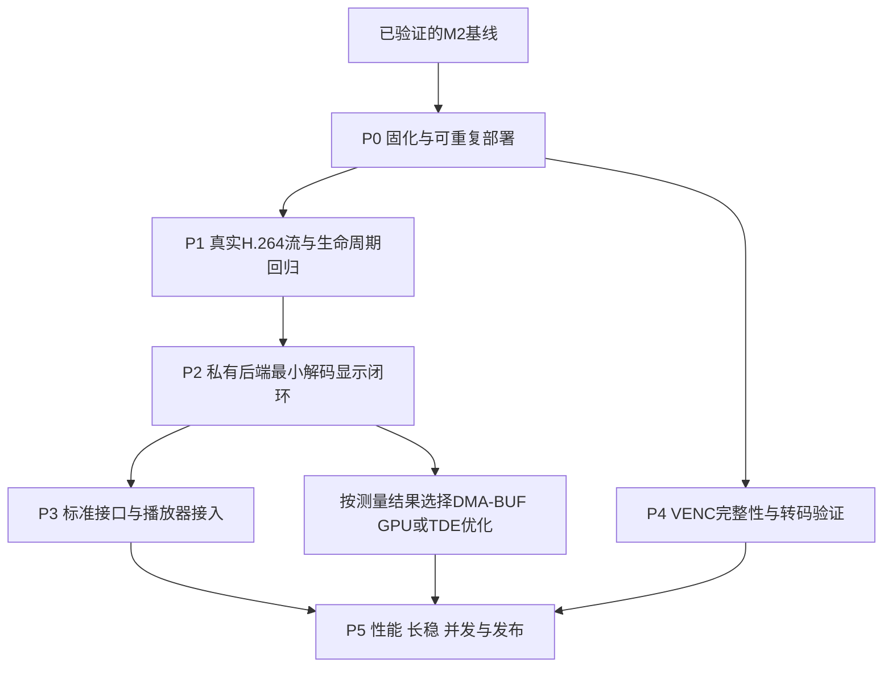

> **已被取代（2026-11-07）**：本文"现状/结论"部分已由 [2026-11-07 全面更新版](HARDWARE-ACCELERATION-STATUS-ROADMAP-2026-11-07.md) 取代；旧文保留用于追溯历史判断与当时的证据边界。

# Hi3798MV300 硬件加速现状与后续路线图

日期：2026-11-06 23:08（Asia/Shanghai）  
目标平台：Hi3798MV300 / AArch64 / mainline Linux 7.3 / Ubuntu 26.04.1

## 2026-11-06 23:22 验收目标更新

用户要求按HiVXE2.0规格书逐项验收。后续编解码验收以[规格验收矩阵](CODEC-SPEC-ACCEPTANCE-2026-11-06.md)为准，覆盖HEVC 4K60、H264/MVC 4K30、各协议1080p60、JPEG/PNG 64MP、MJPEG1080@40以及HEVC/H264单路1080p30编码和码控。本文下方1080p25等建议阶段目标不能替代规格门槛；此前M1/M2/M4功能通过仍保留，但不表示完整规格已通过。

## 1. 当前结论

**JPEG硬解、H.264硬解和H.264硬编码都已有板端功能证据；下一阶段的重点是固化驱动、扩展正确性和稳定性验证，并接入实际播放器。整个硬件加速产品链路尚未完成。**

本次总结基于现有交接记录及本会话M2实测。M1、M4、GPU、显示状态引用历史证据，本次没有重新测试这些模块。后续阶段及验收数量是建议目标，不是已经完成的结果或工期承诺。

| 模块 | 当前状态 | 已建立的证据 | 尚不能据此宣称 |
|---|---|---|---|
| M1 JPEG硬解 | 历史功能验收通过 | 1080p单帧5.3ms，约189fps等效速率，PSNR 66.16dB | 多尺寸/多格式覆盖、持续吞吐、与其他加速器并发均通过 |
| M2 VDEC H.264 | **当前阶段正确性验收通过** | 同一640×360码流两次50/50帧NV21逐字节一致、PTS 0..49完整；其中一次为最终模块独立fresh boot | 任意H.264流、1080p30/4K实时播放、长期稳定、多通道均通过 |
| M3 播放器/标准接口 | 尚未实现，已有条件启动 | 私有MPI/ioctl可输出正确帧；历史DRM/KMS显示已可用 | mpv/GStreamer/浏览器已经自动使用VDEC硬解 |
| M4 VENC H.264 | 历史功能验收通过，完整性仍需收尾 | High Profile 320×240码流可被FFmpeg正常解码；IDR/P帧正常；300帧测试无oops | 输入输出帧严格一一对应、1080p编码性能或码控质量达标 |
| M5 GPU/TDE | GPU基础可用；TDE及调压工作未完成 | 历史lima/Mali450简单GL场景可用，默认桌面用pixman保持稳定 | 重负载GPU稳定、视频零拷贝显示或TDE转换可用 |

M4需特别区分“取流次数”和“编码帧数”：历史记录为300帧输入、309次取流、软件解码299帧；60帧输入、61次取流、解码59帧。码流包可能不等于完整帧，但少一帧的原因仍应通过EOS/drain及输入帧标识闭环验证，不能写成无丢帧。

证据来源：[M1历史总报告](p4-hardware-acceleration-final-report-2026-11-04.md)、[M4最终修复与回归记录](artifacts/venc-reverse/README.md)、[M2本次验收](artifacts/venc-reverse/m2-diag/round51-downmsg-fix-acceptance-20261106.md)、[系统历史状态](STATUS.md)。旧总报告中的M2/M4阻塞结论已被后续记录覆盖。

## 2. M2这次解决了什么

### 2.1 根因与修正链

当前移植将厂商`Map`和`MapCache`合并为默认WB映射，破坏了原厂uncached/WC映射隐含的CPU/设备交接契约。已经验证的修正包括：

| 交接点 | 已实施处理 | 作用及限制 |
|---|---|---|
| CPU→VDH picture/slice消息 | 启动前clean | 已显著改善解码；现有补偿仍有特定消息布局假设，泛化需单独审计 |
| SCD→CPU segment载荷 | 设备写后IVAC | 消除CPU读旧缓存导致的错误起始码/参数解析 |
| VDH→CPU输出帧 | 正确换算stride，按有效平面范围失效缓存 | 修复旧flush长度越界而被guard跳过的问题 |
| **CPU→SCD DownMsg描述符** | **启动前对合法描述符链执行`dc cvac`，随后`dsb sy`** | **本次消除旧packet尾部重读、2136字节长PPS及non-live伪边界的关键修复** |

最后一项的因果证据来自同模块、同启动、只切换一个开关的实验：

| `m2_sync_downmsg` | 关闭 | 开启 | 关闭 | 开启 |
|---|---:|---:|---:|---:|
| 输入AU数 | 3 | 3 | 3 | 3 |
| 输出帧数 | 1 | 3 | 1 | 3 |
| non-live边界事件 | 4 | 0 | 4 | 0 |
| PPS长度 | 异常2136 | 正常7 | 异常2136 | 正常7 |

之后两次全序列均为50/50像素与PTS正确。修复没有截短segment、改变AU分组或修改parser，也没有为了绕过问题丢弃所有跨packet NAL。

### 2.2 当前可复现基线

- 代码：独立`/home/jason/bringup-7.3/port/vdec-m2diag-r2`（诊断仓库），分支`m2/scd-sync-r4`，提交`caea912`。
- [修复补丁](artifacts/venc-reverse/m2-diag/round51/caea912-scd-downmsg.patch)。正式移植目录尚未覆盖。
- 最终板端模块路径：`/root/m2/hi_vdec_downmsg_r51_final.ko`。
- 模块SHA256：`06d6ed62f3babd0b9a63764873ea0f510615a387eeb52e1badce5b4a4f848885`。
- [最终逐帧报告](artifacts/venc-reverse/m2-diag/round51/r51-final-full-report.json)与[板端配置快照](artifacts/venc-reverse/m2-diag/round51/r51-final-state.txt)。
- `/home/jason/bringup-7.3/out/deploy-m2-r51.tgz`（部署包）含模块、测试流和补丁；**不含测试程序**，当前复现使用板上已有的`vdec_verify_deferred_r27`。
- `/home/jason/bringup-7.3/out/m2-r51-acceptance.tgz`（完整验收归档）含两次50帧数据、软件参考和报告。

验证时参数如下。`m2_sync_downmsg`当前代码默认关闭，重新加载必须显式开启；不能把实验开关遗漏当作新的解码故障。

```text
m2_sync_msgs=1
m2_sync_scd=1
m2_sync_downmsg=1
m2_record=0
vdec_scd_wc=0
vdec_flush_put=1
vdec_flush_frame=2
```

完整加载和验证命令见[M2验收说明](artifacts/venc-reverse/m2-diag/round51-downmsg-fix-acceptance-20261106.md)。模块卸载曾有异常，当前换模块仍采用重启后加载。新方案没有证明该生命周期问题已修复。

### 2.3 Android参考源码的定位

提供的Android树确实含有SCD生成汇编、OSAL和MMZ实现，旧“只有资料、没有源码”的概括已撤回。可作为映射语义、ABI和控制流对照。

但Android与Linux SDK结构体及实现版本存在差异，尚未证明该Android树与板上原厂二进制完全同版本。因此应逐函数/字段核对，不能整份替换汇编；原厂4K HEVC性能也不能当作当前Linux移植的性能成绩。

## 3. 推荐推进顺序



优先级按依赖而不是里程碑编号排列。M4收尾可与播放器开发并行；共享板卡时需串行安排模块切换和性能测试，避免相互干扰。M5应由实际瓶颈驱动，不作为M3起步的必要条件。

## 4. 分阶段路线图与验收门槛

### P0：把诊断成果固化为可重复部署版本——立即优先

**目的：**让当前正确性不依赖某个会话、临时文件或手工记住开关。

工作：

1. 对比诊断仓库与正式VDEC移植目录，列出完整差异。`caea912`依赖已有hook及前序补偿，不能只搬这一笔提交便假定等价。
2. 将已验证的消息/载荷/帧同步抽成明确的CPU与设备所有权交接点；保留A/B能力，但为已支持配置设定正确的正常启动行为。
3. 归档模块、匹配用户态验证器、测试流、参考帧、构建环境、配置、校验值及一条命令的验收入口。
4. 固化安全的启动、诊断关闭、失败回滚流程；先保留重启换模块的已知可用方法。
5. 清理会干扰时序的常开打印及过时探针，分步验证；不同时重写MMZ映射方案。

交付：可构建版本、完整部署包、配置清单、自动验收报告。

**建议完成门槛：**干净构建、3次独立启动，各完成50/50像素和PTS验收；仅靠交付包即可复现，不依赖未打包的板端旧测试程序。

### P1：扩展H.264覆盖并修复生命周期——播放器基础

**目的：**从当前以IDR为主的固定样例走向实际视频流。

工作：

- 样例矩阵：IDR/P/B帧、长GOP、多参考帧、多slice、CABAC/CAVLC、720p/1080p；逐项记录支持范围。
- 边界矩阵：合法跨packet NAL、不同送流分块、环绕、EOS/drain、PTS重排序、短流、分辨率变化。
- 生命周期：反复open/start/stop/close，异常退出、超时恢复、内存释放；独立处理已知卸载问题。
- 对每个已支持样例验证全帧像素、显示顺序、PTS和数量。对有B帧的流使用显式参考PTS，扩展现有“PTS等于帧序号”的验证器假设。
- 在正确性通过后分离测量解码、拷贝、落盘耗时。当前测试程序含等待和抓帧，日志fps不能作为硬解吞吐。

交付：带能力标签的测试集、自动回归工具、限制清单、生命周期修复。

**建议完成门槛：**所有声明支持的样例全序列通过；至少100次通道创建/销毁无故障及持续泄漏；1080p30解码达到持续输入速率且无非预期丢帧。未通过的格式明确拒绝或标为未支持。

### P2：先打通最小解码→显示闭环——让正确帧显示出来

**推荐方案：**先用现有MPI/ioctl后端做专用最小播放器，将输入、帧生命周期、显示和PTS同步分开验证。初期允许拷贝，以尽快建立正确基线。

工作：

1. 明确输入封装和码流转换责任，先支持本地H.264 ES，再增加容器demux。
2. 探测DRM plane格式及stride要求，验证NV21是否可直接显示；不支持时明确增加格式转换。
3. 在显示消费完成后释放解码帧，处理背压和buffer复用，记录每个帧的生产/提交/释放时间。
4. 实现启动、暂停、停止、EOS、seek后flush等基本状态机；逐步接入音频时钟。
5. 保留独立文件采集模式，区分解码错误与显示格式/同步错误。

交付：可运行的最小硬解播放器、延迟/丢帧统计及显示路径说明。

**建议完成门槛：**目标1080p30样例持续播放30分钟，无花屏、冻结和非预期丢帧，PTS调度及停止重启行为正确。HDMI音频属于历史未通事项；音视频同步验收须有可用音频输出，不能仅用视频画面代替。

### P3：标准接口与现有播放器集成——M3主要交付

**建议选择：**保留厂商有状态parser/解码核，优先评估V4L2 stateful mem2mem桥接。若近期目标仅为单个应用，也可先提供GStreamer元素或FFmpeg适配层，但这不等同完成V4L2。

| 路线 | 优点 | 需承担的工作 | 建议 |
|---|---|---|---|
| 私有MPI用户态适配 | 复用现有路径，较快接入单个应用 | 插件维护、应用耦合、标准工具覆盖有限 | 用于P2和快速应用验证 |
| V4L2 stateful mem2mem | 与现有VFMw有状态解析更契合，可对接通用生态 | buffer队列、format协商、source-change、EOS、时间戳、内存模型 | 推荐的长期接口候选 |
| V4L2 stateless Request API | 适合宿主维护编解码状态的架构 | 需要重新梳理控制参数、DPB及parser边界，改动大 | 当前不作为首选 |

内核桥接应封装可调用的VDEC后端操作，不在内核中模拟调用用户态私有ioctl。先定义后端接口和锁/回调/生命周期，再实现标准队列语义。

**建议完成门槛：**适用的`v4l2-compliance`检查通过或有逐项说明；至少一个实际播放器/框架确认走硬解，持续1080p30播放，CPU负载相对同流软解基线下降且画面/PTS正确。用执行日志或驱动计数确认硬解，不能只看播放器参数。

### P4：VENC收尾与解码→编码闭环——可并行

工作：

- 用逐帧ID/PTS追踪输入、码流包、完整编码帧和软件解码帧，查清300→299、60→59的尾帧差异。
- 修正EOS/drain与缓冲释放，覆盖IDR/P帧切换、GOP和码率配置。
- 扩展720p/1080p目标，测量实际吞吐、延迟、码率偏差和质量。
- 在M2/M4各自稳定后做解码→编码转码，先验证格式转换和帧生命周期，再优化共享缓冲。

**建议完成门槛：**例如1000帧输入可完整解码出1000帧且无错误，帧ID/PTS正确；目标分辨率下持续达到选定帧率（先评估1080p25），质量/码率按明确指标验收。H.264有损编码使用PSNR/SSIM等指标，不要求编码后像素与输入bit-exact。

### P5：性能、长稳、并发与发布

工作：

- 先量化瓶颈：送流、SCD、VDH、帧拷贝、格式转换、显示、VENC分别计时。
- 按收益引入DMA-BUF导入/导出、同步与引用生命周期；必要时评估TDE或GPU转换。零拷贝必须同时保证cache、格式和释放时机正确。
- 完整审计Map/MapCache及每类缓冲的cache ownership。逐类恢复合理映射或DMA同步语义，不使用“整片内存统一WC”替换当前可用基线。
- 做VDEC/VENC/JPEG与显示并发的内存带宽/容量、IRQ和分配压力测试。
- 核实温度/频率观测能力后再讨论GPU调压或提频；Mali重负载复位问题独立处理。

**建议完成门槛：**单链路8小时、综合负载24小时无oops、超时失控或持续内存增长；支持的操作序列可重复；版本、回滚和能力清单完整。更长soak在上述门槛通过后再安排。

HEVC/MPEG2/4K作为后续能力扩展：先使测试器显式配置编码类型和通道能力、核算MMZ容量，再逐项复用正确性与性能验收。原厂62–63fps HEVC记录只是硬件参考，不保证当前移植可直接达到。

## 5. 近期执行清单

| 顺序 | 下一项任务 | 验收产物 |
|---|---|---|
| 1 | 冻结并复验M2 `caea912`完整基线 | 完整部署包、3次fresh-boot报告、回滚步骤 |
| 2 | 形成正常驱动路径和诊断开关边界 | 与诊断版本等价的全帧报告、可审阅diff |
| 3 | 扩展H.264 P/B帧、多slice和1080p测试 | 每流像素/PTS/帧数报告、能力矩阵 |
| 4 | 通道生命周期与最小显示播放器 | 反复启停报告、可视播放和时间戳日志 |
| 5 | 决定并实现标准接口 | 后端接口设计、V4L2或框架接入验收 |
| 并行 | VENC尾帧与帧数闭环 | 输入/输出帧对应报告 |

每项完成后再扩大范围。当前应避免重复研究已经被可逆实验解决的M2伪边界、直接改parser、把帧数当像素验收、把原厂性能当移植性能，以及在诊断期间同时改多个内存/送流参数。

## 6. 工作方式与文档维护

- 每轮保留代码提交、模块hash、boot ID、全部参数、码流hash、运行日志和验证报告。
- 热路径使用有限内存快照，测试结束后输出；不在ISR中大量打印。
- 新的映射或同步方案必须保留可回退基线，并做单变量对照。
- 仓库内存在保留旧结论的历史文档；判断优先级为“带原始验收证据的最新结论”高于旧概览表。
- 本路线图只定义后续工作，不代表已经实施正式目录整合、开机持久部署、V4L2、播放器或零拷贝。

推荐入口：[M2状态摘要](M2-VDEC-STATUS-SUMMARY-2026-11-06.md)、[M2详细交接](HANDOFF-M2-vdec-2026-11-05.md)、[M4逆向及通过记录](artifacts/venc-reverse/README.md)、[硬件加速历史交接](HANDOFF-hardware-acceleration-2026-11-04.md)。
