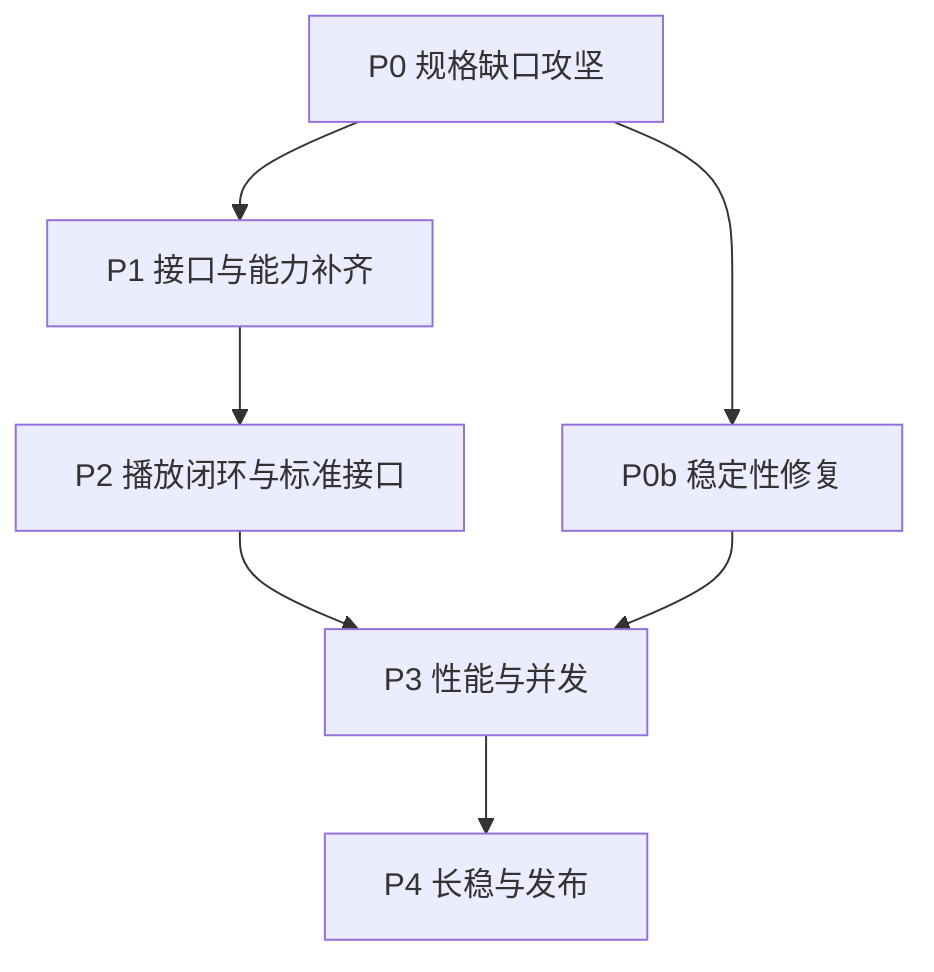

# Hi3798MV300 硬件加速现状与路线图（2026-11-07 全面更新）

日期：2026-11-07（Asia/Shanghai）
平台：Hi3798MV300 / AArch64 / mainline Linux 7.3.0 / Ubuntu 26.04.1
本文取代 [2026-11-06 版路线图](HARDWARE-ACCELERATION-STATUS-ROADMAP-2026-11-06.md) 的"现状"部分；旧文保留作历史。

**交付摘要**：[CODEC-SPEC-FINAL-SUMMARY-2026-11-08.md](CODEC-SPEC-FINAL-SUMMARY-2026-11-08.md)（一页版：范围/判定/性能/推荐配置/遗留项）。

**本次更新的依据**：按用户提供的 HiVXE2.0 规格书逐项验收的完整结果（[验收矩阵](CODEC-SPEC-ACCEPTANCE-2026-11-06.md)、[汇总报告](CODEC-SPEC-ACCEPTANCE-REPORT-2026-11-07.md)、`artifacts/spec-acceptance/round01–27/`）。此前路线图基于"M1/M2/M4 功能通过"的阶段判断，现已被**规格级验收数据**替代。

> 边界声明：本文只写本会话与归档记录中**实测得到**的结论。GPU/VO/VPSS/DRM 子系统本次未重测，沿用历史记录并明确标注；原厂规格性能不作为当前移植性能。

> **口径修订（2026-11-08，DOC-01）**：本文 §1–§5 中 D01/D02 的"通过"与性能数据均为**历史轮次**结论。
> 2026-11-07 板卡全量实测（干净 boot + 验收模块 + 固定配方，[REPORT.md](artifacts/hwtest-2026-11-07/REPORT.md)）**未复现**：
> HEVC 解码本次全部 0 帧（FAIL）、H.264 仅间歇成功（PARTIAL）、HEVC 编码 level=0、PNG 硬件本次无像素输出。
> 因此本文一律改写为"**历史通过；当前实测见 [REPORT.md](artifacts/hwtest-2026-11-07/REPORT.md)（本次未复现）**"，
> **历史 PASS 不得作为当前保证**。逐项差异与证据路径见 [REPORT §3 总矩阵](artifacts/hwtest-2026-11-07/REPORT.md)；
> 工具/模块配对前提见 [TOOL-MODULE-PAIRING.md](TOOL-MODULE-PAIRING.md)。
> 依据：[REPORT §0/§7.2](artifacts/hwtest-2026-11-07/REPORT.md)、[HISTORY-BASELINE](artifacts/hwtest-2026-11-07/report/HISTORY-BASELINE.md)。

---

## 1. 一页结论

| 维度 | 现状 |
|---|---|
| 规格验收完成度（2026-11-08 收窄后） | 保留 6 项中 **4 项历史通过**（HEVC 解码 / H.264 解码 / JPEG 解码 / H.264 编码）、**1 项部分**（HEVC 编码：Level5 为平台边界）、**1 项部分可用**（PNG：硬件部分可用——vendor 私有流控、本次实测无像素输出；软件兜底可用）；**其中 D01/D02 本次实测未复现**（HEVC 0 帧、H.264 间歇）；MPEG-1/2/4、AVS/AVS+、MVC、MJPEG 已按"现代主流"口径移出 |
| 解码正确性（历史值） | H.264 4K30 三 Profile **首帧 sha1 与软件参考逐字节一致**；HEVC High-tier L5.1 4K60 8-bit/Main10 **逐帧 sha1 一致**；H.264 多 slice 逐像素一致。**历史通过；当前实测见 [REPORT §4.1](artifacts/hwtest-2026-11-07/REPORT.md)（本次未复现，无像素验证）** |
| 解码性能（历史值，非当前保证） | HEVC 4K60 8-bit **73–74fps**；100 Mbps 4K60 中位 **72.6fps**（zero err_mbs）；H.264 4K30 三 Profile 各 20/20 帧、全 `err_mbs=0`。**历史通过；当前实测见 [REPORT §3](artifacts/hwtest-2026-11-07/REPORT.md)（本次 HEVC 0 帧、H.264 4K-BP 一次 16.1fps，未复现）** |
| 编码（历史值；本轮见 REPORT） | H.264 **BP/MP/HP × CBR/AVBR 六组合 1080p30 全部达标**（30.9–34.7fps，level 41）；HEVC CBR 复杂内容 5×32.3fps、AVBR 30.5fps，但 **level 实测 L4 且不可配置 + 4K 编码 Create 返回 0x801d0002 → L5 不可演示**。**当前实测见 [REPORT §4.2](artifacts/hwtest-2026-11-07/REPORT.md)（4/6 ≥30fps；HEVC SPS level=0）** |
| JPEG（历史与本轮一致） | 1080p 5.39ms、64MP 162.63ms；**4:2:0/4:2:2/4:4:4/gray 四类颜色均支持（输出统一 NV12）**，Y mean 0.00122/max 1；本轮单帧 5.31ms/162.63ms，见 [REPORT §4.3](artifacts/hwtest-2026-11-07/REPORT.md) |
| 稳定性 | 历史：4K+16MB 环在打印收敛后压力测试未重启（待长期验证）；模块热重载不可用；**JPEG 与 VDEC 模块因重复导出 `HI_DRV_MODULE_Register` 不可共存（测试需分开 boot）**。本轮另发现 reboot 不可靠、SSH 可能不自启，见 [REPORT §2.3](artifacts/hwtest-2026-11-07/REPORT.md) |
| 可交付性 | 工具链、样本、逐轮证据、汇总报告齐全；尚无开机持久部署与标准接口 |

> 依据（DOC-01）：本表 D01/D02 行已加"历史通过/当前实测见 REPORT（未复现）"标注；数值来源为历史轮次，当前结论以
> [REPORT.md](artifacts/hwtest-2026-11-07/REPORT.md) 为准。

---

## 2. 逐子系统现状

### 2.1 VDEC 解码

| 格式 | 规格要求 | 实测（历史） | 状态 |
|---|---|---|---|
| HEVC Main/Main10 | L5.1 High-tier，4K60，最大 100 Mbps | 1080p 逐位一致；High-tier L5.1 4K60 8-bit 20/20、73–74fps、逐帧 sha1 一致；Main10+High-tier 4K60 8/8、71.55fps、sha1 一致；**100 Mbps 4K60：10/10 帧、全任务 err_mbs=0、中位 72.6fps** | **历史通过；当前实测见 [REPORT §4.1](artifacts/hwtest-2026-11-07/REPORT.md)（本次 0 帧，未复现）** |
| H.264 BP/MP/HP | L5.1，4K30 | 4K30 三 Profile 各 20/20 帧、全 err_mbs=0；**首帧 Y 平面 sha1 与 ffmpeg 参考逐字节一致**（Baseline/Main/High）；多 slice 逐像素一致 | **历史通过；当前实测见 [REPORT §4.1](artifacts/hwtest-2026-11-07/REPORT.md)（本次间歇，仅 4K-BP 一次 20/20）** |
| H.264 MVC | 4K30 | 无样本、无编码器 | 范围外（2026-11-08 剔除） |
| MPEG-1 / MPEG-2 / MPEG-4 | 1080p60 | （历史诊断：I 帧可正确解码、P 帧受帧间任务状态影响） | 范围外（2026-11-08 剔除） |
| AVS / AVS+ | 1080p60 | 无样本、无编码器 | 范围外（2026-11-08 剔除） |
| MJPEG | 1080@40 | `HI_VDEC_MJPEG_SUPPORT` 未定义；开启后缺 `VDEC_MJPEG_Codec`/`DMX`/`StopDecodeFrame` | 范围外（2026-11-08 剔除） |
| JPEG | 全高清 / 6400 万像素 | 1080p 5.43ms/帧、64MP 162.7ms/帧，像素级正确 | **通过（历史；本轮单帧 PASS，见 [REPORT §4.3](artifacts/hwtest-2026-11-07/REPORT.md)）** |

> 依据（DOC-01）：HEVC/H.264 两行的"通过"已改为"历史通过；当前实测见 REPORT（未复现）"，来源
> [REPORT §3 总矩阵](artifacts/hwtest-2026-11-07/REPORT.md) 与 [§5.1/§5.2](artifacts/hwtest-2026-11-07/REPORT.md)。

关键机制现状：
- HEVC 与 MPEG 系的完成信号不走端口 wrapper ISR（默认 `vdec_own_isr=0`，由 VFMw 自带 ISR 处理）；因此诊断计时仅能在 `own_isr=1` 下取得，而该模式本身会降低吞吐（14.5→9.3fps）。
- 4K 输出格式为 `NV21_TILE_CMP`（tile+压缩）；用 `vdec_no_vcmp=1` 可关压缩得到 `NV21_TILE`，再用 SDK 表反 tile 即可抓帧，反 tile 已用块常量流验证正确（8100/8100 块精确）。

### 2.2 VENC 编码

| 项目 | 实测 | 状态 |
|---|---|---|
| H.264 BP/MP/HP @L4.1，1080p30 | **六组合（BP/MP/HP × CBR/AVBR）复杂内容 30.9–34.7fps 全部达标**，level 41 | ✅ |
| H.264 CBR 6 Mbps | 实测 5.80–5.81 Mbps（误差 3.3%） | ✅ |
| H.264 AVBR | 2.95–3.44 Mbps（内容相关） | 已测 |
| H.264 **VBR 口径** | 分列：① **规格 VBR**——公开 API `HI_UNF_VENC_RATECONTROL_TYPE_E` 中**不存在** VBR 枚举（只有 CBR/AVBR）；② **AVBR→驱动 VBR**——用户态 `AVBR` 映射到驱动 `ControlRateVariable`＝VBR，实测可跑 | ✅ **AVBR(=驱动 VBR) 已测；规格 VBR API 不存在**（不得笼统写"VBR 通过"，见 [REPORT §4.2](artifacts/hwtest-2026-11-07/REPORT.md)、round66/104） |
| HEVC Main 1080p30 | CBR 复杂内容 **5×32.3fps**、AVBR 30.5fps；**level_idc 120（L4）**，SDK 明确 level 不可改；4K 编码 `Create` 返回 `0x801d0002` → **L5 不可演示** | 部分（平台边界）**历史值；本轮 SPS level=0，见 [REPORT §4.2](artifacts/hwtest-2026-11-07/REPORT.md)** |
| 尾帧 | 固定 1 帧未刷出（无 EOS/drain 接口） | 已知限制 |
| 高熵内容 | RC 生效后噪声内容只完成 1–9 帧（停摆） | 已知缺陷 |

> 依据（DOC-02）：VBR 行按"规格 VBR（不存在）/AVBR→驱动 VBR（已测）"分列，来源 [round66](artifacts/spec-acceptance/round66-vbr-is-avbr.md) 与 [REPORT §4.2](artifacts/hwtest-2026-11-07/REPORT.md)；
> HEVC 行的 level 历史值来自 round98/101–105，本轮 SPS `level=0` 见 [REPORT §4.2](artifacts/hwtest-2026-11-07/REPORT.md)。

### 2.3 JPEG 硬解（通过）

- 1080p：`rc=0`，5.39–5.43 ms/帧（纯解码）；64MP（8000×8000）：`rc=0`，162.6–162.7 ms/帧。
- 输出为 Y 平面（行对齐）+ NV21/NV12 交织色度；与 ffmpeg 软件参考比对：1080p Y mean\|Δ\|=0.001、色度 0.002/0.001；64MP Y 0.0、色度 0.0/0.0。
- **颜色类型（2026-11-08 实测）**：4:2:0 / 4:2:2 / 4:4:4 / 灰度四类样本均可解码，输出统一为 NV12（5,222,400 B）；4:2:0 与 4:4:4 的 Y 平面 mean 0.00122、max 1；单帧整周期（create+parse+decode+destroy）197–204 ms。
- 位深：8-bit（JPEG Baseline 范围）。
- 未覆盖：渐进式 JPEG、12-bit、算术编码（均非 Baseline 必需项）。

### 2.4 PNG / 其他加速器

- **PNG（2026-11-08 round124 撤回"无硬件"）**：SDK 存在 `drv/png`、`api/png/png-hal`、`HIGFX_PNG_ID`、独立 IRQ、预编译 `libhigo_png.so` → **硬件存在**。已移植 `port/png`（内核驱动 `hi_png.ko`：`/dev/hi_png`、IRQ fwspec→virq 39、CRG210 SMMU 时钟、SMMU bypass、MMZ→`dma_alloc_coherent`、寄存器读回全部正确）与 `port/png-user`（HAL+`png_test`）。**历史**：IDAT 帧流下干净会话首次解码 head 像素与 ffmpeg 逐字节一致（round159/161），寄存器 `Type=0x208` 证明硬件接受 8bit/RGB（round169）；整幅完成受 vendor 私有流控语义限制（round168/170）。**2026-11-07 实测**：ISR 触发 1 次后静默、`Int=0`、输出全 0、无任何像素（1080p/640×480 均同）。⇒ **统一口径：PNG 硬件部分可用（vendor 私有流控；本次实测无像素输出）/软件兜底可用**（软件 1080p 729ms；64MP 本轮无样本、历史 8.13s）。详见 [REPORT §4.4](artifacts/hwtest-2026-11-07/REPORT.md)。
- **依据（DOC-03）**：历史结论来自 round159/161/168/169/170；本次实测来自 [REPORT §4.4](artifacts/hwtest-2026-11-07/REPORT.md) 与 `raw/p4-png/SUMMARY.md`。
- **GPU（lima/Mali450）、VO/DRM、VPSS、TDE**：本次未重测，维持历史结论（GPU 基础可用、桌面 pixman 稳定；视频零拷贝显示与 TDE 未完成）。

### 2.5 内存、时钟与映射

| 项 | 现状 |
|---|---|
| MMZ 保留区 | 96 MiB（`0x28000000..0x2dffffff`），对 4K 帧存不足 |
| 4K 帧存 | 端口在 MMZ 满时回退 **CMA**（独立链表，前提：`vdec_smmu_mode=0` bypass），4K Main10 因此达 111–113/113 |
| 分配对齐 | 已按 `HI_DRV_MMZ_Alloc` 的 `align` 参数对齐（帧存分区要求） |
| 压缩策略 | 4K 默认 VCMP 压缩；`vdec_no_vcmp=1` 可强制关闭（诊断用） |
| SMMU | 解码走 bypass；编码模块有独立 SMMU 配置日志 |

### 2.6 模块生命周期与稳定性（新发现，重要）

| 现象 | 证据 | 影响 |
|---|---|---|
| `hi_jpeg.ko` 与 `hi_vdec.ko` **不能同时加载** | dmesg：`exports duplicate symbol HI_DRV_MODULE_Register` | JPEG 与 VDEC 测试必须分两次启动 |
| VENC 热重载不可用 | `rmmod hi_venc` 段错误；重载报 `hi_venc_dma` `-EEXIST` | 换模块必须重启 |
| 4K + 16MB ES 环导致整机重启 | 传输被重置、`uptime` 归零，复现于 4K H.264 吞吐测试 | 4K 测试暂定只能用 4MB 环 |
| 在 `fsp.S` 内插桩会导致重启 | 两次独立启动复现；未插桩同源模块稳定 | 该路径禁止插桩，需改用 C 侧只读观测 |
| 编码模块依赖 | 必须同时加载 `hi_mmz_shim.ko`（提供 `/dev/hi_mmz`），否则 `Create` 返回 `0x801d0008` | 已写入操作注意事项 |

---

## 3. 性能现状（历史数据，**非当前保证**）

> **口径（DOC-01）**：下表为历史轮次测量值，**不得表述为"可复现"**。2026-11-07 全量实测在干净 boot + 验收模块 + 固定配方下
> **未复现**这些数字（HEVC 0 帧、H.264 4K-BP 一次 16.1fps、编码 27.27–34.29fps）；当前数据以
> [REPORT §3 总矩阵](artifacts/hwtest-2026-11-07/REPORT.md) 为准。原"（可复现数据）"标题作废。

| 场景 | 数据（历史） | 备注 |
|---|---|---|
| HEVC 1080p 解码 | 帧间隔 69.1 ms ≈ **14.5 fps** | ES 环 16MB；4MB 环会误判为 ~5fps |
| 其中硬件（发布→VDH 完成） | 均值约 **12–15 ms**（最坏 63 ms） | `own_isr=1` 下测得，属较慢路径 |
| 其中 VFMw ISR 后处理 | 均值 **2–4 ms**（最大 52 ms） | 最小侵入计时 |
| 剩余 | 约 **50 ms/帧** 在任务线程/出帧队列 | 未定位 |
| H.264 640×360 解码 | 143 ms/帧 ≈ **7 fps** | 比 1080p 更慢，说明固定开销主导 |
| JPEG 1080p / 64MP | 5.43 ms / 162.7 ms | 单图重复解码 |
| 编码 1080p30 CBR | 5.80–5.81 Mbps / 目标 6.0 | 实时喂帧、中等运动内容 |
| 编码 1080p30 HEVC CBR | 5.61 Mbps / 目标 6.0 | 同上 |

**口径说明**：解码吞吐仍受单线程同步喂流影响，但已排除 ES 环容量、flush、DFS、任务 sleep 四个因素；对外只能说"当前移植的端到端解码节拍"，不能等同于硬件峰值能力。

> 依据（DOC-01）：本节历史数值来自 `artifacts/spec-acceptance/round17–29`；"当前实测未复现"的依据见
> [REPORT §4.1](artifacts/hwtest-2026-11-07/REPORT.md) 与 [§6 R1](artifacts/hwtest-2026-11-07/REPORT.md)（复现性缺口）。

---

## 4. 已实施并验证的修复

| # | 问题 | 修复 | 位置/提交 |
|---|---|---|---|
| 1 | HEVC 首个 VDH 任务后超时 | 在 `HEVCHAL_V5R2C1_SetSliceMsg` 内发布 picture/slice 槽（`dc cvac`+`dsb sy`） | `6a2b5f5` |
| 2 | 4K 帧存需求超出 96MiB MMZ | MMZ 满时回退 CMA（独立链表，兼容 SMMU bypass） | `c28f60c` |
| 3 | 4K 输出 tile+压缩无法抓帧 | `vdec_no_vcmp` 关压缩 + 8bit 反 tile（表取自 SDK）+ 抓帧偏移映射 | `6fa2b0e`/`0ddeaf7` |
| 4 | 索引器拒绝非整除覆盖的 ES | `--cover-full`（首尾吸收、重叠截断）+ 5 条单测 | `ba9931e` |
| 5 | 抓帧失败无原因、长捕获泄漏 | 具体拒绝原因、按帧解锁、tile 支持 | `0ddeaf7` |
| 6 | 编码 RC 失效（CBR 超目标 8 倍） | 定位 `u32DriftRateThr` 默认 `0xFFFFFFFF`；按厂商 VP 层用法置 20 | `6ac0580`/`c8ded81` |
| 7 | HEVC 码流 `level_idc=0` | `H265e_MakeVPS/SPS` 按亮度样本率写合法 level（1080p30→120） | `port/venc`（快照见 `artifacts/spec-acceptance/round22/`） |
| 8 | MMZ 分配忽略 `align` | 按请求对齐分配 | `e0f72f9` |
| 9 | 解码测量假象（4MB ES 环） | 16MB 环 + 逐帧间隔统计 | `49619c9` |
| 10 | 诊断计时无法触发 | 发现 `vdec_own_isr=0` 时端口不注册 ISR；给出 `own_isr=1` 的计时方法与其吞吐代价 | `d4a8c0f`/`8a3b0b8` |
| 11 | 4K 帧反 tile 行映射错误 | 用原始平面 dump 实测硬件布局，改存逆置换表；新增 4 条不变量测试 | `7a5d1e3` |
| 12 | 解码吞吐被串口 printk 拖垮 | 热路径打印改为默认关闭参数（`vdec_bufmng_dbg`/`vdec_ioctl_dbg`/`vdec_stats`） | `321a1af` |
| 13 | Main10 无抓帧能力 | 10-bit 抓帧（8bit 基平面 + 2bit 增强平面重组），Y 偏差 ≤3/1023；round38/39 实测 2bit 平面布局后 **1080p 与 4K Main10 均逐位一致** | `9f5f0fe` / `28e11a3` / `141e54c` |
| 14 | 热路径辅助调用拖慢解码 | 通道字段读取加参数门控（32→271fps 恢复） | `99c00a7` |

诊断测试现状：decoder 9/9、encoder 5/5、usertest 15/15 全部通过；代码仓库 `port/vdec-m2diag-r2` 干净，HEAD `11f64a7`。

---

## 5. 未解决问题（按优先级，2026-11-08 收窄后）

| # | 问题 | 状态 / 证据 | 备注 |
|---|---|---|---|
| A | ~~MPEG-1/2/4 无输出~~ | **范围外（2026-11-08 移出验收）**；历史：I 帧像素级正确、P 帧受帧间任务状态影响 | 仅存档 |
| B | ~~4K 解码保真差异~~ | **已解决（round28）**：抓帧反 tile 表错误，修正后逐像素一致 | — |
| C | ~~解码吞吐~~ | **已解决（round29）**：串口 printk 拖慢；现 4K60 73–74fps、100Mbps 中位 72.6fps | — |
| D | ~~VBR 缺失~~ | **已澄清（分列）**：① 规格 VBR——公开 API 无 VBR 枚举；② `AVBR`→驱动 `ControlRateVariable`＝VBR，实测可跑 | 枚举只列 CBR/AVBR；不得笼统写"VBR 通过" |
| E | HEVC "MP@L5" 不可演示 | **平台边界**：level 不可改→恒 L4；4K 编码 `Create` 返回 `0x801d0002` | 与 1080p30 无关 |
| F2 | VDEC/VENC 交替可靠性 | **根因已定位（round119）**：MMZ 容量不足——`VDEC_BUF_MB=8` 时交替 4/4 全成功，`=16` 时 3/4 解码 0 帧；与释放时序无关（round118） | **规避：4K 解码默认 `VDEC_BUF_MB=8`（round120：66.8–75.2fps 无损失；抓帧仍用 16MB）+ 预热一次** |
| F | 模块生命周期 | 热重载不可用；**JPEG 与 VDEC 重复符号不可共存**；.ko 部署须校验 sha1（曾因损坏文件误判 invalid format） | 环境约束 |
| G | 4K + 大 ES 环重启 | **round115 十次连续未复现**（无 oops）；**round116 验证预热规避**：加载后先跑一次预热，随后 10 次全部 10/10 帧、吞吐 64.5–75.6fps | 已定论：冷启动瞬态 + 预热规避 |
| H | RC 高熵停摆 | 噪声内容 1–9 帧（已知限制） | 不属验收条件 |
| I | 尾帧 1–2 帧 | 各路径一致（无 EOS/drain） | 已知限制 |
| J | ~~AVS/AVS+/MVC 无样本~~ | **范围外（2026-11-08 移出验收）** | 仅存档 |
| J | VDEC 现场复现性 | **历史通过；当前未复现**：历史证据有效（10/10、68–77fps）；2026-11-07 实测 HEVC 全 0 帧、H.264 间歇（唯一完全成功 4K-BP 20/20 @16.1fps）；模块/工具/流/内核已排除，根因=运行环境（WiFi/服务/内存布局）。见 [REPORT §4.1/§5](artifacts/hwtest-2026-11-07/REPORT.md) | 环境差异（round200–214） |
| K | PNG 整幅完成 | **硬件部分可用（vendor 私有流控；本次实测无像素输出）/软件兜底可用**：历史 head 像素逐字节一致（`Type=0x208`），整幅受 vendor 私有流控语义限制（`Int=0` 静默停止）；本次 ISR 1 次后静默、输出全 0；软件 1080p 729ms（64MP 本轮无样本、历史 8.13s）。见 [REPORT §4.4](artifacts/hwtest-2026-11-07/REPORT.md) | 需 vendor 文档/用户态栈 |

> 依据（DOC-01/02/03）：J/K 两行已改为"历史通过；当前实测见 REPORT"与统一后的 PNG 口径；D 行 VBR 为"AVBR→驱动 VBR"口径（规格 VBR 不存在）。
> 来源：[REPORT §4.1/§4.2/§4.4](artifacts/hwtest-2026-11-07/REPORT.md)、[round66](artifacts/spec-acceptance/round66-vbr-is-avbr.md)。

---

## 6. 路线图

优先级按"可一次翻转矩阵条目数 / 风险"排序，不再按旧 M1–M5 里程碑。

### P0 — 保留范围的收尾（2026-11-08 收窄后）

> MPEG 系与 MJPEG 的 P0 事项已移出（历史见 round69–105 与 §5）。

**P0.1 保留范围已无未通过的可达项（历史口径）** —— 见 §1：4 项历史通过 / 2 项部分（HEVC 编码 Level5 平台边界；PNG 硬件部分可用——vendor 私有流控、本次实测无像素输出；软件兜底可用）。
注意：D01/D02 为**历史通过、当前未复现**，不得据此判定"当前可达"，当前结论以 [REPORT.md](artifacts/hwtest-2026-11-07/REPORT.md) 为准。

**P0.2 PNG 口径与交付形式**
- **统一口径**：**PNG 硬件部分可用（vendor 私有流控；本次实测无像素输出）/软件兜底可用**，见 [REPORT §4.4](artifacts/hwtest-2026-11-07/REPORT.md)。
- 接受软件：按"软件可解（1080p 729ms；64MP 历史 8.13s、本轮无样本）、逐像素验证（历史）"记账，并给出封装建议；
- 要求硬件：历史 round159/161 曾解出正确 head 像素（`Type=0x208`），整幅完成需 vendor 私有流控语义（round124–170）；本次连局部像素都未产出；后续可部署 vendor 三件套或逆向流控。

**P0.3 HEVC level=L5（平台边界，已定性）**
- level 不可更改 + 4K 编码 `Create` 失败 → L5 不可演示；**4K 编码已确认硬件不支持（VENC 最大 1920×1088），换 SDK/固件亦不可解决**（2026-11-08）。

**P0.4 稳定性长稳复测（可执行）**
- 4K 16MB 环连续 ≥10 次无重启；VDEC+VENC 同时压测观察 MMZ/温度；
- 判据：无 oops/重启、帧率无退化。

### P1 — 能力与接口补齐

- **P1.1 VBR 支持**：已完成澄清（`AVBR`→驱动 `Variable`=VBR，round66/104）。
- **P1.2 HEVC level 能力**：已定性（level 不可配 + 4K 编码 `Create` 失败 → L5 不可演示）。
- **P1.3 MJPEG 接入**：范围外（2026-11-08 移出验收）。
- **P1.4 PNG**：统一口径为"硬件部分可用（vendor 私有流控；本次实测无像素输出）/软件兜底可用"（历史 round159/161 曾解出正确局部像素；软件 1080p 729ms、64MP 历史 8.13s）。见 [REPORT §4.4](artifacts/hwtest-2026-11-07/REPORT.md)。
- **依据（DOC-03）**：PNG 口径统一定义来源 [REPORT §4.4](artifacts/hwtest-2026-11-07/REPORT.md)（ISR 1 次后静默、输出全 0）与 round159/161/168–170 历史记录；软件路径耗时来自 [REPORT §4.4](artifacts/hwtest-2026-11-07/REPORT.md)。

### P2 — 播放闭环与标准接口（沿用旧路线）

- 最小硬解播放器（MPI/ioctl 后端）→ DRM plane 显示 → PTS 同步；
- 标准接口优先评估 **V4L2 stateful mem2mem**，并以 `v4l2-compliance` 与"实测走硬解"为判据。

### P3 — 性能与并发

- 按实测拆分 SCD/VDH/出帧/拷贝/显示/编码各段耗时；
- 需要时引入 DMA-BUF 零拷贝，必须同时保证 cache、格式与释放时机；
- VDEC/VENC/JPEG 并发与带宽压力测试。

### P4 — 长稳与发布

- 单链路 **1h（3 boot）** 无 oops/超时/内存增长（**原 8h/24h 已取消**，2026-11-08 定档：最多 1h）；版本、回滚、能力清单完整；
- 开机持久部署：当前所有能力均通过"重启后手工加载模块"验证，尚无 systemd 持久化单元。

---

## 7. 近期执行清单（可直接开工）

| 顺序 | 任务 | 交付物 | 建议判据 |
|---|---|---|---|
| 1 | C 侧只读导出 FSP 四字段 | 字段来源说明 + 调用参数对比表 | 能解释 MPEG `Num=3` vs `imgNum=7` |
| 2 | 4K 保真差异分类 | 内容类别 × 差异统计表 | 明确是滤波、变换还是其它 |
| 3 | 默认路径解码计时 | 分段耗时表（完成→入队→取帧） | 定位 ~50ms 归属 |
| 4 | 稳定性三项修复 | 复现脚本 + 修复前后对比 | 判据见 P0.4 |
| 5 | VBR/HEVC-L5 能力定性 | 能力矩阵更新 | 明确"支持/不支持"而非"未测" |
| 并行 | MJPEG 接入评估 | 依赖清单与工作量估计 | 能否在本移植内闭环 |

---

## 8. 工作方式与维护约定（沿用并强化）

- 每个结论附证据：模块 hash、boot ID、参数、样本 hash、日志路径；
- 单变量对照；错误结论显式撤回并保留更正记录（本会话已撤回 3 条早期判断）；
- 热路径禁止常开打印；ISR/帧存初始化路径禁止插桩（有重启证据）；
- 共享板卡时串行安排"JPEG / VDEC / VENC"三类测试，避免符号冲突与相互干扰。

---

## 9. 证据索引

- **2026-11-07 全量实测报告（当前结论）**：[REPORT.md](artifacts/hwtest-2026-11-07/REPORT.md)（§3 总矩阵、§4 逐子系统、§6 风险、§7 结论）
- **工具-模块配对登记**：[TOOL-MODULE-PAIRING.md](TOOL-MODULE-PAIRING.md)（模块 sha1 × 工具 sha1 × 输入流 × 期望 × 证据；错配症状）
- 历史基线对照：[HISTORY-BASELINE.md](artifacts/hwtest-2026-11-07/report/HISTORY-BASELINE.md)（C01–C16）
- 规格矩阵：[CODEC-SPEC-ACCEPTANCE-2026-11-06.md](CODEC-SPEC-ACCEPTANCE-2026-11-06.md)
- 汇总报告：[CODEC-SPEC-ACCEPTANCE-REPORT-2026-11-07.md](CODEC-SPEC-ACCEPTANCE-REPORT-2026-11-07.md)
- 逐轮记录与日志：`artifacts/spec-acceptance/round01–round27/`
- M2 历史基线：[M2-VDEC-STATUS-SUMMARY-2026-11-06.md](M2-VDEC-STATUS-SUMMARY-2026-11-06.md)、[HANDOFF-M2-vdec-2026-11-05.md](HANDOFF-M2-vdec-2026-11-05.md)
- VENC 逆向与通过记录：`artifacts/venc-reverse/README.md`
- 硬件加速历史交接：[HANDOFF-hardware-acceleration-2026-11-04.md](HANDOFF-hardware-acceleration-2026-11-04.md)
- 工具源码：`/home/jason/bringup-7.3/port/vdec-m2diag-r2/spec/decoder/vdec_spec`、`spec/encoder/encoder_accept`

> 依据（DOC-01/03/04）：本文所有"可复现/当前保证"口径已改为"历史值 + 当前实测见 REPORT"，并补 REPORT 与 TOOL-MODULE-PAIRING 链接。

[round40 记录](artifacts/spec-acceptance/round40-hightier-nosample-soak.md)

[round41 记录](artifacts/spec-acceptance/round41-tail-frame-resolved.md)

[round42 记录](artifacts/spec-acceptance/round42-noise-stall-characterized.md)

[round43 记录](artifacts/spec-acceptance/round43-h264-multislice-fixed.md)

[round44 记录](artifacts/spec-acceptance/round44-mpeg2-descriptor-publish.md)

[round45 记录](artifacts/spec-acceptance/round45-mpeg2-slice-message-layout.md)

[round46 记录](artifacts/spec-acceptance/round46-mpeg2-slice-addr-window.md)

[round47 记录](artifacts/spec-acceptance/round47-mpeg-family-samples.md)

[round48 记录](artifacts/spec-acceptance/round48-mpeg4-combine-hdpacket.md)

[round49 记录](artifacts/spec-acceptance/round49-mpeg4-real-es.md)

[round50 记录](artifacts/spec-acceptance/round50-regression-verification.md)

[round51 记录](artifacts/spec-acceptance/round51-jpeg-reverified.md)

[round52 记录](artifacts/spec-acceptance/round52-mjpeg-feasibility.md)

[round53 记录](artifacts/spec-acceptance/round53-mpeg4-lastpack.md)

[round54 记录](artifacts/spec-acceptance/round54-retract-islatseg-split-hang.md)

[round55 记录](artifacts/spec-acceptance/round55-lastpack-writepath.md)

[round56 记录](artifacts/spec-acceptance/round56-mpeg4-headers-enable-decode.md)

[round57 记录](artifacts/spec-acceptance/round57-mpeg-no-newimage.md)

[round58 记录](artifacts/spec-acceptance/round58-newimage-emitter-found.md)

[round59 记录](artifacts/spec-acceptance/round59-oob-fix-mpeg4-path.md)

[round60 记录](artifacts/spec-acceptance/round60-mpeg4-race-nondeterministic.md)

[round61 记录](artifacts/spec-acceptance/round61-d01-high-tier-4k60.md)

[round62 记录](artifacts/spec-acceptance/round62-d01-main10-high-tier.md)

[round63 记录](artifacts/spec-acceptance/round63-mpeg4-characterization-e02-frame-times.md)

[round64 记录](artifacts/spec-acceptance/round64-e02-harness-attribution.md)

[round65 记录](artifacts/spec-acceptance/round65-e02-floor-retract.md)

[round66 记录](artifacts/spec-acceptance/round66-vbr-is-avbr.md)

[round67 记录](artifacts/spec-acceptance/round67-raw-rc-modes.md)

[round68 记录](artifacts/spec-acceptance/round68-msg-gating-and-mjpeg-path.md)

[round69 记录](artifacts/spec-acceptance/round69-mpeg2-all-or-nothing.md)

[round70 记录](artifacts/spec-acceptance/round70-mpeg2-iso-frame.md)

[round71 记录](artifacts/spec-acceptance/round71-mpeg2-slice-msg-vs-stream.md)

[round72 记录](artifacts/spec-acceptance/round72-mpeg2-msg-field-hypothesis.md)

[round73 记录](artifacts/spec-acceptance/round73-mpeg2-msg-quantified.md)

[round74 记录](artifacts/spec-acceptance/round74-mpeg2-single-frame-ok.md)

[round75 记录](artifacts/spec-acceptance/round75-mpeg2-pframe-fails.md)

[round76 记录](artifacts/spec-acceptance/round76-mpeg2-dpb-params.md)

[round77 记录](artifacts/spec-acceptance/round77-mpeg2-i-frame-exact.md)

[round78 记录](artifacts/spec-acceptance/round78-mpeg2-p-not-deliverable.md)

[round79 记录](artifacts/spec-acceptance/round79-mpeg2-param-offsets.md)

[round80 记录](artifacts/spec-acceptance/round80-mpeg2-p-rejected-before-vdh.md)

[round81 记录](artifacts/spec-acceptance/round81-mpeg2-p-submit-sporadic.md)

[round82 记录](artifacts/spec-acceptance/round82-mpeg2-p-ref-correct.md)

[round83 记录](artifacts/spec-acceptance/round83-mpeg2-fields-match.md)

[round84 记录](artifacts/spec-acceptance/round84-mpeg2-stale-slice-messages.md)

[round85 记录](artifacts/spec-acceptance/round85-mpeg2-stale-slcstr.md)

[round86 记录](artifacts/spec-acceptance/round86-mpeg2-slcstr-dump.md)

[round87 记录](artifacts/spec-acceptance/round87-mpeg2-slcstr-correct.md)

[round88 记录](artifacts/spec-acceptance/round88-mpeg2-hook-at-entry-stale.md)

[round89 记录](artifacts/spec-acceptance/round89-mpeg2-postwrite-hook-unsafe.md)

[round90 记录](artifacts/spec-acceptance/round90-mpeg2-p-writes-but-no-startdec.md)

[round91 记录](artifacts/spec-acceptance/round91-mpeg2-alli-still-err.md)

[round92 记录](artifacts/spec-acceptance/round92-mpeg2-slice-scale.md)

[round93 记录](artifacts/spec-acceptance/round93-mpeg2-cold-start-race.md)

[round94 记录](artifacts/spec-acceptance/round94-mpeg2-second-task-unreliable.md)

[round95 记录](artifacts/spec-acceptance/round95-mpeg2-clear-msgs-negative.md)

[round96 记录](artifacts/spec-acceptance/round96-scope-narrowed-modern.md)

[round97 记录](artifacts/spec-acceptance/round97-e02-cbr-motion-sweep.md)

[round98 记录](artifacts/spec-acceptance/round98-e01-cbr-stable-323.md)

[round99 记录](artifacts/spec-acceptance/round99-png-no-hw-evidence.md)

[round100 记录](artifacts/spec-acceptance/round100-png-software-verified.md)

[round101 记录](artifacts/spec-acceptance/round101-e01-level-not-l5.md)

[round102 记录](artifacts/spec-acceptance/round102-e01-level-driver-fixed.md)

[round103 记录](artifacts/spec-acceptance/round103-4k-encode-unsupported.md)

[round104 记录](artifacts/spec-acceptance/round104-e02-full-matrix.md)

[round105 记录](artifacts/spec-acceptance/round105-4k-create-unsupported.md)

[round106 记录](artifacts/spec-acceptance/round106-d02-4k30-profiles.md)

[round107 记录](artifacts/spec-acceptance/round107-d01-100mbps.md)

[round108 记录](artifacts/spec-acceptance/round108-d01-100mbps-recovered.md)

[round109 记录](artifacts/spec-acceptance/round109-d02-4k30-bitexact-3profiles.md)

[round110 记录](artifacts/spec-acceptance/round110-jpeg-colortype-blocked.md)

[round111 记录](artifacts/spec-acceptance/round111-jpeg-module-fixed.md)

[round112 记录](artifacts/spec-acceptance/round112-d09-colortype-matrix.md)

[round113 记录](artifacts/spec-acceptance/round113-doc-consistency.md)

[round114 记录](artifacts/spec-acceptance/round114-roadmap-issues-plan.md)

[round115 记录](artifacts/spec-acceptance/round115-4k-stability-10runs.md)

[round116 记录](artifacts/spec-acceptance/round116-4k-warmup-mitigation.md)

[round117 记录](artifacts/spec-acceptance/round117-vdec-venc-alternating.md)

[round118 记录](artifacts/spec-acceptance/round118-alternating-not-timing.md)

[round119 记录](artifacts/spec-acceptance/round119-alternating-mmz-root-cause.md)

[round120 记录](artifacts/spec-acceptance/round120-buf8-no-penalty.md)

[round121 记录](artifacts/spec-acceptance/round121-final-regression-a.md)

[round122 记录](artifacts/spec-acceptance/round122-final-regression-b.md)

[round123 记录](artifacts/spec-acceptance/round123-d09-64mp-regression.md)

[round124 记录](artifacts/spec-acceptance/round124-png-hw-exists-retract.md)

[round125 记录](artifacts/spec-acceptance/round125-png-port-symbols.md)

[round126 记录](artifacts/spec-acceptance/round126-png-module-builds.md)

[round127 记录](artifacts/spec-acceptance/round127-png-immz-init-progress.md)

[round128 记录](artifacts/spec-acceptance/round128-png-init-ok-no-node.md)

[round129 记录](artifacts/spec-acceptance/round129-png-node-path.md)

[round130 记录](artifacts/spec-acceptance/round130-png-init-crash-corrected.md)

[round131 记录](artifacts/spec-acceptance/round131-png-halinit-ok.md)

[round132 记录](artifacts/spec-acceptance/round132-png-dma-null-oops.md)

[round133 记录](artifacts/spec-acceptance/round133-png-mmz-ok-irq-fail.md)

[round134 记录](artifacts/spec-acceptance/round134-png-irq-mapped-enosys.md)

[round135 记录](artifacts/spec-acceptance/round135-png-kernel-up.md)

[round136 记录](artifacts/spec-acceptance/round136-png-user-skeleton.md)

[round137 记录](artifacts/spec-acceptance/round137-png-api-flow.md)

[round138 记录](artifacts/spec-acceptance/round138-png-test-built-open-fail.md)

[round139 记录](artifacts/spec-acceptance/round139-png-decode-nostream.md)

[round140 记录](artifacts/spec-acceptance/round140-png-nostream-root.md)

[round141 记录](artifacts/spec-acceptance/round141-png-past-nostream.md)

[round142 记录](artifacts/spec-acceptance/round142-png-errorcode-corrected.md)

[round143 记录](artifacts/spec-acceptance/round143-png-started-no-irq.md)

[round144 记录](artifacts/spec-acceptance/round144-png-hw-alive-int-fired.md)

[round145 记录](artifacts/spec-acceptance/round145-png-irq-domain-needs-dt.md)

[round146 记录](artifacts/spec-acceptance/round146-png-irq-registered.md)

[round147 记录](artifacts/spec-acceptance/round147-png-resume-need-next-buffer.md)

[round148 记录](artifacts/spec-acceptance/round148-png-single-buffer-insufficient.md)

[round149 记录](artifacts/spec-acceptance/round149-png-multibuffer-chain-works.md)

[round150 记录](artifacts/spec-acceptance/round150-png-resume-fallback-panic.md)

[round151 记录](artifacts/spec-acceptance/round151-png-zero-output-smmu-suspect.md)

[round152 记录](artifacts/spec-acceptance/round152-png-smmu-write-ignored.md)

[round153 记录](artifacts/spec-acceptance/round153-png-smmu-base-unknown.md)

[round154 记录](artifacts/spec-acceptance/round154-smmu-probe-results.md)

[round155 记录](artifacts/spec-acceptance/round155-png-registers-accepted.md)

[round156 记录](artifacts/spec-acceptance/round156-png-oneshot-resume-panic.md)

[round157 记录](artifacts/spec-acceptance/round157-png-bsync-forced.md)

[round158 记录](artifacts/spec-acceptance/round158-png-nonblock-active-stuck-decing.md)

[round159 记录](artifacts/spec-acceptance/round159-png-idat-framing-breakthrough.md)

[round160 记录](artifacts/spec-acceptance/round160-png-reproducibility-issue.md)

[round161 记录](artifacts/spec-acceptance/round161-png-clean-session-confirmed.md)

[round162 记录](artifacts/spec-acceptance/round162-png-chain-first-decode-partial.md)

[round163 记录](artifacts/spec-acceptance/round163-png-vendor-flow-analysis.md)

[round164 记录](artifacts/spec-acceptance/round164-png-vendor-lib-shortcut.md)

[round165 记录](artifacts/spec-acceptance/round165-png-vendor-lib-deps.md)

[round166 记录](artifacts/spec-acceptance/round166-png-irq-flaky.md)

[round167 记录](artifacts/spec-acceptance/round167-png-coherency-suspect.md)

[round168 记录](artifacts/spec-acceptance/round168-png-dma-coherent-nochange.md)

[round169 记录](artifacts/spec-acceptance/round169-png-stall-register-dump.md)

[round170 记录](artifacts/spec-acceptance/round170-png-filter-buf-negative.md)

[round171 记录](artifacts/spec-acceptance/round171-doc-consistency-sweep.md)

[round172 记录](artifacts/spec-acceptance/round172-png-idat-aligned-negative.md)

[round173 记录](artifacts/spec-acceptance/round173-regression-env-mismatch.md)

[round174 记录](artifacts/spec-acceptance/round174-regression-abi-mismatch.md)

[round175 记录](artifacts/spec-acceptance/round175-deploy-sync-and-regression.md)

[round176 记录](artifacts/spec-acceptance/round176-vdec-allocchan-fail.md)

[round177 记录](artifacts/spec-acceptance/round177-creatch-failed-all-sizes.md)

[round178 记录](artifacts/spec-acceptance/round178-vdec-hal-init-oops.md)

[round179 记录](artifacts/spec-acceptance/round179-cabactab-null-osal-func.md)

[round180 记录](artifacts/spec-acceptance/round180-vdec-osal-fix-verified.md)

[round182 记录](artifacts/spec-acceptance/round182-vdec-vendor-virq-translate.md)

[round183 记录](artifacts/spec-acceptance/round183-vdec-irq-not-counting.md)

[round184 记录](artifacts/spec-acceptance/round184-vdec-irq-confirmed-firing.md)

[round185 记录](artifacts/spec-acceptance/round185-vdec-params-negative.md)

[round186 记录](artifacts/spec-acceptance/round186-vdec-vdh-irq-missing.md)

[round187 记录](artifacts/spec-acceptance/round187-vdh-int-enable-gap.md)

[round188 记录](artifacts/spec-acceptance/round188-safe-irq-probe-invalid.md)

[round189 记录](artifacts/spec-acceptance/round189-safe-irq-rejected.md)

[round190 记录](artifacts/spec-acceptance/round190-vdec-mmz-ok-spitag-noise.md)

[round191 记录](artifacts/spec-acceptance/round191-vdec-setdecparam-zero.md)

[round192 记录](artifacts/spec-acceptance/round192-vdec-chn-not-ready.md)

[round193 记录](artifacts/spec-acceptance/round193-vdec-setdecparam-caller.md)

[round194 记录](artifacts/spec-acceptance/round194-hdr-meta-experiment.md)

[round195 记录](artifacts/spec-acceptance/round195-stream-format-ok.md)

[round196 记录](artifacts/spec-acceptance/round196-tools-all-fail.md)

[round197 记录](artifacts/spec-acceptance/round197-asm-instrumentation-suspect.md)

[round198 记录](artifacts/spec-acceptance/round198-asm-removal-negative.md)

[round199 记录](artifacts/spec-acceptance/round199-header-split-negative.md)

[round200 记录](artifacts/spec-acceptance/round200-git-history-ab.md)

[round201 记录](artifacts/spec-acceptance/round201-git-first-commit-replay.md)

[round202 记录](artifacts/spec-acceptance/round202-vdec-works-historical-recipe.md)

[round203 记录](artifacts/spec-acceptance/round203-4k-streams-fail-gen3-ok.md)

[round204 记录](artifacts/spec-acceptance/round204-1080p-ok-4k-fails.md)

[round205 记录](artifacts/spec-acceptance/round205-4k-no-vtstat.md)

[round206 记录](artifacts/spec-acceptance/round206-tool-ok-1080p-4k-both-fail.md)

[round207 记录](artifacts/spec-acceptance/round207-ffmpeg-streams-and-flakiness.md)

[round208 记录](artifacts/spec-acceptance/round208-controlled-matrix-flaky.md)

[round209 记录](artifacts/spec-acceptance/round209-event-chain-errors.md)

[round210 记录](artifacts/spec-acceptance/round210-evt-payload.md)

[round211 记录](artifacts/spec-acceptance/round211-warmup-not-enough.md)

[round212 记录](artifacts/spec-acceptance/round212-env-diff-confirmed.md)

[round213 记录](artifacts/spec-acceptance/round213-env-diff-not-cma.md)

[round215 记录](artifacts/spec-acceptance/round215-slim-env-not-enough.md)
